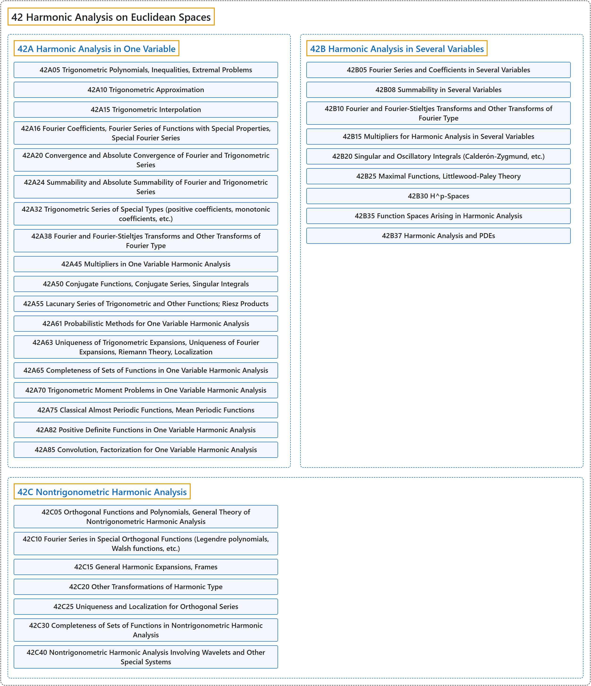

# 42 Harmonic Analysis on Euclidean Spaces

## Classification

## Glossary

| Term | Definition | 中文翻译 | Source |
|---|---|---|---|
| **42 Harmonic Analysis on Euclidean Spaces** 欧氏空间上的调和分析 | "Harmonic analysis studies **the representation and analysis of functions through oscillatory components**." | 调和分析研究**通过振荡分量来表示和分析函数**。 | [Weisstein, n.d., "Harmonic analysis" entry, para. 1](https://mathworld.wolfram.com/HarmonicAnalysis.html#:~:text=Harmonic%20analysis%20studies%20the%20representation%20and%20analysis%20of%20functions) |
| **[42A Harmonic Analysis in One Variable](42a-harmonic-analysis-in-one-variable.md)** 一元调和分析 | (No definition) | （无定义） | [Associate Editors of Mathematical Reviews and zbMATH, 2020](https://msc2020.org/) |
| **[42B Harmonic Analysis in Several Variables](42b-harmonic-analysis-in-several-variables.md)** 多元调和分析 | (No definition) | （无定义） | [Associate Editors of Mathematical Reviews and zbMATH, 2020](https://msc2020.org/) |
| **[42C Nontrigonometric Harmonic Analysis](42c-nontrigonometric-harmonic-analysis.md)** 非三角调和分析 | (No definition) | （无定义） | [Associate Editors of Mathematical Reviews and zbMATH, 2020](https://msc2020.org/) |

## References

Associate Editors of Mathematical Reviews and zbMATH. (2020). *MSC2020: Mathematics Subject Classification system*. Retrieved October 27, 2026, from <https://msc2020.org/>

Weisstein, E. W. (n.d.). *Harmonic analysis*. MathWorld: A Wolfram Resource. Retrieved October 27, 2026, from <https://mathworld.wolfram.com/HarmonicAnalysis.html>
