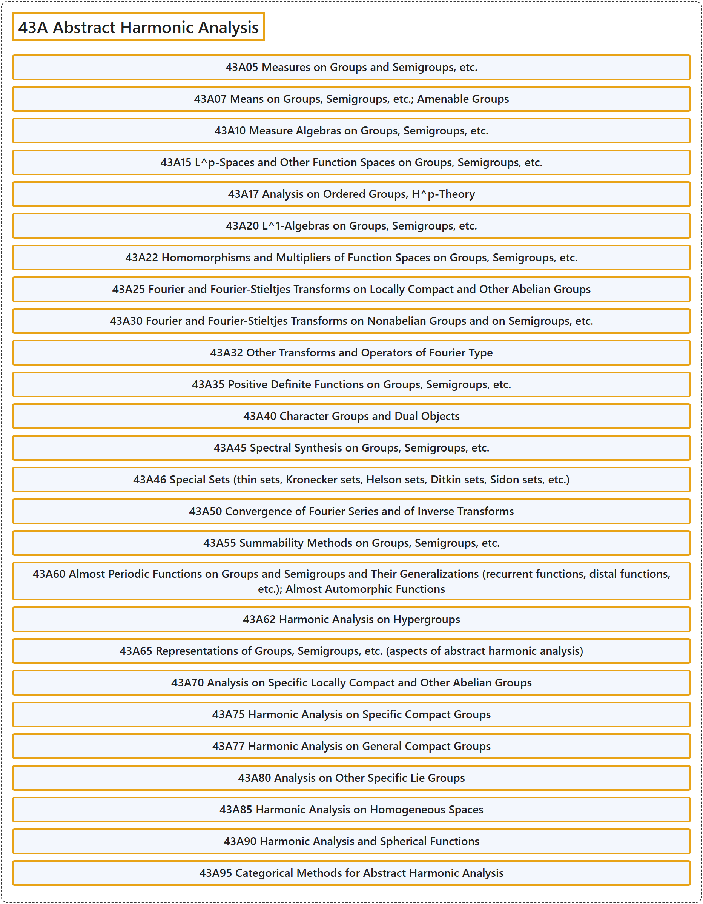

# 43A Abstract Harmonic Analysis

## Classification

## Glossary

| Term | Definition | 中文翻译 | Source |
|---|---|---|---|
| **43A Abstract Harmonic Analysis** 抽象调和分析 | (No definition) | （无定义） | [Associate Editors of Mathematical Reviews and zbMATH, 2020](https://msc2020.org/) |
| **43A05 Measures on Groups and Semigroups, etc.** 群与半群等上的测度 | (No definition) | （无定义） | [Associate Editors of Mathematical Reviews and zbMATH, 2020](https://msc2020.org/) |
| **43A07 Means on Groups, Semigroups, etc.; Amenable Groups** 群与半群等上的平均；可均群 | (No definition) | （无定义） | [Associate Editors of Mathematical Reviews and zbMATH, 2020](https://msc2020.org/) |
| **43A10 Measure Algebras on Groups, Semigroups, etc.** 群与半群等上的测度代数 | (No definition) | （无定义） | [Associate Editors of Mathematical Reviews and zbMATH, 2020](https://msc2020.org/) |
| **43A15 L^p-Spaces and Other Function Spaces on Groups, Semigroups, etc.** 群与半群等上的 L^p 空间及其他函数空间 | (No definition) | （无定义） | [Associate Editors of Mathematical Reviews and zbMATH, 2020](https://msc2020.org/) |
| **43A17 Analysis on Ordered Groups, H^p-Theory** 有序群上的分析，H^p 理论 | (No definition) | （无定义） | [Associate Editors of Mathematical Reviews and zbMATH, 2020](https://msc2020.org/) |
| **43A20 L^1-Algebras on Groups, Semigroups, etc.** 群与半群等上的 L^1 代数 | (No definition) | （无定义） | [Associate Editors of Mathematical Reviews and zbMATH, 2020](https://msc2020.org/) |
| **43A22 Homomorphisms and Multipliers of Function Spaces on Groups, Semigroups, etc.** 群与半群等上函数空间的同态与乘子 | (No definition) | （无定义） | [Associate Editors of Mathematical Reviews and zbMATH, 2020](https://msc2020.org/) |
| **43A25 Fourier and Fourier-Stieltjes Transforms on Locally Compact and Other Abelian Groups** 局部紧群及其他阿贝尔群上的傅里叶变换与傅里叶-斯蒂尔杰斯变换 | (No definition) | （无定义） | [Associate Editors of Mathematical Reviews and zbMATH, 2020](https://msc2020.org/) |
| **43A30 Fourier and Fourier-Stieltjes Transforms on Nonabelian Groups and on Semigroups, etc.** 非阿贝尔群与半群等上的傅里叶变换与傅里叶-斯蒂尔杰斯变换 | (No definition) | （无定义） | [Associate Editors of Mathematical Reviews and zbMATH, 2020](https://msc2020.org/) |
| **43A32 Other Transforms and Operators of Fourier Type** 其他傅里叶型变换与算子 | (No definition) | （无定义） | [Associate Editors of Mathematical Reviews and zbMATH, 2020](https://msc2020.org/) |
| **43A35 Positive Definite Functions on Groups, Semigroups, etc.** 群与半群等上的正定函数 | (No definition) | （无定义） | [Associate Editors of Mathematical Reviews and zbMATH, 2020](https://msc2020.org/) |
| **43A40 Character Groups and Dual Objects** 特征标群与对偶对象 | (No definition) | （无定义） | [Associate Editors of Mathematical Reviews and zbMATH, 2020](https://msc2020.org/) |
| **43A45 Spectral Synthesis on Groups, Semigroups, etc.** 群与半群等上的谱综合 | (No definition) | （无定义） | [Associate Editors of Mathematical Reviews and zbMATH, 2020](https://msc2020.org/) |
| **43A46 Special Sets (thin sets, Kronecker sets, Helson sets, Ditkin sets, Sidon sets, etc.)** 特殊集（薄集、克罗内克集、赫尔森集、迪特金集、西登集等） | (No definition) | （无定义） | [Associate Editors of Mathematical Reviews and zbMATH, 2020](https://msc2020.org/) |
| **43A50 Convergence of Fourier Series and of Inverse Transforms** 傅里叶级数与逆变换的收敛 | (No definition) | （无定义） | [Associate Editors of Mathematical Reviews and zbMATH, 2020](https://msc2020.org/) |
| **43A55 Summability Methods on Groups, Semigroups, etc.** 群与半群等上的可和方法 | (No definition) | （无定义） | [Associate Editors of Mathematical Reviews and zbMATH, 2020](https://msc2020.org/) |
| **43A60 Almost Periodic Functions on Groups and Semigroups and Their Generalizations (recurrent functions, distal functions, etc.); Almost Automorphic Functions** 群与半群上的几乎周期函数及其推广（回复函数、远端函数等）；几乎自守函数 | (No definition) | （无定义） | [Associate Editors of Mathematical Reviews and zbMATH, 2020](https://msc2020.org/) |
| **43A62 Harmonic Analysis on Hypergroups** 超群上的调和分析 | (No definition) | （无定义） | [Associate Editors of Mathematical Reviews and zbMATH, 2020](https://msc2020.org/) |
| **43A65 Representations of Groups, Semigroups, etc. (aspects of abstract harmonic analysis)** 群与半群等的表示（抽象调和分析的方面） | (No definition) | （无定义） | [Associate Editors of Mathematical Reviews and zbMATH, 2020](https://msc2020.org/) |
| **43A70 Analysis on Specific Locally Compact and Other Abelian Groups** 特定局部紧群及其他阿贝尔群上的分析 | (No definition) | （无定义） | [Associate Editors of Mathematical Reviews and zbMATH, 2020](https://msc2020.org/) |
| **43A75 Harmonic Analysis on Specific Compact Groups** 特定紧群上的调和分析 | (No definition) | （无定义） | [Associate Editors of Mathematical Reviews and zbMATH, 2020](https://msc2020.org/) |
| **43A77 Harmonic Analysis on General Compact Groups** 一般紧群上的调和分析 | (No definition) | （无定义） | [Associate Editors of Mathematical Reviews and zbMATH, 2020](https://msc2020.org/) |
| **43A80 Analysis on Other Specific Lie Groups** 其他特定李群上的分析 | (No definition) | （无定义） | [Associate Editors of Mathematical Reviews and zbMATH, 2020](https://msc2020.org/) |
| **43A85 Harmonic Analysis on Homogeneous Spaces** 齐性空间上的调和分析 | (No definition) | （无定义） | [Associate Editors of Mathematical Reviews and zbMATH, 2020](https://msc2020.org/) |
| **43A90 Harmonic Analysis and Spherical Functions** 调和分析与球函数 | (No definition) | （无定义） | [Associate Editors of Mathematical Reviews and zbMATH, 2020](https://msc2020.org/) |
| **43A95 Categorical Methods for Abstract Harmonic Analysis** 抽象调和分析的范畴方法 | (No definition) | （无定义） | [Associate Editors of Mathematical Reviews and zbMATH, 2020](https://msc2020.org/) |

## References

Associate Editors of Mathematical Reviews and zbMATH. (2020). *MSC2020: Mathematics Subject Classification system*. Retrieved October 27, 2026, from <https://msc2020.org/>
