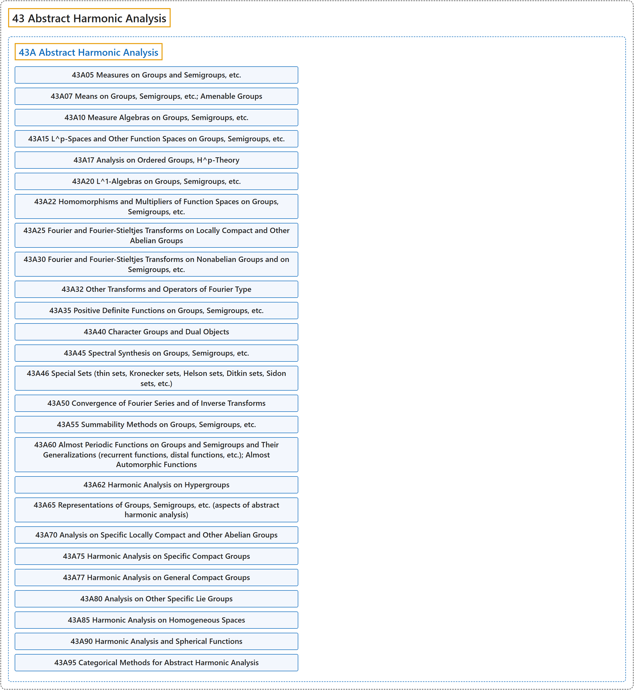

# 43 Abstract Harmonic Analysis

## Classification

## Glossary

| Term | Definition | 中文翻译 | Source |
|---|---|---|---|
| **43 Abstract Harmonic Analysis** 抽象调和分析 | (context) "The field includes such branches as Fourier series, isospectral manifolds (hearing the shape of a drum), and **topological groups**." | （语境）这一领域包括傅里叶级数、等谱流形（听出鼓的形状）以及**拓扑群**等分支。 | [Weisstein, n.d., "Harmonic analysis" entry, para. 2](https://mathworld.wolfram.com/HarmonicAnalysis.html#:~:text=The%20field%20includes%20such%20branches%20as%20Fourier%20series) |
| **[43A Abstract Harmonic Analysis](43a-abstract-harmonic-analysis.md)** 抽象调和分析 | (No definition) | （无定义） | [Associate Editors of Mathematical Reviews and zbMATH, 2020](https://msc2020.org/) |

## References

Associate Editors of Mathematical Reviews and zbMATH. (2020). *MSC2020: Mathematics Subject Classification system*. Retrieved October 27, 2026, from <https://msc2020.org/>

Weisstein, E. W. (n.d.). *Harmonic analysis*. MathWorld: A Wolfram Resource. Retrieved October 27, 2026, from <https://mathworld.wolfram.com/HarmonicAnalysis.html>
