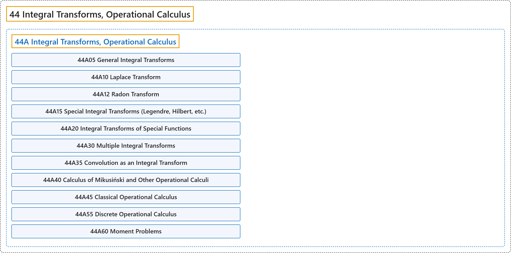

# 44 Integral Transforms, Operational Calculus

## Classification

## Glossary

| Term | Definition | 中文翻译 | Source |
|---|---|---|---|
| **44 Integral Transforms, Operational Calculus** 积分变换、算子演算 | "A general integral transform is defined by g(alpha)=int_a^bf(t)K(alpha,t)dt, where K(alpha,t) is called the **integral kernel** of the transform." | 一般的积分变换定义为 g(alpha)=int_a^bf(t)K(alpha,t)dt，其中 K(alpha,t) 称为该变换的**积分核**。 | [Weisstein, n.d., "Integral transform" entry, para. 1](https://mathworld.wolfram.com/IntegralTransform.html#:~:text=A%20general%20integral%20transform%20is%20defined%20by) |
| **[44A Integral Transforms, Operational Calculus](44a-integral-transforms-operational-calculus.md)** 积分变换、算子演算 | (No definition) | （无定义） | [Associate Editors of Mathematical Reviews and zbMATH, 2020](https://msc2020.org/) |

## References

Associate Editors of Mathematical Reviews and zbMATH. (2020). *MSC2020: Mathematics Subject Classification system*. Retrieved October 27, 2026, from <https://msc2020.org/>

Weisstein, E. W. (n.d.). *Integral transform*. MathWorld: A Wolfram Resource. Retrieved October 27, 2026, from <https://mathworld.wolfram.com/IntegralTransform.html>
