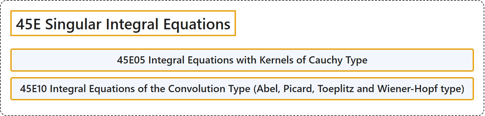

# 45E Singular Integral Equations

## Classification

## Glossary

| Term | Definition | 中文翻译 | Source |
|---|---|---|---|
| **45E Singular Integral Equations** 奇异积分方程 | (No definition) | （无定义） | [Associate Editors of Mathematical Reviews and zbMATH, 2020](https://msc2020.org/) |
| **45E05 Integral Equations with Kernels of Cauchy Type** 柯西型核积分方程 | (No definition) | （无定义） | [Associate Editors of Mathematical Reviews and zbMATH, 2020](https://msc2020.org/) |
| **45E10 Integral Equations of the Convolution Type (Abel, Picard, Toeplitz and Wiener-Hopf type)** 卷积型积分方程（阿贝尔型、皮卡型、特普利茨型与维纳-霍普夫型） | (No definition) | （无定义） | [Associate Editors of Mathematical Reviews and zbMATH, 2020](https://msc2020.org/) |

## References

Associate Editors of Mathematical Reviews and zbMATH. (2020). *MSC2020: Mathematics Subject Classification system*. Retrieved October 27, 2026, from <https://msc2020.org/>
