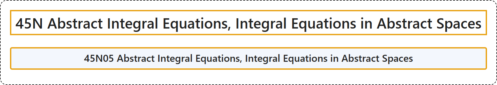

# 45N Abstract Integral Equations, Integral Equations in Abstract Spaces

## Classification

## Glossary

| Term | Definition | 中文翻译 | Source |
|---|---|---|---|
| **45N Abstract Integral Equations, Integral Equations in Abstract Spaces** 抽象积分方程、抽象空间中的积分方程 | (No definition) | （无定义） | [Associate Editors of Mathematical Reviews and zbMATH, 2020](https://msc2020.org/) |
| **45N05 Abstract Integral Equations, Integral Equations in Abstract Spaces** 抽象积分方程，抽象空间中的积分方程 | (No definition) | （无定义） | [Associate Editors of Mathematical Reviews and zbMATH, 2020](https://msc2020.org/) |

## References

Associate Editors of Mathematical Reviews and zbMATH. (2020). *MSC2020: Mathematics Subject Classification system*. Retrieved October 27, 2026, from <https://msc2020.org/>
