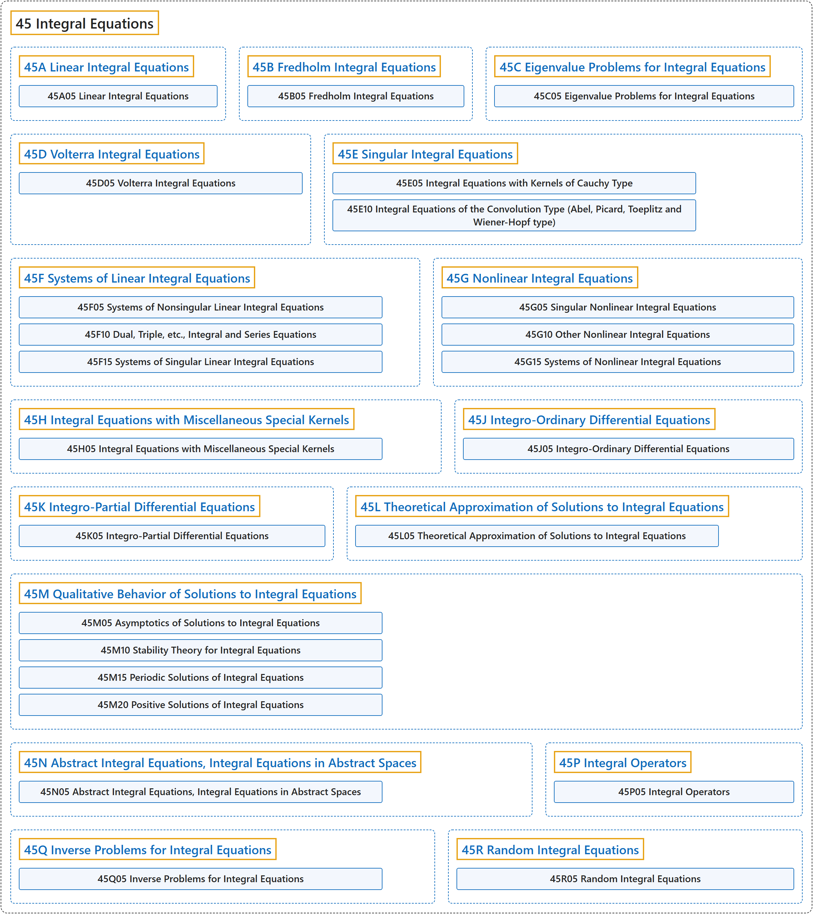

# 45 Integral Equations

## Classification

## Glossary

| Term | Definition | 中文翻译 | Source |
|---|---|---|---|
| **45 Integral Equations** 积分方程 | "An integral equation is an equation involving **a function f(x) and integrals of that function** to solved for f(x)." | 积分方程是含有**一个函数 f(x) 以及该函数的积分**、要从中解出 f(x) 的方程。 | [Weisstein, n.d., "Integral equation" entry, para. 1](https://mathworld.wolfram.com/IntegralEquation.html#:~:text=An%20integral%20equation%20is%20an%20equation%20involving%20a%20function) |
| **[45A Linear Integral Equations](45a-linear-integral-equations.md)** 线性积分方程 | (No definition) | （无定义） | [Associate Editors of Mathematical Reviews and zbMATH, 2020](https://msc2020.org/) |
| **[45B Fredholm Integral Equations](45b-fredholm-integral-equations.md)** 弗雷德霍姆积分方程 | (No definition) | （无定义） | [Associate Editors of Mathematical Reviews and zbMATH, 2020](https://msc2020.org/) |
| **[45C Eigenvalue Problems for Integral Equations](45c-eigenvalue-problems-for-integral-equations.md)** 积分方程的特征值问题 | (No definition) | （无定义） | [Associate Editors of Mathematical Reviews and zbMATH, 2020](https://msc2020.org/) |
| **[45D Volterra Integral Equations](45d-volterra-integral-equations.md)** 沃尔泰拉积分方程 | (No definition) | （无定义） | [Associate Editors of Mathematical Reviews and zbMATH, 2020](https://msc2020.org/) |
| **[45E Singular Integral Equations](45e-singular-integral-equations.md)** 奇异积分方程 | (No definition) | （无定义） | [Associate Editors of Mathematical Reviews and zbMATH, 2020](https://msc2020.org/) |
| **[45F Systems of Linear Integral Equations](45f-systems-of-linear-integral-equations.md)** 线性积分方程组 | (No definition) | （无定义） | [Associate Editors of Mathematical Reviews and zbMATH, 2020](https://msc2020.org/) |
| **[45G Nonlinear Integral Equations](45g-nonlinear-integral-equations.md)** 非线性积分方程 | (No definition) | （无定义） | [Associate Editors of Mathematical Reviews and zbMATH, 2020](https://msc2020.org/) |
| **[45H Integral Equations with Miscellaneous Special Kernels](45h-integral-equations-with-miscellaneous-special-kernels.md)** 带杂项特殊核的积分方程 | (No definition) | （无定义） | [Associate Editors of Mathematical Reviews and zbMATH, 2020](https://msc2020.org/) |
| **[45J Integro-Ordinary Differential Equations](45j-integro-ordinary-differential-equations.md)** 积分常微分方程 | (No definition) | （无定义） | [Associate Editors of Mathematical Reviews and zbMATH, 2020](https://msc2020.org/) |
| **[45K Integro-Partial Differential Equations](45k-integro-partial-differential-equations.md)** 积分偏微分方程 | (No definition) | （无定义） | [Associate Editors of Mathematical Reviews and zbMATH, 2020](https://msc2020.org/) |
| **[45L Theoretical Approximation of Solutions to Integral Equations](45l-theoretical-approximation-of-solutions-to-integral-equations.md)** 积分方程解的理论逼近 | (No definition) | （无定义） | [Associate Editors of Mathematical Reviews and zbMATH, 2020](https://msc2020.org/) |
| **[45M Qualitative Behavior of Solutions to Integral Equations](45m-qualitative-behavior-of-solutions-to-integral-equations.md)** 积分方程解的定性行为 | (No definition) | （无定义） | [Associate Editors of Mathematical Reviews and zbMATH, 2020](https://msc2020.org/) |
| **[45N Abstract Integral Equations, Integral Equations in Abstract Spaces](45n-abstract-integral-equations-integral-equations-in-abstract-s.md)** 抽象积分方程、抽象空间中的积分方程 | (No definition) | （无定义） | [Associate Editors of Mathematical Reviews and zbMATH, 2020](https://msc2020.org/) |
| **[45P Integral Operators](45p-integral-operators.md)** 积分算子 | (No definition) | （无定义） | [Associate Editors of Mathematical Reviews and zbMATH, 2020](https://msc2020.org/) |
| **[45Q Inverse Problems for Integral Equations](45q-inverse-problems-for-integral-equations.md)** 积分方程的反问题 | (No definition) | （无定义） | [Associate Editors of Mathematical Reviews and zbMATH, 2020](https://msc2020.org/) |
| **[45R Random Integral Equations](45r-random-integral-equations.md)** 随机积分方程 | (No definition) | （无定义） | [Associate Editors of Mathematical Reviews and zbMATH, 2020](https://msc2020.org/) |

## References

Associate Editors of Mathematical Reviews and zbMATH. (2020). *MSC2020: Mathematics Subject Classification system*. Retrieved October 27, 2026, from <https://msc2020.org/>

Weisstein, E. W. (n.d.). *Integral equation*. MathWorld: A Wolfram Resource. Retrieved October 27, 2026, from <https://mathworld.wolfram.com/IntegralEquation.html>
