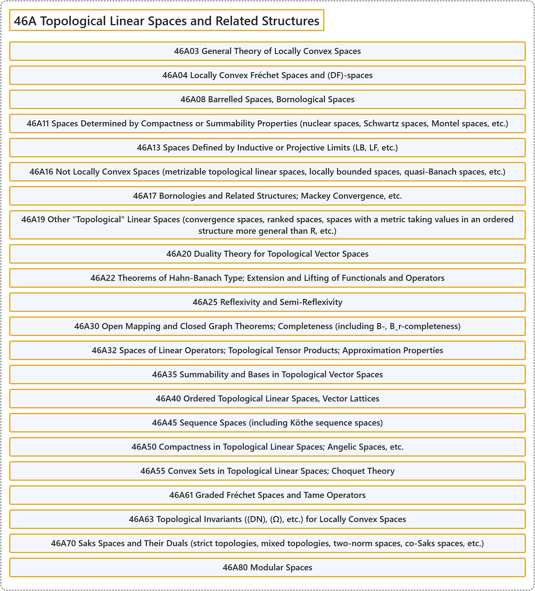

# 46A Topological Linear Spaces and Related Structures

## Classification

## Glossary

| Term | Definition | 中文翻译 | Source |
|---|---|---|---|
| **46A Topological Linear Spaces and Related Structures** 拓扑线性空间及相关结构 | (No definition) | （无定义） | [Associate Editors of Mathematical Reviews and zbMATH, 2020](https://msc2020.org/) |
| **46A03 General Theory of Locally Convex Spaces** 局部凸空间的一般理论 | (No definition) | （无定义） | [Associate Editors of Mathematical Reviews and zbMATH, 2020](https://msc2020.org/) |
| **46A04 Locally Convex Fréchet Spaces and (DF)-spaces** 局部凸弗雷歇空间与（DF）空间 | (No definition) | （无定义） | [Associate Editors of Mathematical Reviews and zbMATH, 2020](https://msc2020.org/) |
| **46A08 Barrelled Spaces, Bornological Spaces** 桶空间，有界型空间 | (No definition) | （无定义） | [Associate Editors of Mathematical Reviews and zbMATH, 2020](https://msc2020.org/) |
| **46A11 Spaces Determined by Compactness or Summability Properties (nuclear spaces, Schwartz spaces, Montel spaces, etc.)** 由紧性或可和性质决定的空间（核空间、施瓦茨空间、蒙泰尔空间等） | (No definition) | （无定义） | [Associate Editors of Mathematical Reviews and zbMATH, 2020](https://msc2020.org/) |
| **46A13 Spaces Defined by Inductive or Projective Limits (LB, LF, etc.)** 由归纳极限或投影极限定义的空间（LB、LF 等） | (No definition) | （无定义） | [Associate Editors of Mathematical Reviews and zbMATH, 2020](https://msc2020.org/) |
| **46A16 Not Locally Convex Spaces (metrizable topological linear spaces, locally bounded spaces, quasi-Banach spaces, etc.)** 非局部凸空间（可度量化拓扑线性空间、局部有界空间、拟巴拿赫空间等） | (No definition) | （无定义） | [Associate Editors of Mathematical Reviews and zbMATH, 2020](https://msc2020.org/) |
| **46A17 Bornologies and Related Structures; Mackey Convergence, etc.** 有界结构及相关结构；马基收敛等 | (No definition) | （无定义） | [Associate Editors of Mathematical Reviews and zbMATH, 2020](https://msc2020.org/) |
| **46A19 Other "Topological" Linear Spaces (convergence spaces, ranked spaces, spaces with a metric taking values in an ordered structure more general than R, etc.)** 其他“拓扑”线性空间（收敛空间、序空间、度量取值于比 R 更一般的有序结构的空间等） | (No definition) | （无定义） | [Associate Editors of Mathematical Reviews and zbMATH, 2020](https://msc2020.org/) |
| **46A20 Duality Theory for Topological Vector Spaces** 拓扑向量空间的对偶理论 | (No definition) | （无定义） | [Associate Editors of Mathematical Reviews and zbMATH, 2020](https://msc2020.org/) |
| **46A22 Theorems of Hahn-Banach Type; Extension and Lifting of Functionals and Operators** 哈恩-巴拿赫型定理；泛函与算子的延拓与提升 | (No definition) | （无定义） | [Associate Editors of Mathematical Reviews and zbMATH, 2020](https://msc2020.org/) |
| **46A25 Reflexivity and Semi-Reflexivity** 自反性与半自反性 | (No definition) | （无定义） | [Associate Editors of Mathematical Reviews and zbMATH, 2020](https://msc2020.org/) |
| **46A30 Open Mapping and Closed Graph Theorems; Completeness (including B-, B_r-completeness)** 开映射定理与闭图像定理；完备性（包括 B-完备性、B_r-完备性） | (No definition) | （无定义） | [Associate Editors of Mathematical Reviews and zbMATH, 2020](https://msc2020.org/) |
| **46A32 Spaces of Linear Operators; Topological Tensor Products; Approximation Properties** 线性算子空间；拓扑张量积；逼近性质 | (No definition) | （无定义） | [Associate Editors of Mathematical Reviews and zbMATH, 2020](https://msc2020.org/) |
| **46A35 Summability and Bases in Topological Vector Spaces** 拓扑向量空间中的可和性与基 | (No definition) | （无定义） | [Associate Editors of Mathematical Reviews and zbMATH, 2020](https://msc2020.org/) |
| **46A40 Ordered Topological Linear Spaces, Vector Lattices** 有序拓扑线性空间，向量格 | (No definition) | （无定义） | [Associate Editors of Mathematical Reviews and zbMATH, 2020](https://msc2020.org/) |
| **46A45 Sequence Spaces (including Köthe sequence spaces)** 序列空间（包括科特序列空间） | (No definition) | （无定义） | [Associate Editors of Mathematical Reviews and zbMATH, 2020](https://msc2020.org/) |
| **46A50 Compactness in Topological Linear Spaces; Angelic Spaces, etc.** 拓扑线性空间中的紧性；天使空间等 | (No definition) | （无定义） | [Associate Editors of Mathematical Reviews and zbMATH, 2020](https://msc2020.org/) |
| **46A55 Convex Sets in Topological Linear Spaces; Choquet Theory** 拓扑线性空间中的凸集；肖凯理论 | (No definition) | （无定义） | [Associate Editors of Mathematical Reviews and zbMATH, 2020](https://msc2020.org/) |
| **46A61 Graded Fréchet Spaces and Tame Operators** 分次弗雷歇空间与驯算子 | (No definition) | （无定义） | [Associate Editors of Mathematical Reviews and zbMATH, 2020](https://msc2020.org/) |
| **46A63 Topological Invariants ((DN), (Ω), etc.) for Locally Convex Spaces** 局部凸空间的拓扑不变量（(DN)、(Ω) 等） | (No definition) | （无定义） | [Associate Editors of Mathematical Reviews and zbMATH, 2020](https://msc2020.org/) |
| **46A70 Saks Spaces and Their Duals (strict topologies, mixed topologies, two-norm spaces, co-Saks spaces, etc.)** 萨克斯空间及其对偶（严格拓扑、混合拓扑、双范数空间、余萨克斯空间等） | (No definition) | （无定义） | [Associate Editors of Mathematical Reviews and zbMATH, 2020](https://msc2020.org/) |
| **46A80 Modular Spaces** 模空间 | (No definition) | （无定义） | [Associate Editors of Mathematical Reviews and zbMATH, 2020](https://msc2020.org/) |

## References

Associate Editors of Mathematical Reviews and zbMATH. (2020). *MSC2020: Mathematics Subject Classification system*. Retrieved October 27, 2026, from <https://msc2020.org/>
