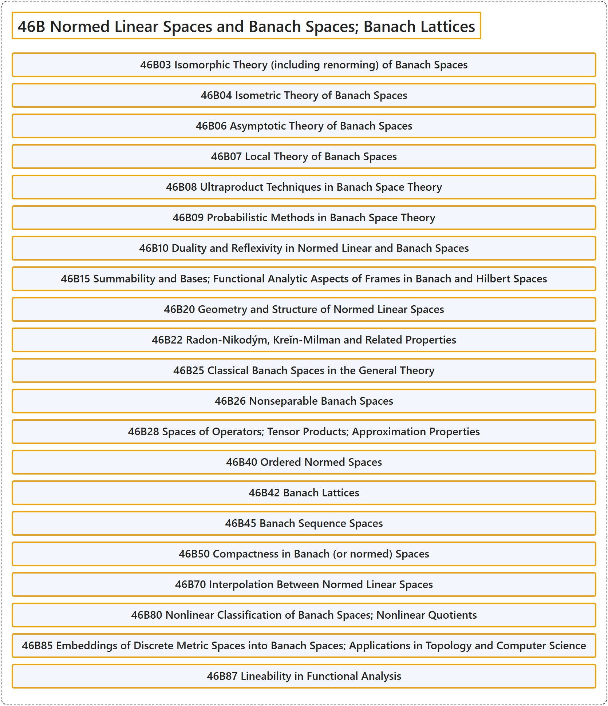

# 46B Normed Linear Spaces and Banach Spaces; Banach Lattices

## Classification

## Glossary

| Term | Definition | 中文翻译 | Source |
|---|---|---|---|
| **46B Normed Linear Spaces and Banach Spaces; Banach Lattices** 赋范线性空间与巴拿赫空间；巴拿赫格 | (No definition) | （无定义） | [Associate Editors of Mathematical Reviews and zbMATH, 2020](https://msc2020.org/) |
| **46B03 Isomorphic Theory (including renorming) of Banach Spaces** 巴拿赫空间的同构理论（包括重新赋范） | (No definition) | （无定义） | [Associate Editors of Mathematical Reviews and zbMATH, 2020](https://msc2020.org/) |
| **46B04 Isometric Theory of Banach Spaces** 巴拿赫空间的等距理论 | (No definition) | （无定义） | [Associate Editors of Mathematical Reviews and zbMATH, 2020](https://msc2020.org/) |
| **46B06 Asymptotic Theory of Banach Spaces** 巴拿赫空间的渐近理论 | (No definition) | （无定义） | [Associate Editors of Mathematical Reviews and zbMATH, 2020](https://msc2020.org/) |
| **46B07 Local Theory of Banach Spaces** 巴拿赫空间的局部理论 | (No definition) | （无定义） | [Associate Editors of Mathematical Reviews and zbMATH, 2020](https://msc2020.org/) |
| **46B08 Ultraproduct Techniques in Banach Space Theory** 巴拿赫空间理论中的超积技术 | (No definition) | （无定义） | [Associate Editors of Mathematical Reviews and zbMATH, 2020](https://msc2020.org/) |
| **46B09 Probabilistic Methods in Banach Space Theory** 巴拿赫空间理论中的概率方法 | (No definition) | （无定义） | [Associate Editors of Mathematical Reviews and zbMATH, 2020](https://msc2020.org/) |
| **46B10 Duality and Reflexivity in Normed Linear and Banach Spaces** 赋范线性空间与巴拿赫空间中的对偶与自反性 | (No definition) | （无定义） | [Associate Editors of Mathematical Reviews and zbMATH, 2020](https://msc2020.org/) |
| **46B15 Summability and Bases; Functional Analytic Aspects of Frames in Banach and Hilbert Spaces** 巴拿赫空间与希尔伯特空间中的可和性与基；框架的泛函分析方面 | (No definition) | （无定义） | [Associate Editors of Mathematical Reviews and zbMATH, 2020](https://msc2020.org/) |
| **46B20 Geometry and Structure of Normed Linear Spaces** 赋范线性空间的几何与结构 | (No definition) | （无定义） | [Associate Editors of Mathematical Reviews and zbMATH, 2020](https://msc2020.org/) |
| **46B22 Radon-Nikodým, Kreĭn-Milman and Related Properties** 拉东-尼科迪姆、克列因-米尔曼及相关性质 | (No definition) | （无定义） | [Associate Editors of Mathematical Reviews and zbMATH, 2020](https://msc2020.org/) |
| **46B25 Classical Banach Spaces in the General Theory** 一般理论中的经典巴拿赫空间 | (No definition) | （无定义） | [Associate Editors of Mathematical Reviews and zbMATH, 2020](https://msc2020.org/) |
| **46B26 Nonseparable Banach Spaces** 不可分巴拿赫空间 | (No definition) | （无定义） | [Associate Editors of Mathematical Reviews and zbMATH, 2020](https://msc2020.org/) |
| **46B28 Spaces of Operators; Tensor Products; Approximation Properties** 算子空间；张量积；逼近性质 | (No definition) | （无定义） | [Associate Editors of Mathematical Reviews and zbMATH, 2020](https://msc2020.org/) |
| **46B40 Ordered Normed Spaces** 有序赋范空间 | (No definition) | （无定义） | [Associate Editors of Mathematical Reviews and zbMATH, 2020](https://msc2020.org/) |
| **46B42 Banach Lattices** 巴拿赫格 | (No definition) | （无定义） | [Associate Editors of Mathematical Reviews and zbMATH, 2020](https://msc2020.org/) |
| **46B45 Banach Sequence Spaces** 巴拿赫序列空间 | (No definition) | （无定义） | [Associate Editors of Mathematical Reviews and zbMATH, 2020](https://msc2020.org/) |
| **46B50 Compactness in Banach (or normed) Spaces** 巴拿赫（或赋范）空间中的紧性 | (No definition) | （无定义） | [Associate Editors of Mathematical Reviews and zbMATH, 2020](https://msc2020.org/) |
| **46B70 Interpolation Between Normed Linear Spaces** 赋范线性空间之间的插值 | (No definition) | （无定义） | [Associate Editors of Mathematical Reviews and zbMATH, 2020](https://msc2020.org/) |
| **46B80 Nonlinear Classification of Banach Spaces; Nonlinear Quotients** 巴拿赫空间的非线性分类；非线性商 | (No definition) | （无定义） | [Associate Editors of Mathematical Reviews and zbMATH, 2020](https://msc2020.org/) |
| **46B85 Embeddings of Discrete Metric Spaces into Banach Spaces; Applications in Topology and Computer Science** 离散度量空间到巴拿赫空间的嵌入；在拓扑与计算机科学中的应用 | (No definition) | （无定义） | [Associate Editors of Mathematical Reviews and zbMATH, 2020](https://msc2020.org/) |
| **46B87 Lineability in Functional Analysis** 泛函分析中的线性可构造性 | (No definition) | （无定义） | [Associate Editors of Mathematical Reviews and zbMATH, 2020](https://msc2020.org/) |

## References

Associate Editors of Mathematical Reviews and zbMATH. (2020). *MSC2020: Mathematics Subject Classification system*. Retrieved October 27, 2026, from <https://msc2020.org/>
