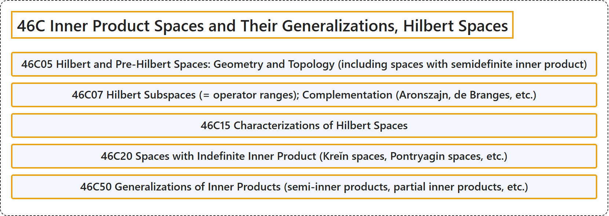

# 46C Inner Product Spaces and Their Generalizations, Hilbert Spaces

## Classification

## Glossary

| Term | Definition | 中文翻译 | Source |
|---|---|---|---|
| **46C Inner Product Spaces and Their Generalizations, Hilbert Spaces** 内积空间及其推广、希尔伯特空间 | (No definition) | （无定义） | [Associate Editors of Mathematical Reviews and zbMATH, 2020](https://msc2020.org/) |
| **46C05 Hilbert and Pre-Hilbert Spaces: Geometry and Topology (including spaces with semidefinite inner product)** 希尔伯特空间与前希尔伯特空间：几何与拓扑（包括半定内积空间） | (No definition) | （无定义） | [Associate Editors of Mathematical Reviews and zbMATH, 2020](https://msc2020.org/) |
| **46C07 Hilbert Subspaces (= operator ranges); Complementation (Aronszajn, de Branges, etc.)** 希尔伯特子空间（= 算子值域）；余补（阿龙扎伊恩、德布朗热等） | (No definition) | （无定义） | [Associate Editors of Mathematical Reviews and zbMATH, 2020](https://msc2020.org/) |
| **46C15 Characterizations of Hilbert Spaces** 希尔伯特空间的刻画 | (No definition) | （无定义） | [Associate Editors of Mathematical Reviews and zbMATH, 2020](https://msc2020.org/) |
| **46C20 Spaces with Indefinite Inner Product (Kreĭn spaces, Pontryagin spaces, etc.)** 不定内积空间（克列因空间、庞特里亚金空间等） | (No definition) | （无定义） | [Associate Editors of Mathematical Reviews and zbMATH, 2020](https://msc2020.org/) |
| **46C50 Generalizations of Inner Products (semi-inner products, partial inner products, etc.)** 内积的推广（半内积、部分内积等） | (No definition) | （无定义） | [Associate Editors of Mathematical Reviews and zbMATH, 2020](https://msc2020.org/) |

## References

Associate Editors of Mathematical Reviews and zbMATH. (2020). *MSC2020: Mathematics Subject Classification system*. Retrieved October 27, 2026, from <https://msc2020.org/>
