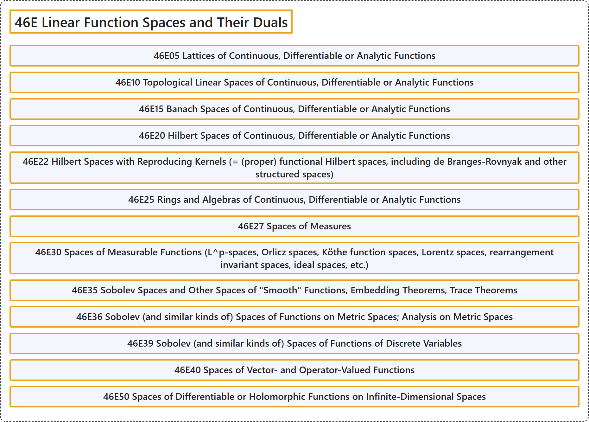

# 46E Linear Function Spaces and Their Duals

## Classification

## Glossary

| Term | Definition | 中文翻译 | Source |
|---|---|---|---|
| **46E Linear Function Spaces and Their Duals** 线性函数空间及其对偶 | (No definition) | （无定义） | [Associate Editors of Mathematical Reviews and zbMATH, 2020](https://msc2020.org/) |
| **46E05 Lattices of Continuous, Differentiable or Analytic Functions** 连续、可微或解析函数的格 | (No definition) | （无定义） | [Associate Editors of Mathematical Reviews and zbMATH, 2020](https://msc2020.org/) |
| **46E10 Topological Linear Spaces of Continuous, Differentiable or Analytic Functions** 连续、可微或解析函数的拓扑线性空间 | (No definition) | （无定义） | [Associate Editors of Mathematical Reviews and zbMATH, 2020](https://msc2020.org/) |
| **46E15 Banach Spaces of Continuous, Differentiable or Analytic Functions** 连续、可微或解析函数的巴拿赫空间 | (No definition) | （无定义） | [Associate Editors of Mathematical Reviews and zbMATH, 2020](https://msc2020.org/) |
| **46E20 Hilbert Spaces of Continuous, Differentiable or Analytic Functions** 连续、可微或解析函数的希尔伯特空间 | (No definition) | （无定义） | [Associate Editors of Mathematical Reviews and zbMATH, 2020](https://msc2020.org/) |
| **46E22 Hilbert Spaces with Reproducing Kernels (= (proper) functional Hilbert spaces, including de Branges-Rovnyak and other structured spaces)** 具有再生核的希尔伯特空间（= （真）泛函希尔伯特空间，包括德布朗热-罗夫尼亚克及其他有结构的空间） | (No definition) | （无定义） | [Associate Editors of Mathematical Reviews and zbMATH, 2020](https://msc2020.org/) |
| **46E25 Rings and Algebras of Continuous, Differentiable or Analytic Functions** 连续、可微或解析函数的环与代数 | (No definition) | （无定义） | [Associate Editors of Mathematical Reviews and zbMATH, 2020](https://msc2020.org/) |
| **46E27 Spaces of Measures** 测度空间 | (No definition) | （无定义） | [Associate Editors of Mathematical Reviews and zbMATH, 2020](https://msc2020.org/) |
| **46E30 Spaces of Measurable Functions (L^p-spaces, Orlicz spaces, Köthe function spaces, Lorentz spaces, rearrangement invariant spaces, ideal spaces, etc.)** 可测函数空间（L^p 空间、奥尔利奇空间、科特函数空间、洛伦兹空间、重排不变空间、理想空间等） | (No definition) | （无定义） | [Associate Editors of Mathematical Reviews and zbMATH, 2020](https://msc2020.org/) |
| **46E35 Sobolev Spaces and Other Spaces of "Smooth" Functions, Embedding Theorems, Trace Theorems** 索伯列夫空间及其他“光滑”函数空间，嵌入定理，迹定理 | (No definition) | （无定义） | [Associate Editors of Mathematical Reviews and zbMATH, 2020](https://msc2020.org/) |
| **46E36 Sobolev (and similar kinds of) Spaces of Functions on Metric Spaces; Analysis on Metric Spaces** 度量空间上函数的索伯列夫（及类似种类的）空间；度量空间上的分析 | (No definition) | （无定义） | [Associate Editors of Mathematical Reviews and zbMATH, 2020](https://msc2020.org/) |
| **46E39 Sobolev (and similar kinds of) Spaces of Functions of Discrete Variables** 离散变量函数的索伯列夫（及类似种类的）空间 | (No definition) | （无定义） | [Associate Editors of Mathematical Reviews and zbMATH, 2020](https://msc2020.org/) |
| **46E40 Spaces of Vector- and Operator-Valued Functions** 向量值与算子值函数空间 | (No definition) | （无定义） | [Associate Editors of Mathematical Reviews and zbMATH, 2020](https://msc2020.org/) |
| **46E50 Spaces of Differentiable or Holomorphic Functions on Infinite-Dimensional Spaces** 无穷维空间上的可微函数空间或全纯函数空间 | (No definition) | （无定义） | [Associate Editors of Mathematical Reviews and zbMATH, 2020](https://msc2020.org/) |

## References

Associate Editors of Mathematical Reviews and zbMATH. (2020). *MSC2020: Mathematics Subject Classification system*. Retrieved October 27, 2026, from <https://msc2020.org/>
