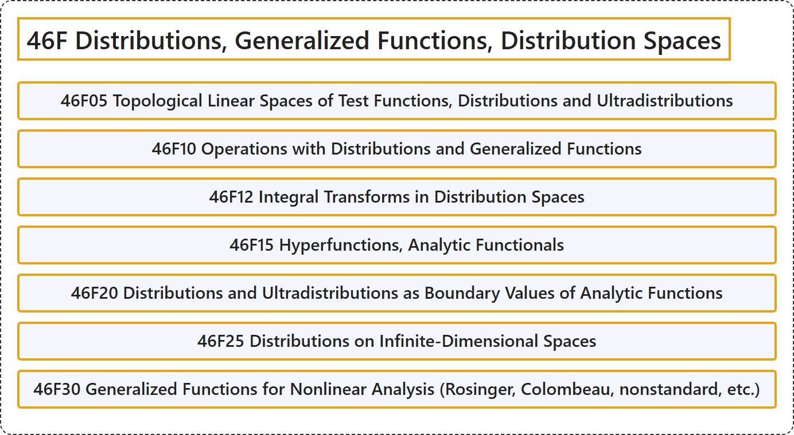

# 46F Distributions, Generalized Functions, Distribution Spaces

## Classification

## Glossary

| Term | Definition | 中文翻译 | Source |
|---|---|---|---|
| **46F Distributions, Generalized Functions, Distribution Spaces** 分布、广义函数、分布空间 | (No definition) | （无定义） | [Associate Editors of Mathematical Reviews and zbMATH, 2020](https://msc2020.org/) |
| **46F05 Topological Linear Spaces of Test Functions, Distributions and Ultradistributions** 检验函数、广义函数与超广义函数的拓扑线性空间 | (No definition) | （无定义） | [Associate Editors of Mathematical Reviews and zbMATH, 2020](https://msc2020.org/) |
| **46F10 Operations with Distributions and Generalized Functions** 广义函数的运算 | (No definition) | （无定义） | [Associate Editors of Mathematical Reviews and zbMATH, 2020](https://msc2020.org/) |
| **46F12 Integral Transforms in Distribution Spaces** 广义函数空间中的积分变换 | (No definition) | （无定义） | [Associate Editors of Mathematical Reviews and zbMATH, 2020](https://msc2020.org/) |
| **46F15 Hyperfunctions, Analytic Functionals** 超函数，解析泛函 | (No definition) | （无定义） | [Associate Editors of Mathematical Reviews and zbMATH, 2020](https://msc2020.org/) |
| **46F20 Distributions and Ultradistributions as Boundary Values of Analytic Functions** 作为解析函数边值的广义函数与超广义函数 | (No definition) | （无定义） | [Associate Editors of Mathematical Reviews and zbMATH, 2020](https://msc2020.org/) |
| **46F25 Distributions on Infinite-Dimensional Spaces** 无穷维空间上的广义函数 | (No definition) | （无定义） | [Associate Editors of Mathematical Reviews and zbMATH, 2020](https://msc2020.org/) |
| **46F30 Generalized Functions for Nonlinear Analysis (Rosinger, Colombeau, nonstandard, etc.)** 非线性分析的广义函数（罗辛格、科隆博、非标准等） | (No definition) | （无定义） | [Associate Editors of Mathematical Reviews and zbMATH, 2020](https://msc2020.org/) |

## References

Associate Editors of Mathematical Reviews and zbMATH. (2020). *MSC2020: Mathematics Subject Classification system*. Retrieved October 27, 2026, from <https://msc2020.org/>
