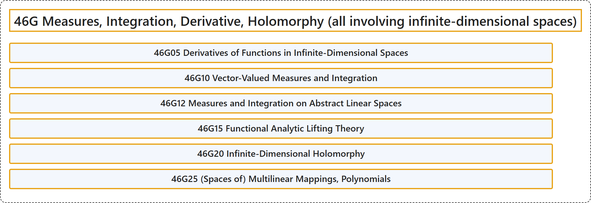

# 46G Measures, Integration, Derivative, Holomorphy (all involving infinite-dimensional spaces)

## Classification

## Glossary

| Term | Definition | 中文翻译 | Source |
|---|---|---|---|
| **46G Measures, Integration, Derivative, Holomorphy (all involving infinite-dimensional spaces)** 测度、积分、导数、全纯性（均涉及无穷维空间） | (No definition) | （无定义） | [Associate Editors of Mathematical Reviews and zbMATH, 2020](https://msc2020.org/) |
| **46G05 Derivatives of Functions in Infinite-Dimensional Spaces** 无穷维空间中函数的导数 | (No definition) | （无定义） | [Associate Editors of Mathematical Reviews and zbMATH, 2020](https://msc2020.org/) |
| **46G10 Vector-Valued Measures and Integration** 向量值测度与积分 | (No definition) | （无定义） | [Associate Editors of Mathematical Reviews and zbMATH, 2020](https://msc2020.org/) |
| **46G12 Measures and Integration on Abstract Linear Spaces** 抽象线性空间上的测度与积分 | (No definition) | （无定义） | [Associate Editors of Mathematical Reviews and zbMATH, 2020](https://msc2020.org/) |
| **46G15 Functional Analytic Lifting Theory** 泛函分析的提升理论 | (No definition) | （无定义） | [Associate Editors of Mathematical Reviews and zbMATH, 2020](https://msc2020.org/) |
| **46G20 Infinite-Dimensional Holomorphy** 无穷维全纯性 | (No definition) | （无定义） | [Associate Editors of Mathematical Reviews and zbMATH, 2020](https://msc2020.org/) |
| **46G25 (Spaces of) Multilinear Mappings, Polynomials** 多重线性映射（空间），多项式 | (No definition) | （无定义） | [Associate Editors of Mathematical Reviews and zbMATH, 2020](https://msc2020.org/) |

## References

Associate Editors of Mathematical Reviews and zbMATH. (2020). *MSC2020: Mathematics Subject Classification system*. Retrieved October 27, 2026, from <https://msc2020.org/>
