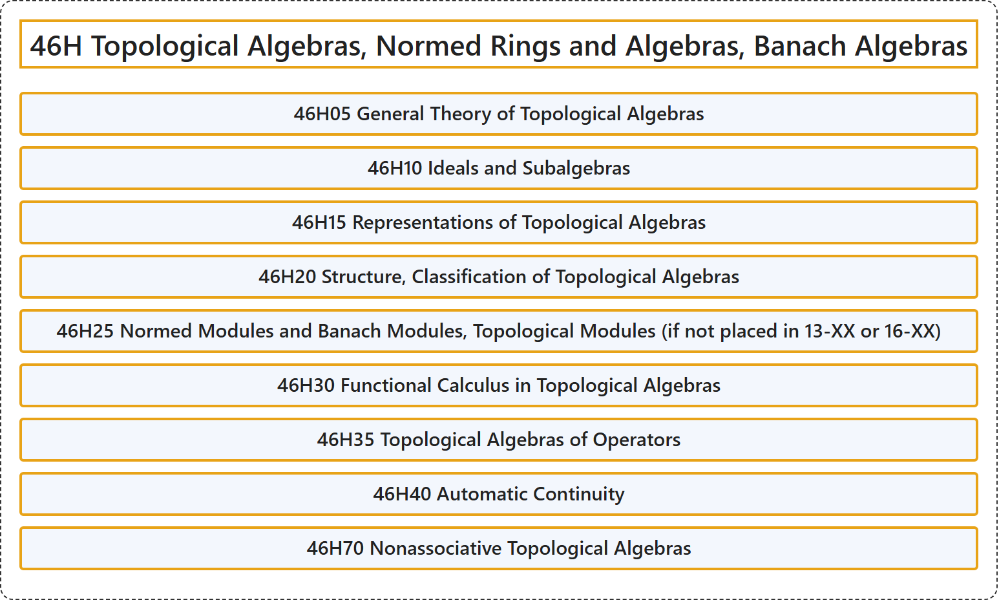

# 46H Topological Algebras, Normed Rings and Algebras, Banach Algebras

## Classification

## Glossary

| Term | Definition | 中文翻译 | Source |
|---|---|---|---|
| **46H Topological Algebras, Normed Rings and Algebras, Banach Algebras** 拓扑代数、赋范环与赋范代数、巴拿赫代数 | (No definition) | （无定义） | [Associate Editors of Mathematical Reviews and zbMATH, 2020](https://msc2020.org/) |
| **46H05 General Theory of Topological Algebras** 拓扑代数的一般理论 | (No definition) | （无定义） | [Associate Editors of Mathematical Reviews and zbMATH, 2020](https://msc2020.org/) |
| **46H10 Ideals and Subalgebras** 理想与子代数 | (No definition) | （无定义） | [Associate Editors of Mathematical Reviews and zbMATH, 2020](https://msc2020.org/) |
| **46H15 Representations of Topological Algebras** 拓扑代数的表示 | (No definition) | （无定义） | [Associate Editors of Mathematical Reviews and zbMATH, 2020](https://msc2020.org/) |
| **46H20 Structure, Classification of Topological Algebras** 拓扑代数的结构，分类 | (No definition) | （无定义） | [Associate Editors of Mathematical Reviews and zbMATH, 2020](https://msc2020.org/) |
| **46H25 Normed Modules and Banach Modules, Topological Modules (if not placed in 13-XX or 16-XX)** 赋范模与巴拿赫模，拓扑模（若不属于 13-XX 或 16-XX） | (No definition) | （无定义） | [Associate Editors of Mathematical Reviews and zbMATH, 2020](https://msc2020.org/) |
| **46H30 Functional Calculus in Topological Algebras** 拓扑代数中的泛函演算 | (No definition) | （无定义） | [Associate Editors of Mathematical Reviews and zbMATH, 2020](https://msc2020.org/) |
| **46H35 Topological Algebras of Operators** 算子拓扑代数 | (No definition) | （无定义） | [Associate Editors of Mathematical Reviews and zbMATH, 2020](https://msc2020.org/) |
| **46H40 Automatic Continuity** 自动连续性 | (No definition) | （无定义） | [Associate Editors of Mathematical Reviews and zbMATH, 2020](https://msc2020.org/) |
| **46H70 Nonassociative Topological Algebras** 非结合拓扑代数 | (No definition) | （无定义） | [Associate Editors of Mathematical Reviews and zbMATH, 2020](https://msc2020.org/) |

## References

Associate Editors of Mathematical Reviews and zbMATH. (2020). *MSC2020: Mathematics Subject Classification system*. Retrieved October 27, 2026, from <https://msc2020.org/>
