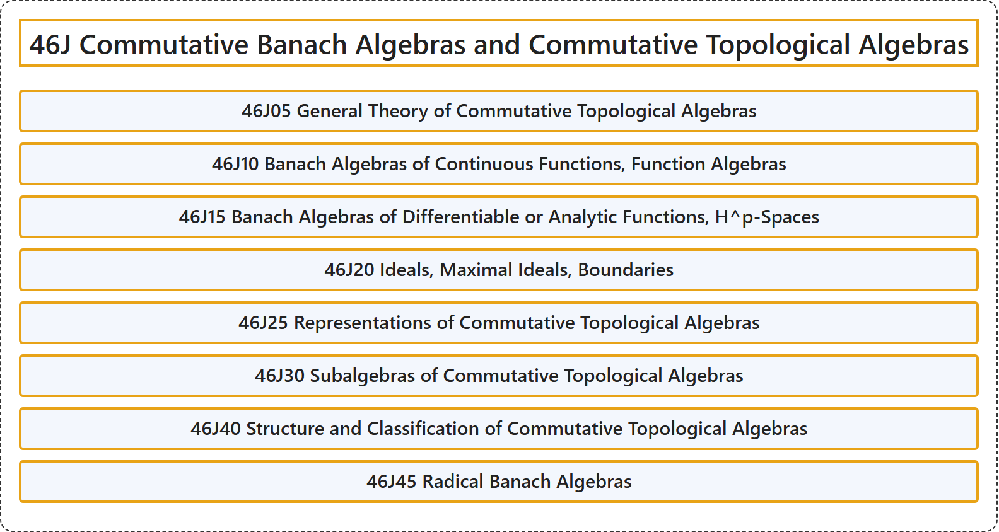

# 46J Commutative Banach Algebras and Commutative Topological Algebras

## Classification

## Glossary

| Term | Definition | 中文翻译 | Source |
|---|---|---|---|
| **46J Commutative Banach Algebras and Commutative Topological Algebras** 交换巴拿赫代数与交换拓扑代数 | (No definition) | （无定义） | [Associate Editors of Mathematical Reviews and zbMATH, 2020](https://msc2020.org/) |
| **46J05 General Theory of Commutative Topological Algebras** 交换拓扑代数的一般理论 | (No definition) | （无定义） | [Associate Editors of Mathematical Reviews and zbMATH, 2020](https://msc2020.org/) |
| **46J10 Banach Algebras of Continuous Functions, Function Algebras** 连续函数的巴拿赫代数，函数代数 | (No definition) | （无定义） | [Associate Editors of Mathematical Reviews and zbMATH, 2020](https://msc2020.org/) |
| **46J15 Banach Algebras of Differentiable or Analytic Functions, H^p-Spaces** 可微或解析函数的巴拿赫代数，H^p 空间 | (No definition) | （无定义） | [Associate Editors of Mathematical Reviews and zbMATH, 2020](https://msc2020.org/) |
| **46J20 Ideals, Maximal Ideals, Boundaries** 理想，极大理想，边界 | (No definition) | （无定义） | [Associate Editors of Mathematical Reviews and zbMATH, 2020](https://msc2020.org/) |
| **46J25 Representations of Commutative Topological Algebras** 交换拓扑代数的表示 | (No definition) | （无定义） | [Associate Editors of Mathematical Reviews and zbMATH, 2020](https://msc2020.org/) |
| **46J30 Subalgebras of Commutative Topological Algebras** 交换拓扑代数的子代数 | (No definition) | （无定义） | [Associate Editors of Mathematical Reviews and zbMATH, 2020](https://msc2020.org/) |
| **46J40 Structure and Classification of Commutative Topological Algebras** 交换拓扑代数的结构与分类 | (No definition) | （无定义） | [Associate Editors of Mathematical Reviews and zbMATH, 2020](https://msc2020.org/) |
| **46J45 Radical Banach Algebras** 根基巴拿赫代数 | (No definition) | （无定义） | [Associate Editors of Mathematical Reviews and zbMATH, 2020](https://msc2020.org/) |

## References

Associate Editors of Mathematical Reviews and zbMATH. (2020). *MSC2020: Mathematics Subject Classification system*. Retrieved October 27, 2026, from <https://msc2020.org/>
