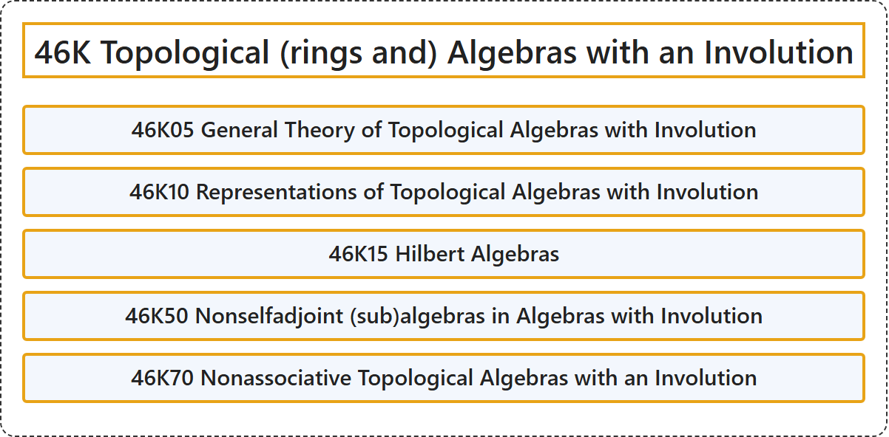

# 46K Topological (rings and) Algebras with an Involution

## Classification

## Glossary

| Term | Definition | 中文翻译 | Source |
|---|---|---|---|
| **46K Topological (rings and) Algebras with an Involution** 带对合的拓扑（环与）代数 | (No definition) | （无定义） | [Associate Editors of Mathematical Reviews and zbMATH, 2020](https://msc2020.org/) |
| **46K05 General Theory of Topological Algebras with Involution** 带对合的拓扑代数的一般理论 | (No definition) | （无定义） | [Associate Editors of Mathematical Reviews and zbMATH, 2020](https://msc2020.org/) |
| **46K10 Representations of Topological Algebras with Involution** 带对合的拓扑代数的表示 | (No definition) | （无定义） | [Associate Editors of Mathematical Reviews and zbMATH, 2020](https://msc2020.org/) |
| **46K15 Hilbert Algebras** 希尔伯特代数 | (No definition) | （无定义） | [Associate Editors of Mathematical Reviews and zbMATH, 2020](https://msc2020.org/) |
| **46K50 Nonselfadjoint (sub)algebras in Algebras with Involution** 带对合代数中的非自伴（子）代数 | (No definition) | （无定义） | [Associate Editors of Mathematical Reviews and zbMATH, 2020](https://msc2020.org/) |
| **46K70 Nonassociative Topological Algebras with an Involution** 带对合的非结合拓扑代数 | (No definition) | （无定义） | [Associate Editors of Mathematical Reviews and zbMATH, 2020](https://msc2020.org/) |

## References

Associate Editors of Mathematical Reviews and zbMATH. (2020). *MSC2020: Mathematics Subject Classification system*. Retrieved October 27, 2026, from <https://msc2020.org/>
