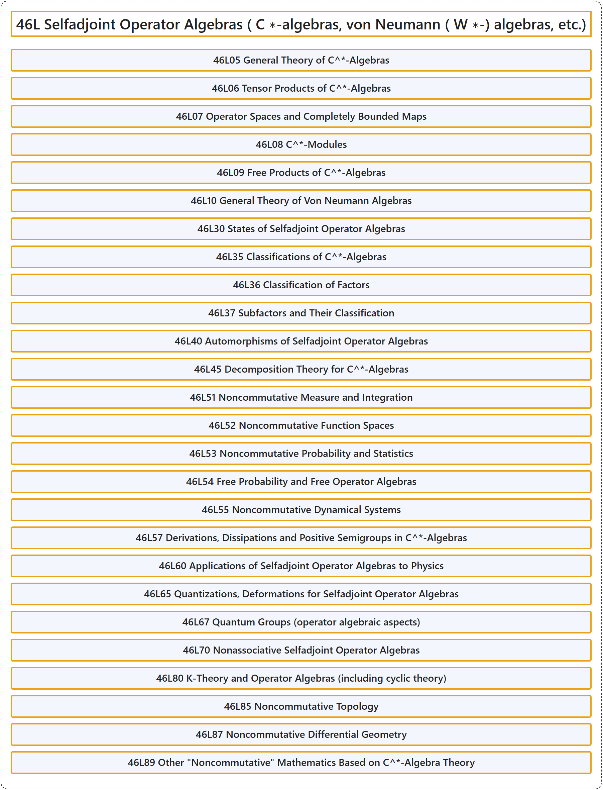

# 46L Selfadjoint Operator Algebras ( C ∗-algebras, von Neumann ( W ∗-) algebras, etc.)

## Classification

## Glossary

| Term | Definition | 中文翻译 | Source |
|---|---|---|---|
| **46L Selfadjoint Operator Algebras ( C ∗-algebras, von Neumann ( W ∗-) algebras, etc.)** 自伴算子代数（ C ∗-代数、冯诺依曼（ W ∗-）代数等） | (No definition) | （无定义） | [Associate Editors of Mathematical Reviews and zbMATH, 2020](https://msc2020.org/) |
| **46L05 General Theory of C^\*-Algebras** C^*-代数的一般理论 | (No definition) | （无定义） | [Associate Editors of Mathematical Reviews and zbMATH, 2020](https://msc2020.org/) |
| **46L06 Tensor Products of C^\*-Algebras** C^*-代数的张量积 | (No definition) | （无定义） | [Associate Editors of Mathematical Reviews and zbMATH, 2020](https://msc2020.org/) |
| **46L07 Operator Spaces and Completely Bounded Maps** 算子空间与完全有界映射 | (No definition) | （无定义） | [Associate Editors of Mathematical Reviews and zbMATH, 2020](https://msc2020.org/) |
| **46L08 C^\*-Modules** C^*-模 | (No definition) | （无定义） | [Associate Editors of Mathematical Reviews and zbMATH, 2020](https://msc2020.org/) |
| **46L09 Free Products of C^\*-Algebras** C^*-代数的自由积 | (No definition) | （无定义） | [Associate Editors of Mathematical Reviews and zbMATH, 2020](https://msc2020.org/) |
| **46L10 General Theory of Von Neumann Algebras** 冯诺伊曼代数的一般理论 | (No definition) | （无定义） | [Associate Editors of Mathematical Reviews and zbMATH, 2020](https://msc2020.org/) |
| **46L30 States of Selfadjoint Operator Algebras** 自伴算子代数的态 | (No definition) | （无定义） | [Associate Editors of Mathematical Reviews and zbMATH, 2020](https://msc2020.org/) |
| **46L35 Classifications of C^\*-Algebras** C^*-代数的分类 | (No definition) | （无定义） | [Associate Editors of Mathematical Reviews and zbMATH, 2020](https://msc2020.org/) |
| **46L36 Classification of Factors** 因子的分类 | (No definition) | （无定义） | [Associate Editors of Mathematical Reviews and zbMATH, 2020](https://msc2020.org/) |
| **46L37 Subfactors and Their Classification** 子因子及其分类 | (No definition) | （无定义） | [Associate Editors of Mathematical Reviews and zbMATH, 2020](https://msc2020.org/) |
| **46L40 Automorphisms of Selfadjoint Operator Algebras** 自伴算子代数的自同构 | (No definition) | （无定义） | [Associate Editors of Mathematical Reviews and zbMATH, 2020](https://msc2020.org/) |
| **46L45 Decomposition Theory for C^\*-Algebras** C^*-代数的分解理论 | (No definition) | （无定义） | [Associate Editors of Mathematical Reviews and zbMATH, 2020](https://msc2020.org/) |
| **46L51 Noncommutative Measure and Integration** 非交换测度与积分 | (No definition) | （无定义） | [Associate Editors of Mathematical Reviews and zbMATH, 2020](https://msc2020.org/) |
| **46L52 Noncommutative Function Spaces** 非交换函数空间 | (No definition) | （无定义） | [Associate Editors of Mathematical Reviews and zbMATH, 2020](https://msc2020.org/) |
| **46L53 Noncommutative Probability and Statistics** 非交换概率与统计 | (No definition) | （无定义） | [Associate Editors of Mathematical Reviews and zbMATH, 2020](https://msc2020.org/) |
| **46L54 Free Probability and Free Operator Algebras** 自由概率与自由算子代数 | (No definition) | （无定义） | [Associate Editors of Mathematical Reviews and zbMATH, 2020](https://msc2020.org/) |
| **46L55 Noncommutative Dynamical Systems** 非交换动力系统 | (No definition) | （无定义） | [Associate Editors of Mathematical Reviews and zbMATH, 2020](https://msc2020.org/) |
| **46L57 Derivations, Dissipations and Positive Semigroups in C^\*-Algebras** C^*-代数中的导子、耗散与正半群 | (No definition) | （无定义） | [Associate Editors of Mathematical Reviews and zbMATH, 2020](https://msc2020.org/) |
| **46L60 Applications of Selfadjoint Operator Algebras to Physics** 自伴算子代数在物理学中的应用 | (No definition) | （无定义） | [Associate Editors of Mathematical Reviews and zbMATH, 2020](https://msc2020.org/) |
| **46L65 Quantizations, Deformations for Selfadjoint Operator Algebras** 自伴算子代数的量子化，形变 | (No definition) | （无定义） | [Associate Editors of Mathematical Reviews and zbMATH, 2020](https://msc2020.org/) |
| **46L67 Quantum Groups (operator algebraic aspects)** 量子群（算子代数方面） | (No definition) | （无定义） | [Associate Editors of Mathematical Reviews and zbMATH, 2020](https://msc2020.org/) |
| **46L70 Nonassociative Selfadjoint Operator Algebras** 非结合自伴算子代数 | (No definition) | （无定义） | [Associate Editors of Mathematical Reviews and zbMATH, 2020](https://msc2020.org/) |
| **46L80 K-Theory and Operator Algebras (including cyclic theory)** K 理论与算子代数（包括循环理论） | (No definition) | （无定义） | [Associate Editors of Mathematical Reviews and zbMATH, 2020](https://msc2020.org/) |
| **46L85 Noncommutative Topology** 非交换拓扑 | (No definition) | （无定义） | [Associate Editors of Mathematical Reviews and zbMATH, 2020](https://msc2020.org/) |
| **46L87 Noncommutative Differential Geometry** 非交换微分几何 | (No definition) | （无定义） | [Associate Editors of Mathematical Reviews and zbMATH, 2020](https://msc2020.org/) |
| **46L89 Other "Noncommutative" Mathematics Based on C^\*-Algebra Theory** 基于 C^*-代数理论的其他“非交换”数学 | (No definition) | （无定义） | [Associate Editors of Mathematical Reviews and zbMATH, 2020](https://msc2020.org/) |

## References

Associate Editors of Mathematical Reviews and zbMATH. (2020). *MSC2020: Mathematics Subject Classification system*. Retrieved October 27, 2026, from <https://msc2020.org/>
