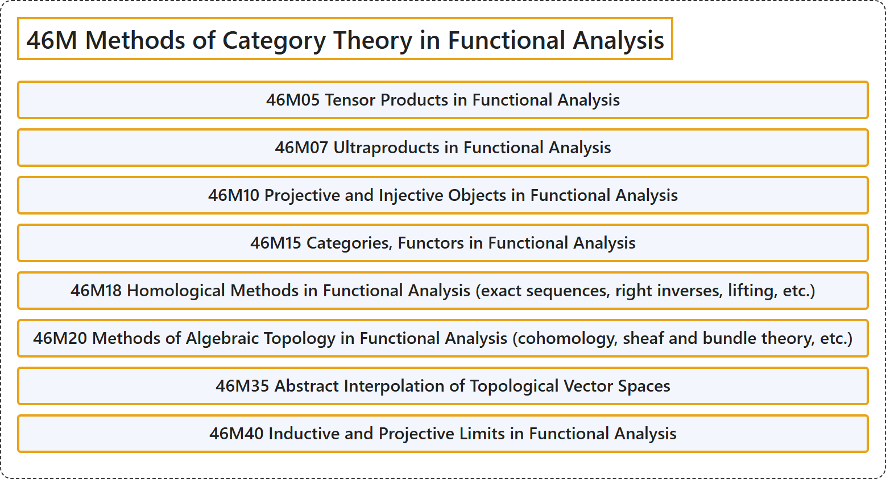

# 46M Methods of Category Theory in Functional Analysis

## Classification

## Glossary

| Term | Definition | 中文翻译 | Source |
|---|---|---|---|
| **46M Methods of Category Theory in Functional Analysis** 泛函分析中的范畴论方法 | (No definition) | （无定义） | [Associate Editors of Mathematical Reviews and zbMATH, 2020](https://msc2020.org/) |
| **46M05 Tensor Products in Functional Analysis** 泛函分析中的张量积 | (No definition) | （无定义） | [Associate Editors of Mathematical Reviews and zbMATH, 2020](https://msc2020.org/) |
| **46M07 Ultraproducts in Functional Analysis** 泛函分析中的超积 | (No definition) | （无定义） | [Associate Editors of Mathematical Reviews and zbMATH, 2020](https://msc2020.org/) |
| **46M10 Projective and Injective Objects in Functional Analysis** 泛函分析中的投射对象与内射对象 | (No definition) | （无定义） | [Associate Editors of Mathematical Reviews and zbMATH, 2020](https://msc2020.org/) |
| **46M15 Categories, Functors in Functional Analysis** 泛函分析中的范畴，函子 | (No definition) | （无定义） | [Associate Editors of Mathematical Reviews and zbMATH, 2020](https://msc2020.org/) |
| **46M18 Homological Methods in Functional Analysis (exact sequences, right inverses, lifting, etc.)** 泛函分析中的同调方法（正合序列、右逆、提升等） | (No definition) | （无定义） | [Associate Editors of Mathematical Reviews and zbMATH, 2020](https://msc2020.org/) |
| **46M20 Methods of Algebraic Topology in Functional Analysis (cohomology, sheaf and bundle theory, etc.)** 泛函分析中的代数拓扑方法（上同调，层与丛理论等） | (No definition) | （无定义） | [Associate Editors of Mathematical Reviews and zbMATH, 2020](https://msc2020.org/) |
| **46M35 Abstract Interpolation of Topological Vector Spaces** 拓扑向量空间的抽象插值 | (No definition) | （无定义） | [Associate Editors of Mathematical Reviews and zbMATH, 2020](https://msc2020.org/) |
| **46M40 Inductive and Projective Limits in Functional Analysis** 泛函分析中的归纳极限与投影极限 | (No definition) | （无定义） | [Associate Editors of Mathematical Reviews and zbMATH, 2020](https://msc2020.org/) |

## References

Associate Editors of Mathematical Reviews and zbMATH. (2020). *MSC2020: Mathematics Subject Classification system*. Retrieved October 27, 2026, from <https://msc2020.org/>
