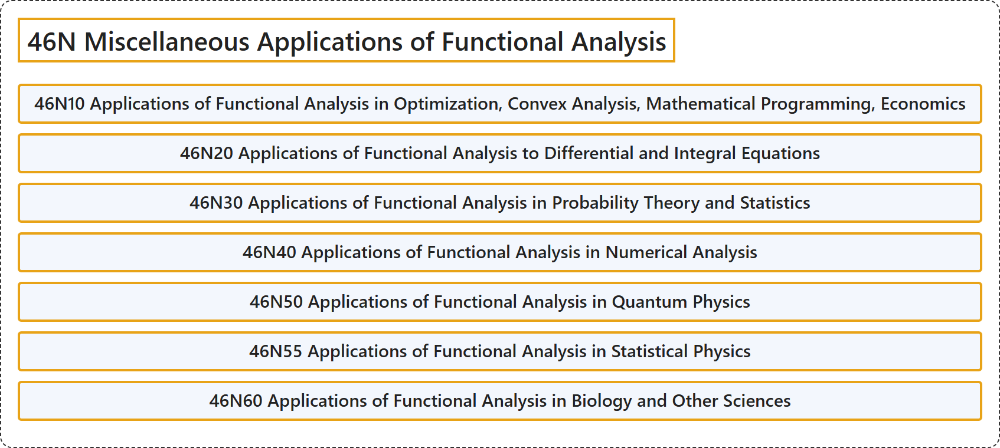

# 46N Miscellaneous Applications of Functional Analysis

## Classification

## Glossary

| Term | Definition | 中文翻译 | Source |
|---|---|---|---|
| **46N Miscellaneous Applications of Functional Analysis** 泛函分析的杂项应用 | (No definition) | （无定义） | [Associate Editors of Mathematical Reviews and zbMATH, 2020](https://msc2020.org/) |
| **46N10 Applications of Functional Analysis in Optimization, Convex Analysis, Mathematical Programming, Economics** 泛函分析在最优化、凸分析、数学规划、经济学中的应用 | (No definition) | （无定义） | [Associate Editors of Mathematical Reviews and zbMATH, 2020](https://msc2020.org/) |
| **46N20 Applications of Functional Analysis to Differential and Integral Equations** 泛函分析在微分方程与积分方程中的应用 | (No definition) | （无定义） | [Associate Editors of Mathematical Reviews and zbMATH, 2020](https://msc2020.org/) |
| **46N30 Applications of Functional Analysis in Probability Theory and Statistics** 泛函分析在概率论与统计学中的应用 | (No definition) | （无定义） | [Associate Editors of Mathematical Reviews and zbMATH, 2020](https://msc2020.org/) |
| **46N40 Applications of Functional Analysis in Numerical Analysis** 泛函分析在数值分析中的应用 | (No definition) | （无定义） | [Associate Editors of Mathematical Reviews and zbMATH, 2020](https://msc2020.org/) |
| **46N50 Applications of Functional Analysis in Quantum Physics** 泛函分析在量子物理中的应用 | (No definition) | （无定义） | [Associate Editors of Mathematical Reviews and zbMATH, 2020](https://msc2020.org/) |
| **46N55 Applications of Functional Analysis in Statistical Physics** 泛函分析在统计物理中的应用 | (No definition) | （无定义） | [Associate Editors of Mathematical Reviews and zbMATH, 2020](https://msc2020.org/) |
| **46N60 Applications of Functional Analysis in Biology and Other Sciences** 泛函分析在生物学及其他科学中的应用 | (No definition) | （无定义） | [Associate Editors of Mathematical Reviews and zbMATH, 2020](https://msc2020.org/) |

## References

Associate Editors of Mathematical Reviews and zbMATH. (2020). *MSC2020: Mathematics Subject Classification system*. Retrieved October 27, 2026, from <https://msc2020.org/>
