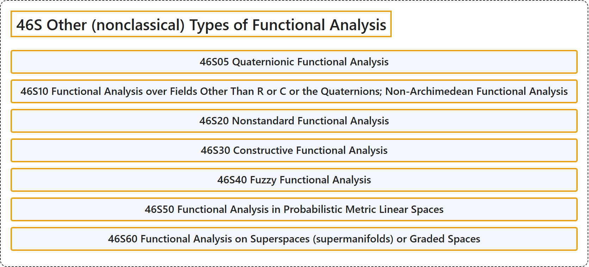

# 46S Other (nonclassical) Types of Functional Analysis

## Classification

## Glossary

| Term | Definition | 中文翻译 | Source |
|---|---|---|---|
| **46S Other (nonclassical) Types of Functional Analysis** 泛函分析的其他（非经典）类型 | (No definition) | （无定义） | [Associate Editors of Mathematical Reviews and zbMATH, 2020](https://msc2020.org/) |
| **46S05 Quaternionic Functional Analysis** 四元数泛函分析 | (No definition) | （无定义） | [Associate Editors of Mathematical Reviews and zbMATH, 2020](https://msc2020.org/) |
| **46S10 Functional Analysis over Fields Other Than R or C or the Quaternions; Non-Archimedean Functional Analysis** R、C 及四元数以外的域上的泛函分析；非阿基米德泛函分析 | (No definition) | （无定义） | [Associate Editors of Mathematical Reviews and zbMATH, 2020](https://msc2020.org/) |
| **46S20 Nonstandard Functional Analysis** 非标准泛函分析 | (No definition) | （无定义） | [Associate Editors of Mathematical Reviews and zbMATH, 2020](https://msc2020.org/) |
| **46S30 Constructive Functional Analysis** 构造性泛函分析 | (No definition) | （无定义） | [Associate Editors of Mathematical Reviews and zbMATH, 2020](https://msc2020.org/) |
| **46S40 Fuzzy Functional Analysis** 模糊泛函分析 | (No definition) | （无定义） | [Associate Editors of Mathematical Reviews and zbMATH, 2020](https://msc2020.org/) |
| **46S50 Functional Analysis in Probabilistic Metric Linear Spaces** 概率度量线性空间中的泛函分析 | (No definition) | （无定义） | [Associate Editors of Mathematical Reviews and zbMATH, 2020](https://msc2020.org/) |
| **46S60 Functional Analysis on Superspaces (supermanifolds) or Graded Spaces** 超空间（超流形）或分次空间上的泛函分析 | (No definition) | （无定义） | [Associate Editors of Mathematical Reviews and zbMATH, 2020](https://msc2020.org/) |

## References

Associate Editors of Mathematical Reviews and zbMATH. (2020). *MSC2020: Mathematics Subject Classification system*. Retrieved October 27, 2026, from <https://msc2020.org/>
