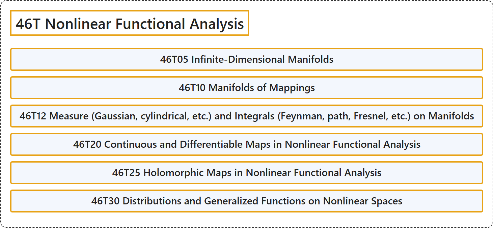

# 46T Nonlinear Functional Analysis

## Classification

## Glossary

| Term | Definition | 中文翻译 | Source |
|---|---|---|---|
| **46T Nonlinear Functional Analysis** 非线性泛函分析 | (No definition) | （无定义） | [Associate Editors of Mathematical Reviews and zbMATH, 2020](https://msc2020.org/) |
| **46T05 Infinite-Dimensional Manifolds** 无穷维流形 | (No definition) | （无定义） | [Associate Editors of Mathematical Reviews and zbMATH, 2020](https://msc2020.org/) |
| **46T10 Manifolds of Mappings** 映射流形 | (No definition) | （无定义） | [Associate Editors of Mathematical Reviews and zbMATH, 2020](https://msc2020.org/) |
| **46T12 Measure (Gaussian, cylindrical, etc.) and Integrals (Feynman, path, Fresnel, etc.) on Manifolds** 流形上的测度（高斯、柱面等）与积分（费曼、路径、菲涅耳等） | (No definition) | （无定义） | [Associate Editors of Mathematical Reviews and zbMATH, 2020](https://msc2020.org/) |
| **46T20 Continuous and Differentiable Maps in Nonlinear Functional Analysis** 非线性泛函分析中的连续映射与可微映射 | (No definition) | （无定义） | [Associate Editors of Mathematical Reviews and zbMATH, 2020](https://msc2020.org/) |
| **46T25 Holomorphic Maps in Nonlinear Functional Analysis** 非线性泛函分析中的全纯映射 | (No definition) | （无定义） | [Associate Editors of Mathematical Reviews and zbMATH, 2020](https://msc2020.org/) |
| **46T30 Distributions and Generalized Functions on Nonlinear Spaces** 非线性空间上的广义函数 | (No definition) | （无定义） | [Associate Editors of Mathematical Reviews and zbMATH, 2020](https://msc2020.org/) |

## References

Associate Editors of Mathematical Reviews and zbMATH. (2020). *MSC2020: Mathematics Subject Classification system*. Retrieved October 27, 2026, from <https://msc2020.org/>
