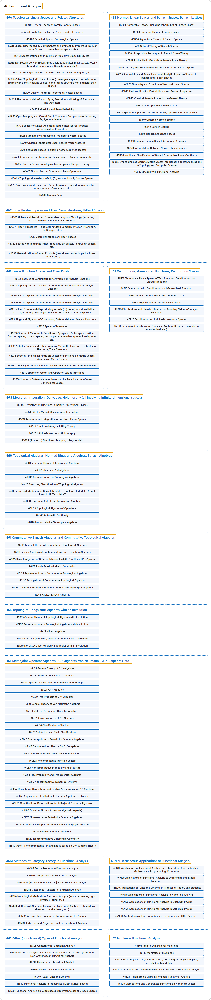

# 46 Functional Analysis

## Classification

## Glossary

| Term | Definition | 中文翻译 | Source |
|---|---|---|---|
| **46 Functional Analysis** 泛函分析 | "Functional analysis is a branch of mathematics concerned with **infinite-dimensional vector spaces** (mainly function spaces) and **mappings between them**." | 泛函分析是一个数学分支，研究**无穷维向量空间**（主要是函数空间）以及**它们之间的映射**。 | [Weisstein, n.d., "Functional analysis" entry, para. 1](https://mathworld.wolfram.com/FunctionalAnalysis.html#:~:text=Functional%20analysis%20is%20a%20branch%20of%20mathematics%20concerned%20with%20infinite) |
| **[46A Topological Linear Spaces and Related Structures](46a-topological-linear-spaces-and-related-structures.md)** 拓扑线性空间及相关结构 | (No definition) | （无定义） | [Associate Editors of Mathematical Reviews and zbMATH, 2020](https://msc2020.org/) |
| **[46B Normed Linear Spaces and Banach Spaces; Banach Lattices](46b-normed-linear-spaces-and-banach-spaces-banach-lattices.md)** 赋范线性空间与巴拿赫空间；巴拿赫格 | (No definition) | （无定义） | [Associate Editors of Mathematical Reviews and zbMATH, 2020](https://msc2020.org/) |
| **[46C Inner Product Spaces and Their Generalizations, Hilbert Spaces](46c-inner-product-spaces-and-their-generalizations-hilbert-space.md)** 内积空间及其推广、希尔伯特空间 | (No definition) | （无定义） | [Associate Editors of Mathematical Reviews and zbMATH, 2020](https://msc2020.org/) |
| **[46E Linear Function Spaces and Their Duals](46e-linear-function-spaces-and-their-duals.md)** 线性函数空间及其对偶 | (No definition) | （无定义） | [Associate Editors of Mathematical Reviews and zbMATH, 2020](https://msc2020.org/) |
| **[46F Distributions, Generalized Functions, Distribution Spaces](46f-distributions-generalized-functions-distribution-spaces.md)** 分布、广义函数、分布空间 | (No definition) | （无定义） | [Associate Editors of Mathematical Reviews and zbMATH, 2020](https://msc2020.org/) |
| **[46G Measures, Integration, Derivative, Holomorphy (all involving infinite-dimensional spaces)](46g-measures-integration-derivative-holomorphy-all-involving-inf.md)** 测度、积分、导数、全纯性（均涉及无穷维空间） | (No definition) | （无定义） | [Associate Editors of Mathematical Reviews and zbMATH, 2020](https://msc2020.org/) |
| **[46H Topological Algebras, Normed Rings and Algebras, Banach Algebras](46h-topological-algebras-normed-rings-and-algebras-banach-algebr.md)** 拓扑代数、赋范环与赋范代数、巴拿赫代数 | (No definition) | （无定义） | [Associate Editors of Mathematical Reviews and zbMATH, 2020](https://msc2020.org/) |
| **[46J Commutative Banach Algebras and Commutative Topological Algebras](46j-commutative-banach-algebras-and-commutative-topological-alge.md)** 交换巴拿赫代数与交换拓扑代数 | (No definition) | （无定义） | [Associate Editors of Mathematical Reviews and zbMATH, 2020](https://msc2020.org/) |
| **[46K Topological (rings and) Algebras with an Involution](46k-topological-rings-and-algebras-with-an-involution.md)** 带对合的拓扑（环与）代数 | (No definition) | （无定义） | [Associate Editors of Mathematical Reviews and zbMATH, 2020](https://msc2020.org/) |
| **[46L Selfadjoint Operator Algebras ( C ∗-algebras, von Neumann ( W ∗-) algebras, etc.)](46l-selfadjoint-operator-algebras-c-algebras-von-neumann-w-algeb.md)** 自伴算子代数（ C ∗-代数、冯诺依曼（ W ∗-）代数等） | (No definition) | （无定义） | [Associate Editors of Mathematical Reviews and zbMATH, 2020](https://msc2020.org/) |
| **[46M Methods of Category Theory in Functional Analysis](46m-methods-of-category-theory-in-functional-analysis.md)** 泛函分析中的范畴论方法 | (No definition) | （无定义） | [Associate Editors of Mathematical Reviews and zbMATH, 2020](https://msc2020.org/) |
| **[46N Miscellaneous Applications of Functional Analysis](46n-miscellaneous-applications-of-functional-analysis.md)** 泛函分析的杂项应用 | (No definition) | （无定义） | [Associate Editors of Mathematical Reviews and zbMATH, 2020](https://msc2020.org/) |
| **[46S Other (nonclassical) Types of Functional Analysis](46s-other-nonclassical-types-of-functional-analysis.md)** 泛函分析的其他（非经典）类型 | (No definition) | （无定义） | [Associate Editors of Mathematical Reviews and zbMATH, 2020](https://msc2020.org/) |
| **[46T Nonlinear Functional Analysis](46t-nonlinear-functional-analysis.md)** 非线性泛函分析 | (No definition) | （无定义） | [Associate Editors of Mathematical Reviews and zbMATH, 2020](https://msc2020.org/) |

## References

Associate Editors of Mathematical Reviews and zbMATH. (2020). *MSC2020: Mathematics Subject Classification system*. Retrieved October 27, 2026, from <https://msc2020.org/>

Weisstein, E. W. (n.d.). *Functional analysis*. MathWorld: A Wolfram Resource. Retrieved October 27, 2026, from <https://mathworld.wolfram.com/FunctionalAnalysis.html>
