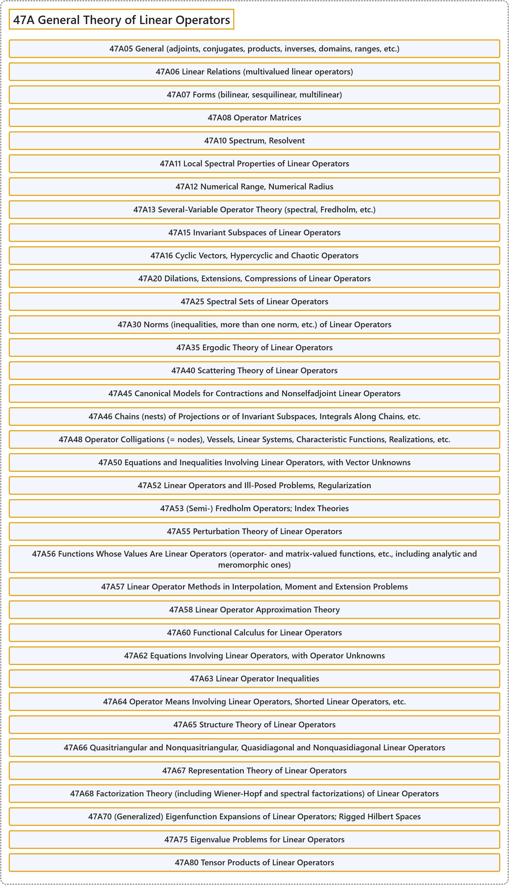

# 47A General Theory of Linear Operators

## Classification

## Glossary

| Term | Definition | 中文翻译 | Source |
|---|---|---|---|
| **47A General Theory of Linear Operators** 线性算子一般理论 | (No definition) | （无定义） | [Associate Editors of Mathematical Reviews and zbMATH, 2020](https://msc2020.org/) |
| **47A05 General (adjoints, conjugates, products, inverses, domains, ranges, etc.)** 一般（伴随、共轭、乘积、逆、定义域、值域等） | (No definition) | （无定义） | [Associate Editors of Mathematical Reviews and zbMATH, 2020](https://msc2020.org/) |
| **47A06 Linear Relations (multivalued linear operators)** 线性关系（多值线性算子） | (No definition) | （无定义） | [Associate Editors of Mathematical Reviews and zbMATH, 2020](https://msc2020.org/) |
| **47A07 Forms (bilinear, sesquilinear, multilinear)** 型式（双线性、半双线性、多重线性） | (No definition) | （无定义） | [Associate Editors of Mathematical Reviews and zbMATH, 2020](https://msc2020.org/) |
| **47A08 Operator Matrices** 算子矩阵 | (No definition) | （无定义） | [Associate Editors of Mathematical Reviews and zbMATH, 2020](https://msc2020.org/) |
| **47A10 Spectrum, Resolvent** 谱，预解式 | (No definition) | （无定义） | [Associate Editors of Mathematical Reviews and zbMATH, 2020](https://msc2020.org/) |
| **47A11 Local Spectral Properties of Linear Operators** 线性算子的局部谱性质 | (No definition) | （无定义） | [Associate Editors of Mathematical Reviews and zbMATH, 2020](https://msc2020.org/) |
| **47A12 Numerical Range, Numerical Radius** 数值域，数值半径 | (No definition) | （无定义） | [Associate Editors of Mathematical Reviews and zbMATH, 2020](https://msc2020.org/) |
| **47A13 Several-Variable Operator Theory (spectral, Fredholm, etc.)** 多变量算子理论（谱、弗雷德霍姆等） | (No definition) | （无定义） | [Associate Editors of Mathematical Reviews and zbMATH, 2020](https://msc2020.org/) |
| **47A15 Invariant Subspaces of Linear Operators** 线性算子的不变子空间 | (No definition) | （无定义） | [Associate Editors of Mathematical Reviews and zbMATH, 2020](https://msc2020.org/) |
| **47A16 Cyclic Vectors, Hypercyclic and Chaotic Operators** 循环向量，超循环算子与混沌算子 | (No definition) | （无定义） | [Associate Editors of Mathematical Reviews and zbMATH, 2020](https://msc2020.org/) |
| **47A20 Dilations, Extensions, Compressions of Linear Operators** 线性算子的膨胀、延拓、压缩 | (No definition) | （无定义） | [Associate Editors of Mathematical Reviews and zbMATH, 2020](https://msc2020.org/) |
| **47A25 Spectral Sets of Linear Operators** 线性算子的谱集 | (No definition) | （无定义） | [Associate Editors of Mathematical Reviews and zbMATH, 2020](https://msc2020.org/) |
| **47A30 Norms (inequalities, more than one norm, etc.) of Linear Operators** 线性算子的范数（不等式，多于一个范数等） | (No definition) | （无定义） | [Associate Editors of Mathematical Reviews and zbMATH, 2020](https://msc2020.org/) |
| **47A35 Ergodic Theory of Linear Operators** 线性算子的遍历理论 | (No definition) | （无定义） | [Associate Editors of Mathematical Reviews and zbMATH, 2020](https://msc2020.org/) |
| **47A40 Scattering Theory of Linear Operators** 线性算子的散射理论 | (No definition) | （无定义） | [Associate Editors of Mathematical Reviews and zbMATH, 2020](https://msc2020.org/) |
| **47A45 Canonical Models for Contractions and Nonselfadjoint Linear Operators** 压缩与非自伴线性算子的典范模型 | (No definition) | （无定义） | [Associate Editors of Mathematical Reviews and zbMATH, 2020](https://msc2020.org/) |
| **47A46 Chains (nests) of Projections or of Invariant Subspaces, Integrals Along Chains, etc.** 投影或不变子空间的链（套），沿链的积分等 | (No definition) | （无定义） | [Associate Editors of Mathematical Reviews and zbMATH, 2020](https://msc2020.org/) |
| **47A48 Operator Colligations (= nodes), Vessels, Linear Systems, Characteristic Functions, Realizations, etc.** 算子联结（= 结点），容器，线性系统，特征函数，实现等 | (No definition) | （无定义） | [Associate Editors of Mathematical Reviews and zbMATH, 2020](https://msc2020.org/) |
| **47A50 Equations and Inequalities Involving Linear Operators, with Vector Unknowns** 涉及线性算子、未知量为向量的方程与不等式 | (No definition) | （无定义） | [Associate Editors of Mathematical Reviews and zbMATH, 2020](https://msc2020.org/) |
| **47A52 Linear Operators and Ill-Posed Problems, Regularization** 线性算子与不适定问题，正则化 | (No definition) | （无定义） | [Associate Editors of Mathematical Reviews and zbMATH, 2020](https://msc2020.org/) |
| **47A53 (Semi-) Fredholm Operators; Index Theories** （半）弗雷德霍姆算子；指标理论 | (No definition) | （无定义） | [Associate Editors of Mathematical Reviews and zbMATH, 2020](https://msc2020.org/) |
| **47A55 Perturbation Theory of Linear Operators** 线性算子的扰动理论 | (No definition) | （无定义） | [Associate Editors of Mathematical Reviews and zbMATH, 2020](https://msc2020.org/) |
| **47A56 Functions Whose Values Are Linear Operators (operator- and matrix-valued functions, etc., including analytic and meromorphic ones)** 取值为线性算子的函数（算子值与矩阵值函数等，包括解析的与亚纯的） | (No definition) | （无定义） | [Associate Editors of Mathematical Reviews and zbMATH, 2020](https://msc2020.org/) |
| **47A57 Linear Operator Methods in Interpolation, Moment and Extension Problems** 插值、矩问题与延拓问题中的线性算子方法 | (No definition) | （无定义） | [Associate Editors of Mathematical Reviews and zbMATH, 2020](https://msc2020.org/) |
| **47A58 Linear Operator Approximation Theory** 线性算子逼近论 | (No definition) | （无定义） | [Associate Editors of Mathematical Reviews and zbMATH, 2020](https://msc2020.org/) |
| **47A60 Functional Calculus for Linear Operators** 线性算子的泛函演算 | (No definition) | （无定义） | [Associate Editors of Mathematical Reviews and zbMATH, 2020](https://msc2020.org/) |
| **47A62 Equations Involving Linear Operators, with Operator Unknowns** 涉及线性算子、未知量为算子的方程 | (No definition) | （无定义） | [Associate Editors of Mathematical Reviews and zbMATH, 2020](https://msc2020.org/) |
| **47A63 Linear Operator Inequalities** 线性算子不等式 | (No definition) | （无定义） | [Associate Editors of Mathematical Reviews and zbMATH, 2020](https://msc2020.org/) |
| **47A64 Operator Means Involving Linear Operators, Shorted Linear Operators, etc.** 涉及线性算子的算子平均，缩短线性算子等 | (No definition) | （无定义） | [Associate Editors of Mathematical Reviews and zbMATH, 2020](https://msc2020.org/) |
| **47A65 Structure Theory of Linear Operators** 线性算子的结构理论 | (No definition) | （无定义） | [Associate Editors of Mathematical Reviews and zbMATH, 2020](https://msc2020.org/) |
| **47A66 Quasitriangular and Nonquasitriangular, Quasidiagonal and Nonquasidiagonal Linear Operators** 拟三角与非拟三角、拟对角与非拟对角线性算子 | (No definition) | （无定义） | [Associate Editors of Mathematical Reviews and zbMATH, 2020](https://msc2020.org/) |
| **47A67 Representation Theory of Linear Operators** 线性算子的表示理论 | (No definition) | （无定义） | [Associate Editors of Mathematical Reviews and zbMATH, 2020](https://msc2020.org/) |
| **47A68 Factorization Theory (including Wiener-Hopf and spectral factorizations) of Linear Operators** 线性算子的因子分解理论（包括维纳-霍普夫分解与谱分解） | (No definition) | （无定义） | [Associate Editors of Mathematical Reviews and zbMATH, 2020](https://msc2020.org/) |
| **47A70 (Generalized) Eigenfunction Expansions of Linear Operators; Rigged Hilbert Spaces** 线性算子的（广义）本征函数展开；装备希尔伯特空间 | (No definition) | （无定义） | [Associate Editors of Mathematical Reviews and zbMATH, 2020](https://msc2020.org/) |
| **47A75 Eigenvalue Problems for Linear Operators** 线性算子的特征值问题 | (No definition) | （无定义） | [Associate Editors of Mathematical Reviews and zbMATH, 2020](https://msc2020.org/) |
| **47A80 Tensor Products of Linear Operators** 线性算子的张量积 | (No definition) | （无定义） | [Associate Editors of Mathematical Reviews and zbMATH, 2020](https://msc2020.org/) |

## References

Associate Editors of Mathematical Reviews and zbMATH. (2020). *MSC2020: Mathematics Subject Classification system*. Retrieved October 27, 2026, from <https://msc2020.org/>
