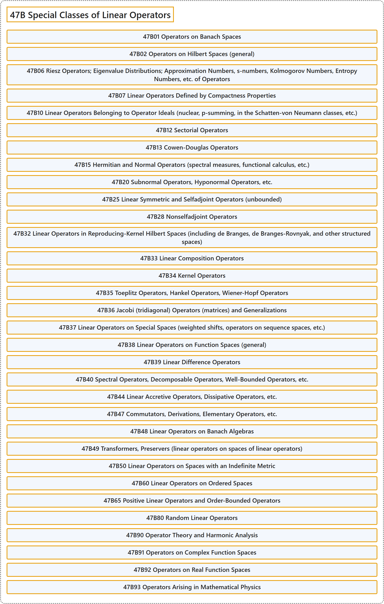

# 47B Special Classes of Linear Operators

## Classification

## Glossary

| Term | Definition | 中文翻译 | Source |
|---|---|---|---|
| **47B Special Classes of Linear Operators** 特殊类线性算子 | (No definition) | （无定义） | [Associate Editors of Mathematical Reviews and zbMATH, 2020](https://msc2020.org/) |
| **47B01 Operators on Banach Spaces** 巴拿赫空间上的算子 | (No definition) | （无定义） | [Associate Editors of Mathematical Reviews and zbMATH, 2020](https://msc2020.org/) |
| **47B02 Operators on Hilbert Spaces (general)** 希尔伯特空间上的算子（一般） | (No definition) | （无定义） | [Associate Editors of Mathematical Reviews and zbMATH, 2020](https://msc2020.org/) |
| **47B06 Riesz Operators; Eigenvalue Distributions; Approximation Numbers, s-numbers, Kolmogorov Numbers, Entropy Numbers, etc. of Operators** 里斯算子；特征值分布；算子的逼近数、s 数、柯尔莫哥洛夫数、熵数等 | (No definition) | （无定义） | [Associate Editors of Mathematical Reviews and zbMATH, 2020](https://msc2020.org/) |
| **47B07 Linear Operators Defined by Compactness Properties** 由紧性质定义的线性算子 | (No definition) | （无定义） | [Associate Editors of Mathematical Reviews and zbMATH, 2020](https://msc2020.org/) |
| **47B10 Linear Operators Belonging to Operator Ideals (nuclear, p-summing, in the Schatten-von Neumann classes, etc.)** 属于算子理想的线性算子（核算子、p-可和算子、沙滕-冯诺伊曼类等） | (No definition) | （无定义） | [Associate Editors of Mathematical Reviews and zbMATH, 2020](https://msc2020.org/) |
| **47B12 Sectorial Operators** 扇形算子 | (No definition) | （无定义） | [Associate Editors of Mathematical Reviews and zbMATH, 2020](https://msc2020.org/) |
| **47B13 Cowen-Douglas Operators** 考恩-道格拉斯算子 | (No definition) | （无定义） | [Associate Editors of Mathematical Reviews and zbMATH, 2020](https://msc2020.org/) |
| **47B15 Hermitian and Normal Operators (spectral measures, functional calculus, etc.)** 厄米算子与正规算子（谱测度、函数演算等） | (No definition) | （无定义） | [Associate Editors of Mathematical Reviews and zbMATH, 2020](https://msc2020.org/) |
| **47B20 Subnormal Operators, Hyponormal Operators, etc.** 次正规算子、亚正规算子等 | (No definition) | （无定义） | [Associate Editors of Mathematical Reviews and zbMATH, 2020](https://msc2020.org/) |
| **47B25 Linear Symmetric and Selfadjoint Operators (unbounded)** 线性对称算子与自伴算子（无界） | (No definition) | （无定义） | [Associate Editors of Mathematical Reviews and zbMATH, 2020](https://msc2020.org/) |
| **47B28 Nonselfadjoint Operators** 非自伴算子 | (No definition) | （无定义） | [Associate Editors of Mathematical Reviews and zbMATH, 2020](https://msc2020.org/) |
| **47B32 Linear Operators in Reproducing-Kernel Hilbert Spaces (including de Branges, de Branges-Rovnyak, and other structured spaces)** 再生核希尔伯特空间中的线性算子（包括 de Branges 空间、de Branges-Rovnyak 空间及其他结构空间） | (No definition) | （无定义） | [Associate Editors of Mathematical Reviews and zbMATH, 2020](https://msc2020.org/) |
| **47B33 Linear Composition Operators** 线性复合算子 | (No definition) | （无定义） | [Associate Editors of Mathematical Reviews and zbMATH, 2020](https://msc2020.org/) |
| **47B34 Kernel Operators** 核算子 | (No definition) | （无定义） | [Associate Editors of Mathematical Reviews and zbMATH, 2020](https://msc2020.org/) |
| **47B35 Toeplitz Operators, Hankel Operators, Wiener-Hopf Operators** 特普利茨算子、汉克尔算子、维纳-霍普夫算子 | (No definition) | （无定义） | [Associate Editors of Mathematical Reviews and zbMATH, 2020](https://msc2020.org/) |
| **47B36 Jacobi (tridiagonal) Operators (matrices) and Generalizations** 雅可比（三对角）算子（矩阵）及其推广 | (No definition) | （无定义） | [Associate Editors of Mathematical Reviews and zbMATH, 2020](https://msc2020.org/) |
| **47B37 Linear Operators on Special Spaces (weighted shifts, operators on sequence spaces, etc.)** 特殊空间上的线性算子（加权移位、序列空间上的算子等） | (No definition) | （无定义） | [Associate Editors of Mathematical Reviews and zbMATH, 2020](https://msc2020.org/) |
| **47B38 Linear Operators on Function Spaces (general)** 函数空间上的线性算子（一般） | (No definition) | （无定义） | [Associate Editors of Mathematical Reviews and zbMATH, 2020](https://msc2020.org/) |
| **47B39 Linear Difference Operators** 线性差分算子 | (No definition) | （无定义） | [Associate Editors of Mathematical Reviews and zbMATH, 2020](https://msc2020.org/) |
| **47B40 Spectral Operators, Decomposable Operators, Well-Bounded Operators, etc.** 谱算子、可分解算子、良有界算子等 | (No definition) | （无定义） | [Associate Editors of Mathematical Reviews and zbMATH, 2020](https://msc2020.org/) |
| **47B44 Linear Accretive Operators, Dissipative Operators, etc.** 线性增生算子、耗散算子等 | (No definition) | （无定义） | [Associate Editors of Mathematical Reviews and zbMATH, 2020](https://msc2020.org/) |
| **47B47 Commutators, Derivations, Elementary Operators, etc.** 换位子、导子、初等算子等 | (No definition) | （无定义） | [Associate Editors of Mathematical Reviews and zbMATH, 2020](https://msc2020.org/) |
| **47B48 Linear Operators on Banach Algebras** 巴拿赫代数上的线性算子 | (No definition) | （无定义） | [Associate Editors of Mathematical Reviews and zbMATH, 2020](https://msc2020.org/) |
| **47B49 Transformers, Preservers (linear operators on spaces of linear operators)** 变换器、保持器（线性算子空间上的线性算子） | (No definition) | （无定义） | [Associate Editors of Mathematical Reviews and zbMATH, 2020](https://msc2020.org/) |
| **47B50 Linear Operators on Spaces with an Indefinite Metric** 不定度量空间上的线性算子 | (No definition) | （无定义） | [Associate Editors of Mathematical Reviews and zbMATH, 2020](https://msc2020.org/) |
| **47B60 Linear Operators on Ordered Spaces** 序空间上的线性算子 | (No definition) | （无定义） | [Associate Editors of Mathematical Reviews and zbMATH, 2020](https://msc2020.org/) |
| **47B65 Positive Linear Operators and Order-Bounded Operators** 正线性算子与序有界算子 | (No definition) | （无定义） | [Associate Editors of Mathematical Reviews and zbMATH, 2020](https://msc2020.org/) |
| **47B80 Random Linear Operators** 随机线性算子 | (No definition) | （无定义） | [Associate Editors of Mathematical Reviews and zbMATH, 2020](https://msc2020.org/) |
| **47B90 Operator Theory and Harmonic Analysis** 算子理论与调和分析 | (No definition) | （无定义） | [Associate Editors of Mathematical Reviews and zbMATH, 2020](https://msc2020.org/) |
| **47B91 Operators on Complex Function Spaces** 复函数空间上的算子 | (No definition) | （无定义） | [Associate Editors of Mathematical Reviews and zbMATH, 2020](https://msc2020.org/) |
| **47B92 Operators on Real Function Spaces** 实函数空间上的算子 | (No definition) | （无定义） | [Associate Editors of Mathematical Reviews and zbMATH, 2020](https://msc2020.org/) |
| **47B93 Operators Arising in Mathematical Physics** 数学物理中产生的算子 | (No definition) | （无定义） | [Associate Editors of Mathematical Reviews and zbMATH, 2020](https://msc2020.org/) |

## References

Associate Editors of Mathematical Reviews and zbMATH. (2020). *MSC2020: Mathematics Subject Classification system*. Retrieved October 27, 2026, from <https://msc2020.org/>
