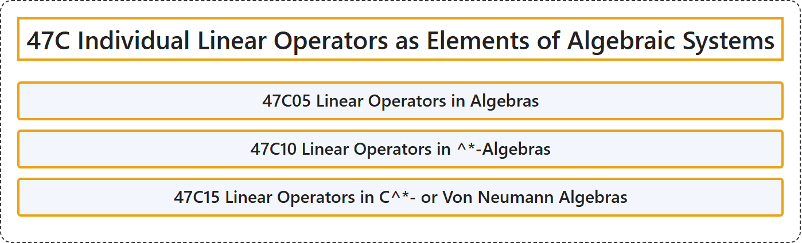

# 47C Individual Linear Operators as Elements of Algebraic Systems

## Classification

## Glossary

| Term | Definition | 中文翻译 | Source |
|---|---|---|---|
| **47C Individual Linear Operators as Elements of Algebraic Systems** 作为代数系统元素的个别线性算子 | (No definition) | （无定义） | [Associate Editors of Mathematical Reviews and zbMATH, 2020](https://msc2020.org/) |
| **47C05 Linear Operators in Algebras** 代数中的线性算子 | (No definition) | （无定义） | [Associate Editors of Mathematical Reviews and zbMATH, 2020](https://msc2020.org/) |
| **47C10 Linear Operators in ^\*-Algebras** ^*-代数中的线性算子 | (No definition) | （无定义） | [Associate Editors of Mathematical Reviews and zbMATH, 2020](https://msc2020.org/) |
| **47C15 Linear Operators in C^\*- or Von Neumann Algebras** C^* 代数或冯诺伊曼代数中的线性算子 | (No definition) | （无定义） | [Associate Editors of Mathematical Reviews and zbMATH, 2020](https://msc2020.org/) |

## References

Associate Editors of Mathematical Reviews and zbMATH. (2020). *MSC2020: Mathematics Subject Classification system*. Retrieved October 27, 2026, from <https://msc2020.org/>
