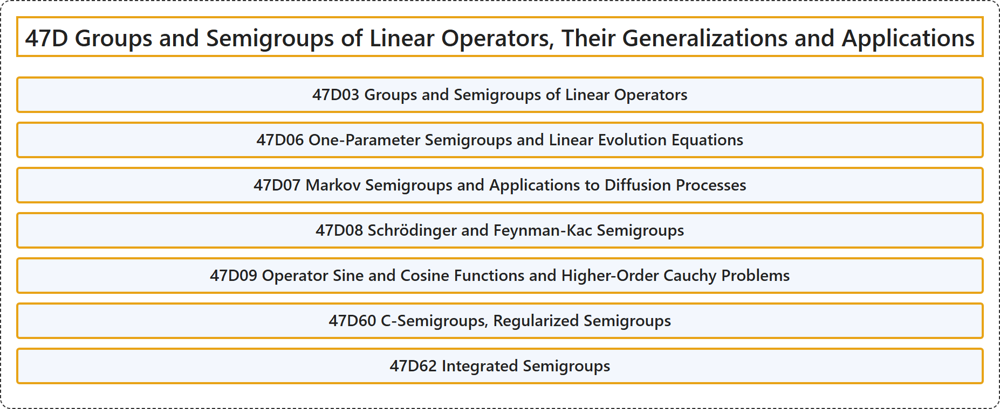

# 47D Groups and Semigroups of Linear Operators, Their Generalizations and Applications

## Classification

## Glossary

| Term | Definition | 中文翻译 | Source |
|---|---|---|---|
| **47D Groups and Semigroups of Linear Operators, Their Generalizations and Applications** 线性算子的群与半群、其推广及应用 | (No definition) | （无定义） | [Associate Editors of Mathematical Reviews and zbMATH, 2020](https://msc2020.org/) |
| **47D03 Groups and Semigroups of Linear Operators** 线性算子的群与半群 | (No definition) | （无定义） | [Associate Editors of Mathematical Reviews and zbMATH, 2020](https://msc2020.org/) |
| **47D06 One-Parameter Semigroups and Linear Evolution Equations** 单参数半群与线性发展方程 | (No definition) | （无定义） | [Associate Editors of Mathematical Reviews and zbMATH, 2020](https://msc2020.org/) |
| **47D07 Markov Semigroups and Applications to Diffusion Processes** 马尔可夫半群及其在扩散过程中的应用 | (No definition) | （无定义） | [Associate Editors of Mathematical Reviews and zbMATH, 2020](https://msc2020.org/) |
| **47D08 Schrödinger and Feynman-Kac Semigroups** 薛定谔半群与费曼-卡茨半群 | (No definition) | （无定义） | [Associate Editors of Mathematical Reviews and zbMATH, 2020](https://msc2020.org/) |
| **47D09 Operator Sine and Cosine Functions and Higher-Order Cauchy Problems** 算子正弦函数与余弦函数及高阶柯西问题 | (No definition) | （无定义） | [Associate Editors of Mathematical Reviews and zbMATH, 2020](https://msc2020.org/) |
| **47D60 C-Semigroups, Regularized Semigroups** C-半群、正则化半群 | (No definition) | （无定义） | [Associate Editors of Mathematical Reviews and zbMATH, 2020](https://msc2020.org/) |
| **47D62 Integrated Semigroups** 积分半群 | (No definition) | （无定义） | [Associate Editors of Mathematical Reviews and zbMATH, 2020](https://msc2020.org/) |

## References

Associate Editors of Mathematical Reviews and zbMATH. (2020). *MSC2020: Mathematics Subject Classification system*. Retrieved October 27, 2026, from <https://msc2020.org/>
