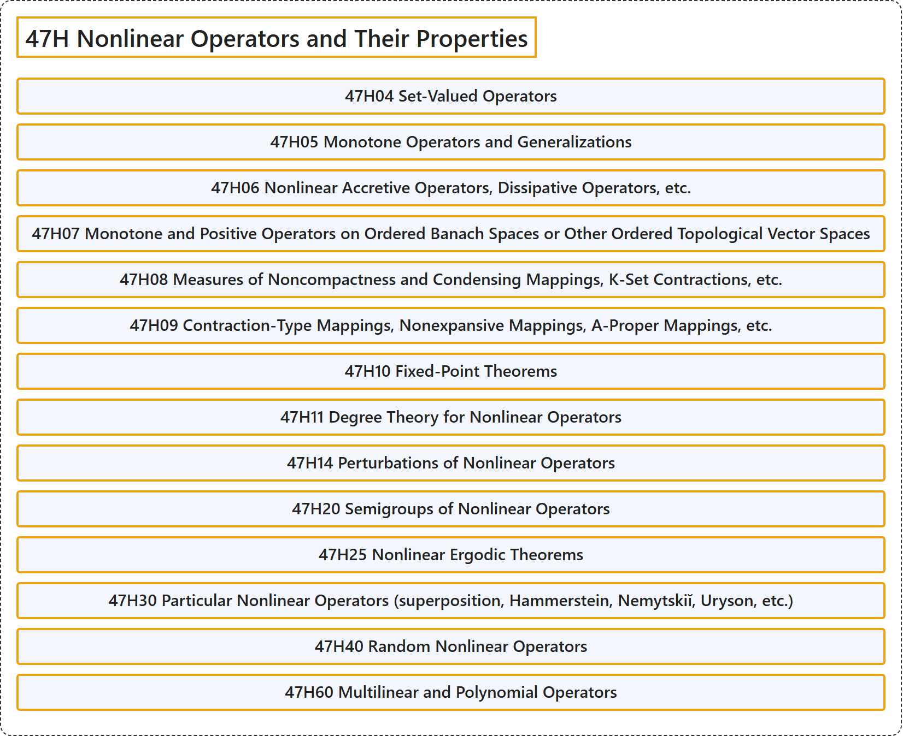

# 47H Nonlinear Operators and Their Properties

## Classification

## Glossary

| Term | Definition | 中文翻译 | Source |
|---|---|---|---|
| **47H Nonlinear Operators and Their Properties** 非线性算子及其性质 | (No definition) | （无定义） | [Associate Editors of Mathematical Reviews and zbMATH, 2020](https://msc2020.org/) |
| **47H04 Set-Valued Operators** 集值算子 | (No definition) | （无定义） | [Associate Editors of Mathematical Reviews and zbMATH, 2020](https://msc2020.org/) |
| **47H05 Monotone Operators and Generalizations** 单调算子及其推广 | (No definition) | （无定义） | [Associate Editors of Mathematical Reviews and zbMATH, 2020](https://msc2020.org/) |
| **47H06 Nonlinear Accretive Operators, Dissipative Operators, etc.** 非线性增生算子、耗散算子等 | (No definition) | （无定义） | [Associate Editors of Mathematical Reviews and zbMATH, 2020](https://msc2020.org/) |
| **47H07 Monotone and Positive Operators on Ordered Banach Spaces or Other Ordered Topological Vector Spaces** 有序巴拿赫空间或其他有序拓扑向量空间上的单调算子与正算子 | (No definition) | （无定义） | [Associate Editors of Mathematical Reviews and zbMATH, 2020](https://msc2020.org/) |
| **47H08 Measures of Noncompactness and Condensing Mappings, K-Set Contractions, etc.** 非紧性测度与凝聚映射、K-集压缩等 | (No definition) | （无定义） | [Associate Editors of Mathematical Reviews and zbMATH, 2020](https://msc2020.org/) |
| **47H09 Contraction-Type Mappings, Nonexpansive Mappings, A-Proper Mappings, etc.** 压缩型映射、非扩张映射、A-真映射等 | (No definition) | （无定义） | [Associate Editors of Mathematical Reviews and zbMATH, 2020](https://msc2020.org/) |
| **47H10 Fixed-Point Theorems** 不动点定理 | (No definition) | （无定义） | [Associate Editors of Mathematical Reviews and zbMATH, 2020](https://msc2020.org/) |
| **47H11 Degree Theory for Nonlinear Operators** 非线性算子的度理论 | (No definition) | （无定义） | [Associate Editors of Mathematical Reviews and zbMATH, 2020](https://msc2020.org/) |
| **47H14 Perturbations of Nonlinear Operators** 非线性算子的扰动 | (No definition) | （无定义） | [Associate Editors of Mathematical Reviews and zbMATH, 2020](https://msc2020.org/) |
| **47H20 Semigroups of Nonlinear Operators** 非线性算子半群 | (No definition) | （无定义） | [Associate Editors of Mathematical Reviews and zbMATH, 2020](https://msc2020.org/) |
| **47H25 Nonlinear Ergodic Theorems** 非线性遍历定理 | (No definition) | （无定义） | [Associate Editors of Mathematical Reviews and zbMATH, 2020](https://msc2020.org/) |
| **47H30 Particular Nonlinear Operators (superposition, Hammerstein, Nemytskiĭ, Uryson, etc.)** 特殊非线性算子（叠加算子、哈默斯坦算子、涅梅茨基算子、乌雷松算子等） | (No definition) | （无定义） | [Associate Editors of Mathematical Reviews and zbMATH, 2020](https://msc2020.org/) |
| **47H40 Random Nonlinear Operators** 随机非线性算子 | (No definition) | （无定义） | [Associate Editors of Mathematical Reviews and zbMATH, 2020](https://msc2020.org/) |
| **47H60 Multilinear and Polynomial Operators** 多重线性算子与多项式算子 | (No definition) | （无定义） | [Associate Editors of Mathematical Reviews and zbMATH, 2020](https://msc2020.org/) |

## References

Associate Editors of Mathematical Reviews and zbMATH. (2020). *MSC2020: Mathematics Subject Classification system*. Retrieved October 27, 2026, from <https://msc2020.org/>
