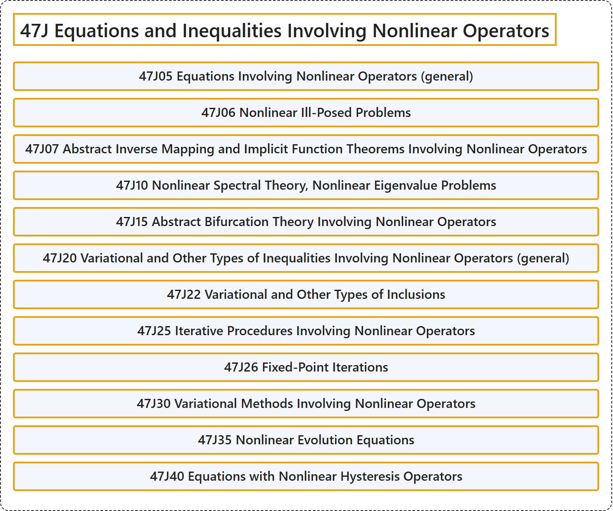

# 47J Equations and Inequalities Involving Nonlinear Operators

## Classification

## Glossary

| Term | Definition | 中文翻译 | Source |
|---|---|---|---|
| **47J Equations and Inequalities Involving Nonlinear Operators** 涉及非线性算子的方程与不等式 | (No definition) | （无定义） | [Associate Editors of Mathematical Reviews and zbMATH, 2020](https://msc2020.org/) |
| **47J05 Equations Involving Nonlinear Operators (general)** 涉及非线性算子的方程（一般） | (No definition) | （无定义） | [Associate Editors of Mathematical Reviews and zbMATH, 2020](https://msc2020.org/) |
| **47J06 Nonlinear Ill-Posed Problems** 非线性不适定问题 | (No definition) | （无定义） | [Associate Editors of Mathematical Reviews and zbMATH, 2020](https://msc2020.org/) |
| **47J07 Abstract Inverse Mapping and Implicit Function Theorems Involving Nonlinear Operators** 涉及非线性算子的抽象反函数定理与隐函数定理 | (No definition) | （无定义） | [Associate Editors of Mathematical Reviews and zbMATH, 2020](https://msc2020.org/) |
| **47J10 Nonlinear Spectral Theory, Nonlinear Eigenvalue Problems** 非线性谱理论、非线性特征值问题 | (No definition) | （无定义） | [Associate Editors of Mathematical Reviews and zbMATH, 2020](https://msc2020.org/) |
| **47J15 Abstract Bifurcation Theory Involving Nonlinear Operators** 涉及非线性算子的抽象分支理论 | (No definition) | （无定义） | [Associate Editors of Mathematical Reviews and zbMATH, 2020](https://msc2020.org/) |
| **47J20 Variational and Other Types of Inequalities Involving Nonlinear Operators (general)** 涉及非线性算子的变分不等式及其他类型的不等式（一般） | (No definition) | （无定义） | [Associate Editors of Mathematical Reviews and zbMATH, 2020](https://msc2020.org/) |
| **47J22 Variational and Other Types of Inclusions** 变分包含及其他类型的包含 | (No definition) | （无定义） | [Associate Editors of Mathematical Reviews and zbMATH, 2020](https://msc2020.org/) |
| **47J25 Iterative Procedures Involving Nonlinear Operators** 涉及非线性算子的迭代程序 | (No definition) | （无定义） | [Associate Editors of Mathematical Reviews and zbMATH, 2020](https://msc2020.org/) |
| **47J26 Fixed-Point Iterations** 不动点迭代 | (No definition) | （无定义） | [Associate Editors of Mathematical Reviews and zbMATH, 2020](https://msc2020.org/) |
| **47J30 Variational Methods Involving Nonlinear Operators** 涉及非线性算子的变分方法 | (No definition) | （无定义） | [Associate Editors of Mathematical Reviews and zbMATH, 2020](https://msc2020.org/) |
| **47J35 Nonlinear Evolution Equations** 非线性发展方程 | (No definition) | （无定义） | [Associate Editors of Mathematical Reviews and zbMATH, 2020](https://msc2020.org/) |
| **47J40 Equations with Nonlinear Hysteresis Operators** 含非线性滞后算子的方程 | (No definition) | （无定义） | [Associate Editors of Mathematical Reviews and zbMATH, 2020](https://msc2020.org/) |

## References

Associate Editors of Mathematical Reviews and zbMATH. (2020). *MSC2020: Mathematics Subject Classification system*. Retrieved October 27, 2026, from <https://msc2020.org/>
