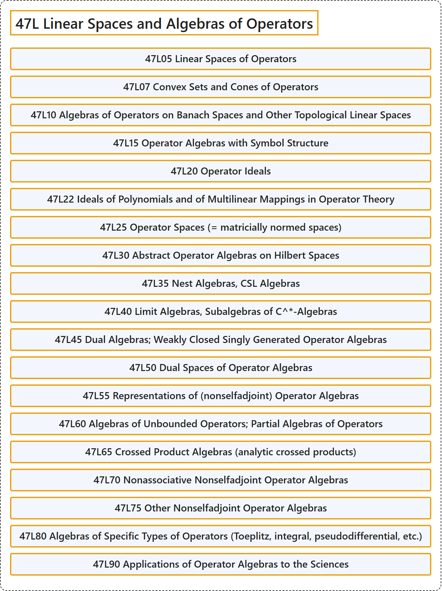

# 47L Linear Spaces and Algebras of Operators

## Classification

## Glossary

| Term | Definition | 中文翻译 | Source |
|---|---|---|---|
| **47L Linear Spaces and Algebras of Operators** 算子的线性空间与代数 | (No definition) | （无定义） | [Associate Editors of Mathematical Reviews and zbMATH, 2020](https://msc2020.org/) |
| **47L05 Linear Spaces of Operators** 算子的线性空间 | (No definition) | （无定义） | [Associate Editors of Mathematical Reviews and zbMATH, 2020](https://msc2020.org/) |
| **47L07 Convex Sets and Cones of Operators** 算子的凸集与锥 | (No definition) | （无定义） | [Associate Editors of Mathematical Reviews and zbMATH, 2020](https://msc2020.org/) |
| **47L10 Algebras of Operators on Banach Spaces and Other Topological Linear Spaces** 巴拿赫空间及其他拓扑线性空间上的算子代数 | (No definition) | （无定义） | [Associate Editors of Mathematical Reviews and zbMATH, 2020](https://msc2020.org/) |
| **47L15 Operator Algebras with Symbol Structure** 具有符号结构的算子代数 | (No definition) | （无定义） | [Associate Editors of Mathematical Reviews and zbMATH, 2020](https://msc2020.org/) |
| **47L20 Operator Ideals** 算子理想 | (No definition) | （无定义） | [Associate Editors of Mathematical Reviews and zbMATH, 2020](https://msc2020.org/) |
| **47L22 Ideals of Polynomials and of Multilinear Mappings in Operator Theory** 算子理论中的多项式理想与多重线性映射理想 | (No definition) | （无定义） | [Associate Editors of Mathematical Reviews and zbMATH, 2020](https://msc2020.org/) |
| **47L25 Operator Spaces (= matricially normed spaces)** 算子空间（= 矩阵赋范空间） | (No definition) | （无定义） | [Associate Editors of Mathematical Reviews and zbMATH, 2020](https://msc2020.org/) |
| **47L30 Abstract Operator Algebras on Hilbert Spaces** 希尔伯特空间上的抽象算子代数 | (No definition) | （无定义） | [Associate Editors of Mathematical Reviews and zbMATH, 2020](https://msc2020.org/) |
| **47L35 Nest Algebras, CSL Algebras** 套代数、CSL 代数 | (No definition) | （无定义） | [Associate Editors of Mathematical Reviews and zbMATH, 2020](https://msc2020.org/) |
| **47L40 Limit Algebras, Subalgebras of C^\*-Algebras** 极限代数、C^* 代数的子代数 | (No definition) | （无定义） | [Associate Editors of Mathematical Reviews and zbMATH, 2020](https://msc2020.org/) |
| **47L45 Dual Algebras; Weakly Closed Singly Generated Operator Algebras** 对偶代数；弱闭单生成算子代数 | (No definition) | （无定义） | [Associate Editors of Mathematical Reviews and zbMATH, 2020](https://msc2020.org/) |
| **47L50 Dual Spaces of Operator Algebras** 算子代数的对偶空间 | (No definition) | （无定义） | [Associate Editors of Mathematical Reviews and zbMATH, 2020](https://msc2020.org/) |
| **47L55 Representations of (nonselfadjoint) Operator Algebras** （非自伴）算子代数的表示 | (No definition) | （无定义） | [Associate Editors of Mathematical Reviews and zbMATH, 2020](https://msc2020.org/) |
| **47L60 Algebras of Unbounded Operators; Partial Algebras of Operators** 无界算子代数；算子的偏代数 | (No definition) | （无定义） | [Associate Editors of Mathematical Reviews and zbMATH, 2020](https://msc2020.org/) |
| **47L65 Crossed Product Algebras (analytic crossed products)** 交叉积代数（解析交叉积） | (No definition) | （无定义） | [Associate Editors of Mathematical Reviews and zbMATH, 2020](https://msc2020.org/) |
| **47L70 Nonassociative Nonselfadjoint Operator Algebras** 非结合非自伴算子代数 | (No definition) | （无定义） | [Associate Editors of Mathematical Reviews and zbMATH, 2020](https://msc2020.org/) |
| **47L75 Other Nonselfadjoint Operator Algebras** 其他非自伴算子代数 | (No definition) | （无定义） | [Associate Editors of Mathematical Reviews and zbMATH, 2020](https://msc2020.org/) |
| **47L80 Algebras of Specific Types of Operators (Toeplitz, integral, pseudodifferential, etc.)** 特定类型算子的代数（特普利茨算子、积分算子、伪微分算子等） | (No definition) | （无定义） | [Associate Editors of Mathematical Reviews and zbMATH, 2020](https://msc2020.org/) |
| **47L90 Applications of Operator Algebras to the Sciences** 算子代数在科学中的应用 | (No definition) | （无定义） | [Associate Editors of Mathematical Reviews and zbMATH, 2020](https://msc2020.org/) |

## References

Associate Editors of Mathematical Reviews and zbMATH. (2020). *MSC2020: Mathematics Subject Classification system*. Retrieved October 27, 2026, from <https://msc2020.org/>
