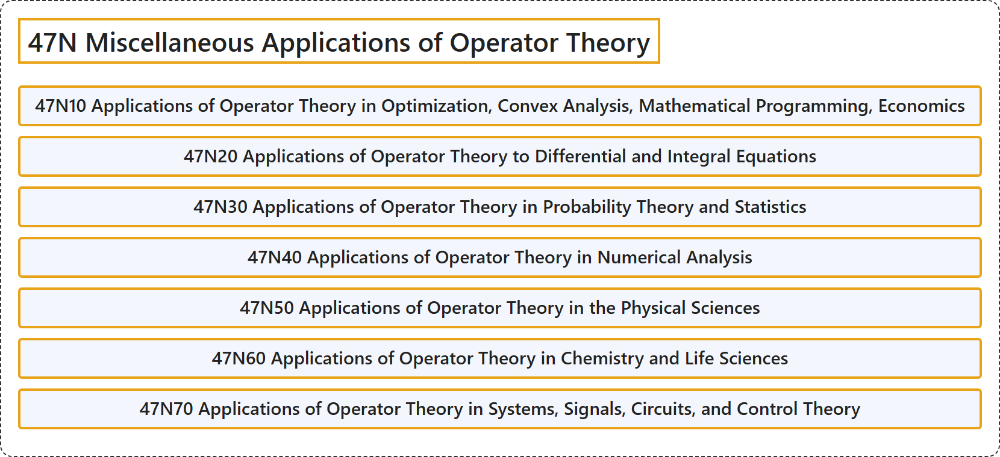

# 47N Miscellaneous Applications of Operator Theory

## Classification

## Glossary

| Term | Definition | 中文翻译 | Source |
|---|---|---|---|
| **47N Miscellaneous Applications of Operator Theory** 算子理论的杂项应用 | (No definition) | （无定义） | [Associate Editors of Mathematical Reviews and zbMATH, 2020](https://msc2020.org/) |
| **47N10 Applications of Operator Theory in Optimization, Convex Analysis, Mathematical Programming, Economics** 算子理论在最优化、凸分析、数学规划、经济学中的应用 | (No definition) | （无定义） | [Associate Editors of Mathematical Reviews and zbMATH, 2020](https://msc2020.org/) |
| **47N20 Applications of Operator Theory to Differential and Integral Equations** 算子理论在微分方程与积分方程中的应用 | (No definition) | （无定义） | [Associate Editors of Mathematical Reviews and zbMATH, 2020](https://msc2020.org/) |
| **47N30 Applications of Operator Theory in Probability Theory and Statistics** 算子理论在概率论与统计学中的应用 | (No definition) | （无定义） | [Associate Editors of Mathematical Reviews and zbMATH, 2020](https://msc2020.org/) |
| **47N40 Applications of Operator Theory in Numerical Analysis** 算子理论在数值分析中的应用 | (No definition) | （无定义） | [Associate Editors of Mathematical Reviews and zbMATH, 2020](https://msc2020.org/) |
| **47N50 Applications of Operator Theory in the Physical Sciences** 算子理论在物理科学中的应用 | (No definition) | （无定义） | [Associate Editors of Mathematical Reviews and zbMATH, 2020](https://msc2020.org/) |
| **47N60 Applications of Operator Theory in Chemistry and Life Sciences** 算子理论在化学与生命科学中的应用 | (No definition) | （无定义） | [Associate Editors of Mathematical Reviews and zbMATH, 2020](https://msc2020.org/) |
| **47N70 Applications of Operator Theory in Systems, Signals, Circuits, and Control Theory** 算子理论在系统、信号、电路与控制论中的应用 | (No definition) | （无定义） | [Associate Editors of Mathematical Reviews and zbMATH, 2020](https://msc2020.org/) |

## References

Associate Editors of Mathematical Reviews and zbMATH. (2020). *MSC2020: Mathematics Subject Classification system*. Retrieved October 27, 2026, from <https://msc2020.org/>
