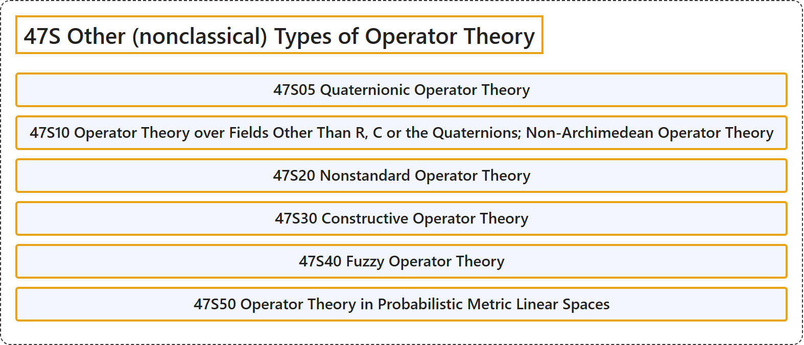

# 47S Other (nonclassical) Types of Operator Theory

## Classification

## Glossary

| Term | Definition | 中文翻译 | Source |
|---|---|---|---|
| **47S Other (nonclassical) Types of Operator Theory** 算子理论的其他（非经典）类型 | (No definition) | （无定义） | [Associate Editors of Mathematical Reviews and zbMATH, 2020](https://msc2020.org/) |
| **47S05 Quaternionic Operator Theory** 四元数算子理论 | (No definition) | （无定义） | [Associate Editors of Mathematical Reviews and zbMATH, 2020](https://msc2020.org/) |
| **47S10 Operator Theory over Fields Other Than R, C or the Quaternions; Non-Archimedean Operator Theory** R、C 或四元数以外的域上的算子理论；非阿基米德算子理论 | (No definition) | （无定义） | [Associate Editors of Mathematical Reviews and zbMATH, 2020](https://msc2020.org/) |
| **47S20 Nonstandard Operator Theory** 非标准算子理论 | (No definition) | （无定义） | [Associate Editors of Mathematical Reviews and zbMATH, 2020](https://msc2020.org/) |
| **47S30 Constructive Operator Theory** 构造性算子理论 | (No definition) | （无定义） | [Associate Editors of Mathematical Reviews and zbMATH, 2020](https://msc2020.org/) |
| **47S40 Fuzzy Operator Theory** 模糊算子理论 | (No definition) | （无定义） | [Associate Editors of Mathematical Reviews and zbMATH, 2020](https://msc2020.org/) |
| **47S50 Operator Theory in Probabilistic Metric Linear Spaces** 概率度量线性空间中的算子理论 | (No definition) | （无定义） | [Associate Editors of Mathematical Reviews and zbMATH, 2020](https://msc2020.org/) |

## References

Associate Editors of Mathematical Reviews and zbMATH. (2020). *MSC2020: Mathematics Subject Classification system*. Retrieved October 27, 2026, from <https://msc2020.org/>
