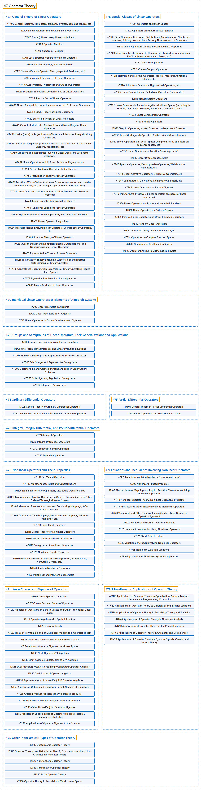

# 47 Operator Theory

## Classification

## Glossary

| Term | Definition | 中文翻译 | Source |
|---|---|---|---|
| **47 Operator Theory** 算子理论 | "Operator theory is a broad area of mathematics connected with **functional analysis, differential equations, index theory, representation theory, and mathematical physics**." | 算子理论是一个广阔的数学领域，与**泛函分析、微分方程、指标理论、表示论和数学物理**相关联。 | [Weisstein, n.d., "Operator theory" entry, para. 1](https://mathworld.wolfram.com/OperatorTheory.html#:~:text=Operator%20theory%20is%20a%20broad%20area%20of%20mathematics) |
| **[47A General Theory of Linear Operators](47a-general-theory-of-linear-operators.md)** 线性算子一般理论 | (No definition) | （无定义） | [Associate Editors of Mathematical Reviews and zbMATH, 2020](https://msc2020.org/) |
| **[47B Special Classes of Linear Operators](47b-special-classes-of-linear-operators.md)** 特殊类线性算子 | (No definition) | （无定义） | [Associate Editors of Mathematical Reviews and zbMATH, 2020](https://msc2020.org/) |
| **[47C Individual Linear Operators as Elements of Algebraic Systems](47c-individual-linear-operators-as-elements-of-algebraic-systems.md)** 作为代数系统元素的个别线性算子 | (No definition) | （无定义） | [Associate Editors of Mathematical Reviews and zbMATH, 2020](https://msc2020.org/) |
| **[47D Groups and Semigroups of Linear Operators, Their Generalizations and Applications](47d-groups-and-semigroups-of-linear-operators-their-generalizati.md)** 线性算子的群与半群、其推广及应用 | (No definition) | （无定义） | [Associate Editors of Mathematical Reviews and zbMATH, 2020](https://msc2020.org/) |
| **[47E Ordinary Differential Operators](47e-ordinary-differential-operators.md)** 常微分算子 | (No definition) | （无定义） | [Associate Editors of Mathematical Reviews and zbMATH, 2020](https://msc2020.org/) |
| **[47F Partial Differential Operators](47f-partial-differential-operators.md)** 偏微分算子 | (No definition) | （无定义） | [Associate Editors of Mathematical Reviews and zbMATH, 2020](https://msc2020.org/) |
| **[47G Integral, Integro-Differential, and Pseudodifferential Operators](47g-integral-integro-differential-and-pseudodifferential-operato.md)** 积分算子、积分微分算子与伪微分算子 | (No definition) | （无定义） | [Associate Editors of Mathematical Reviews and zbMATH, 2020](https://msc2020.org/) |
| **[47H Nonlinear Operators and Their Properties](47h-nonlinear-operators-and-their-properties.md)** 非线性算子及其性质 | (No definition) | （无定义） | [Associate Editors of Mathematical Reviews and zbMATH, 2020](https://msc2020.org/) |
| **[47J Equations and Inequalities Involving Nonlinear Operators](47j-equations-and-inequalities-involving-nonlinear-operators.md)** 涉及非线性算子的方程与不等式 | (No definition) | （无定义） | [Associate Editors of Mathematical Reviews and zbMATH, 2020](https://msc2020.org/) |
| **[47L Linear Spaces and Algebras of Operators](47l-linear-spaces-and-algebras-of-operators.md)** 算子的线性空间与代数 | (No definition) | （无定义） | [Associate Editors of Mathematical Reviews and zbMATH, 2020](https://msc2020.org/) |
| **[47N Miscellaneous Applications of Operator Theory](47n-miscellaneous-applications-of-operator-theory.md)** 算子理论的杂项应用 | (No definition) | （无定义） | [Associate Editors of Mathematical Reviews and zbMATH, 2020](https://msc2020.org/) |
| **[47S Other (nonclassical) Types of Operator Theory](47s-other-nonclassical-types-of-operator-theory.md)** 算子理论的其他（非经典）类型 | (No definition) | （无定义） | [Associate Editors of Mathematical Reviews and zbMATH, 2020](https://msc2020.org/) |

## References

Associate Editors of Mathematical Reviews and zbMATH. (2020). *MSC2020: Mathematics Subject Classification system*. Retrieved October 27, 2026, from <https://msc2020.org/>

Weisstein, E. W. (n.d.). *Operator theory*. MathWorld: A Wolfram Resource. Retrieved October 27, 2026, from <https://mathworld.wolfram.com/OperatorTheory.html>
