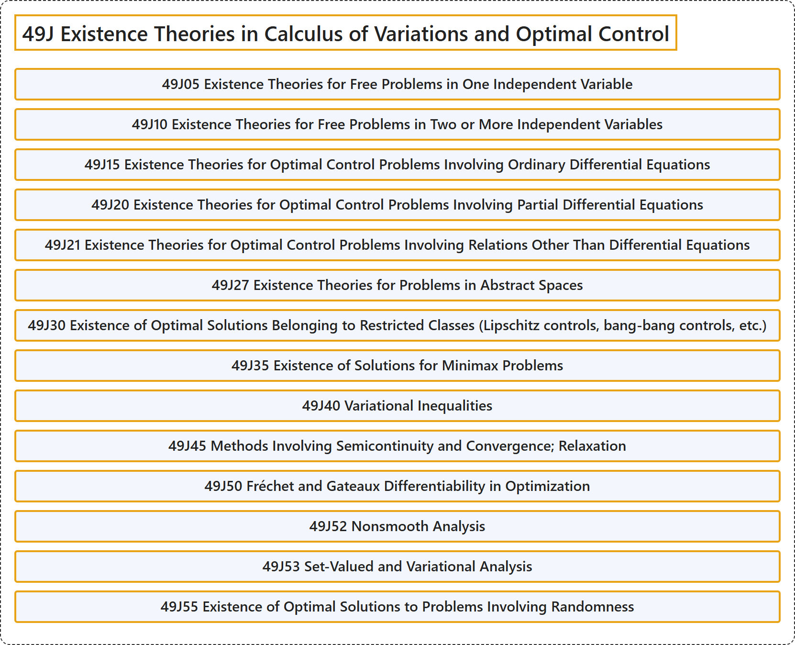

# 49J Existence Theories in Calculus of Variations and Optimal Control

## Classification

## Glossary

| Term | Definition | 中文翻译 | Source |
|---|---|---|---|
| **49J Existence Theories in Calculus of Variations and Optimal Control** 变分法与最优控制中的存在性理论 | (No definition) | （无定义） | [Associate Editors of Mathematical Reviews and zbMATH, 2020](https://msc2020.org/) |
| **49J05 Existence Theories for Free Problems in One Independent Variable** 一个自变量的自由问题的存在性理论 | (No definition) | （无定义） | [Associate Editors of Mathematical Reviews and zbMATH, 2020](https://msc2020.org/) |
| **49J10 Existence Theories for Free Problems in Two or More Independent Variables** 两个或多个自变量的自由问题的存在性理论 | (No definition) | （无定义） | [Associate Editors of Mathematical Reviews and zbMATH, 2020](https://msc2020.org/) |
| **49J15 Existence Theories for Optimal Control Problems Involving Ordinary Differential Equations** 涉及常微分方程的最优控制问题的存在性理论 | (No definition) | （无定义） | [Associate Editors of Mathematical Reviews and zbMATH, 2020](https://msc2020.org/) |
| **49J20 Existence Theories for Optimal Control Problems Involving Partial Differential Equations** 涉及偏微分方程的最优控制问题的存在性理论 | (No definition) | （无定义） | [Associate Editors of Mathematical Reviews and zbMATH, 2020](https://msc2020.org/) |
| **49J21 Existence Theories for Optimal Control Problems Involving Relations Other Than Differential Equations** 涉及微分方程以外关系的最优控制问题的存在性理论 | (No definition) | （无定义） | [Associate Editors of Mathematical Reviews and zbMATH, 2020](https://msc2020.org/) |
| **49J27 Existence Theories for Problems in Abstract Spaces** 抽象空间中问题的存在性理论 | (No definition) | （无定义） | [Associate Editors of Mathematical Reviews and zbMATH, 2020](https://msc2020.org/) |
| **49J30 Existence of Optimal Solutions Belonging to Restricted Classes (Lipschitz controls, bang-bang controls, etc.)** 属于受限类的最优解的存在性（利普希茨控制、砰砰控制等） | (No definition) | （无定义） | [Associate Editors of Mathematical Reviews and zbMATH, 2020](https://msc2020.org/) |
| **49J35 Existence of Solutions for Minimax Problems** 极小极大问题解的存在性 | (No definition) | （无定义） | [Associate Editors of Mathematical Reviews and zbMATH, 2020](https://msc2020.org/) |
| **49J40 Variational Inequalities** 变分不等式 | (No definition) | （无定义） | [Associate Editors of Mathematical Reviews and zbMATH, 2020](https://msc2020.org/) |
| **49J45 Methods Involving Semicontinuity and Convergence; Relaxation** 涉及半连续性与收敛的方法；松弛 | (No definition) | （无定义） | [Associate Editors of Mathematical Reviews and zbMATH, 2020](https://msc2020.org/) |
| **49J50 Fréchet and Gateaux Differentiability in Optimization** 最优化中的弗雷歇可微性与加托可微性 | (No definition) | （无定义） | [Associate Editors of Mathematical Reviews and zbMATH, 2020](https://msc2020.org/) |
| **49J52 Nonsmooth Analysis** 非光滑分析 | (No definition) | （无定义） | [Associate Editors of Mathematical Reviews and zbMATH, 2020](https://msc2020.org/) |
| **49J53 Set-Valued and Variational Analysis** 集值分析与变分分析 | (No definition) | （无定义） | [Associate Editors of Mathematical Reviews and zbMATH, 2020](https://msc2020.org/) |
| **49J55 Existence of Optimal Solutions to Problems Involving Randomness** 涉及随机性的问题的最优解的存在性 | (No definition) | （无定义） | [Associate Editors of Mathematical Reviews and zbMATH, 2020](https://msc2020.org/) |

## References

Associate Editors of Mathematical Reviews and zbMATH. (2020). *MSC2020: Mathematics Subject Classification system*. Retrieved October 27, 2026, from <https://msc2020.org/>
