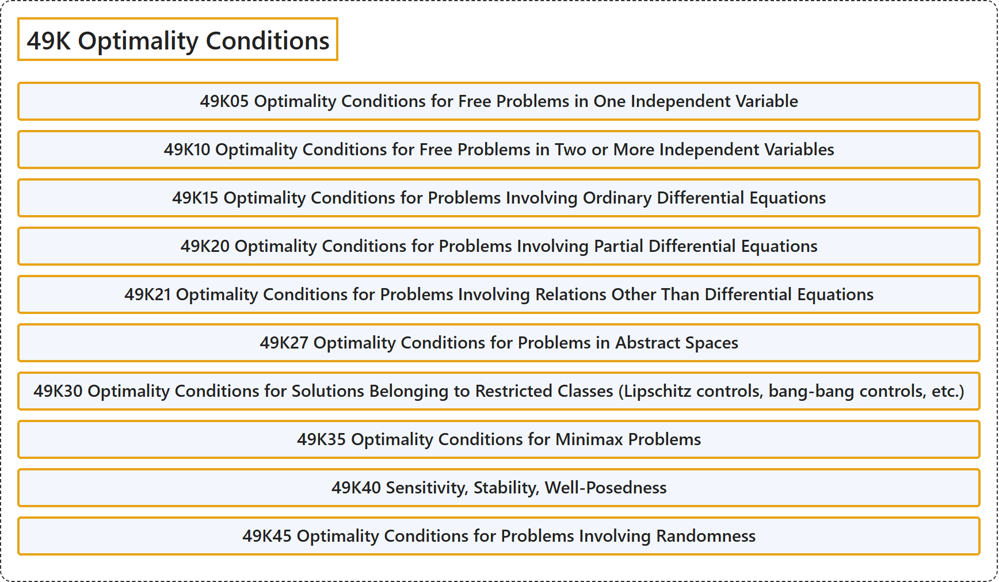

# 49K Optimality Conditions

## Classification

## Glossary

| Term | Definition | 中文翻译 | Source |
|---|---|---|---|
| **49K Optimality Conditions** 最优性条件 | (No definition) | （无定义） | [Associate Editors of Mathematical Reviews and zbMATH, 2020](https://msc2020.org/) |
| **49K05 Optimality Conditions for Free Problems in One Independent Variable** 一个自变量的自由问题的最优性条件 | (No definition) | （无定义） | [Associate Editors of Mathematical Reviews and zbMATH, 2020](https://msc2020.org/) |
| **49K10 Optimality Conditions for Free Problems in Two or More Independent Variables** 两个或多个自变量的自由问题的最优性条件 | (No definition) | （无定义） | [Associate Editors of Mathematical Reviews and zbMATH, 2020](https://msc2020.org/) |
| **49K15 Optimality Conditions for Problems Involving Ordinary Differential Equations** 涉及常微分方程的问题的最优性条件 | (No definition) | （无定义） | [Associate Editors of Mathematical Reviews and zbMATH, 2020](https://msc2020.org/) |
| **49K20 Optimality Conditions for Problems Involving Partial Differential Equations** 涉及偏微分方程的问题的最优性条件 | (No definition) | （无定义） | [Associate Editors of Mathematical Reviews and zbMATH, 2020](https://msc2020.org/) |
| **49K21 Optimality Conditions for Problems Involving Relations Other Than Differential Equations** 涉及微分方程以外关系的问题的最优性条件 | (No definition) | （无定义） | [Associate Editors of Mathematical Reviews and zbMATH, 2020](https://msc2020.org/) |
| **49K27 Optimality Conditions for Problems in Abstract Spaces** 抽象空间中问题的最优性条件 | (No definition) | （无定义） | [Associate Editors of Mathematical Reviews and zbMATH, 2020](https://msc2020.org/) |
| **49K30 Optimality Conditions for Solutions Belonging to Restricted Classes (Lipschitz controls, bang-bang controls, etc.)** 属于受限类的解的最优性条件（利普希茨控制、砰砰控制等） | (No definition) | （无定义） | [Associate Editors of Mathematical Reviews and zbMATH, 2020](https://msc2020.org/) |
| **49K35 Optimality Conditions for Minimax Problems** 极小极大问题的最优性条件 | (No definition) | （无定义） | [Associate Editors of Mathematical Reviews and zbMATH, 2020](https://msc2020.org/) |
| **49K40 Sensitivity, Stability, Well-Posedness** 灵敏度、稳定性、适定性 | (No definition) | （无定义） | [Associate Editors of Mathematical Reviews and zbMATH, 2020](https://msc2020.org/) |
| **49K45 Optimality Conditions for Problems Involving Randomness** 涉及随机性的问题的最优性条件 | (No definition) | （无定义） | [Associate Editors of Mathematical Reviews and zbMATH, 2020](https://msc2020.org/) |

## References

Associate Editors of Mathematical Reviews and zbMATH. (2020). *MSC2020: Mathematics Subject Classification system*. Retrieved October 27, 2026, from <https://msc2020.org/>
