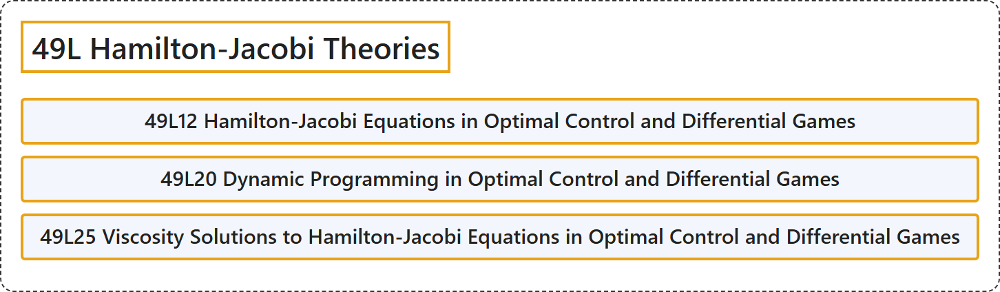

# 49L Hamilton-Jacobi Theories

## Classification

## Glossary

| Term | Definition | 中文翻译 | Source |
|---|---|---|---|
| **49L Hamilton-Jacobi Theories** 哈密顿-雅可比理论 | (No definition) | （无定义） | [Associate Editors of Mathematical Reviews and zbMATH, 2020](https://msc2020.org/) |
| **49L12 Hamilton-Jacobi Equations in Optimal Control and Differential Games** 最优控制与微分对策中的哈密顿-雅可比方程 | (No definition) | （无定义） | [Associate Editors of Mathematical Reviews and zbMATH, 2020](https://msc2020.org/) |
| **49L20 Dynamic Programming in Optimal Control and Differential Games** 最优控制与微分对策中的动态规划 | (No definition) | （无定义） | [Associate Editors of Mathematical Reviews and zbMATH, 2020](https://msc2020.org/) |
| **49L25 Viscosity Solutions to Hamilton-Jacobi Equations in Optimal Control and Differential Games** 最优控制与微分对策中哈密顿-雅可比方程的粘性解 | (No definition) | （无定义） | [Associate Editors of Mathematical Reviews and zbMATH, 2020](https://msc2020.org/) |

## References

Associate Editors of Mathematical Reviews and zbMATH. (2020). *MSC2020: Mathematics Subject Classification system*. Retrieved October 27, 2026, from <https://msc2020.org/>
