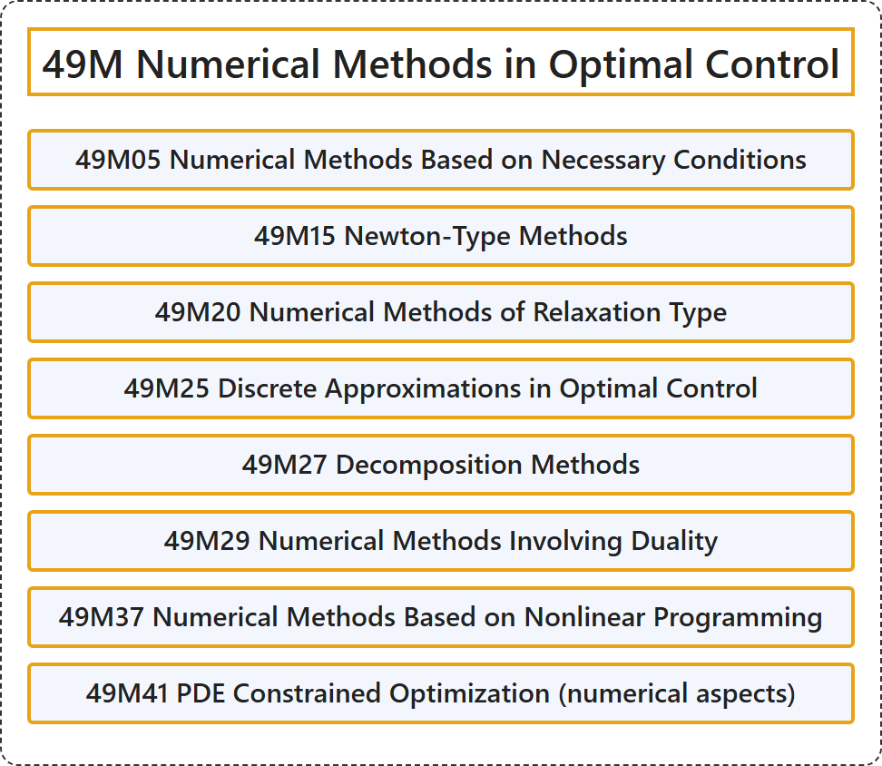

# 49M Numerical Methods in Optimal Control

## Classification

## Glossary

| Term | Definition | 中文翻译 | Source |
|---|---|---|---|
| **49M Numerical Methods in Optimal Control** 最优控制中的数值方法 | (No definition) | （无定义） | [Associate Editors of Mathematical Reviews and zbMATH, 2020](https://msc2020.org/) |
| **49M05 Numerical Methods Based on Necessary Conditions** 基于必要条件的数值方法 | (No definition) | （无定义） | [Associate Editors of Mathematical Reviews and zbMATH, 2020](https://msc2020.org/) |
| **49M15 Newton-Type Methods** 牛顿型方法 | (No definition) | （无定义） | [Associate Editors of Mathematical Reviews and zbMATH, 2020](https://msc2020.org/) |
| **49M20 Numerical Methods of Relaxation Type** 松弛型数值方法 | (No definition) | （无定义） | [Associate Editors of Mathematical Reviews and zbMATH, 2020](https://msc2020.org/) |
| **49M25 Discrete Approximations in Optimal Control** 最优控制中的离散逼近 | (No definition) | （无定义） | [Associate Editors of Mathematical Reviews and zbMATH, 2020](https://msc2020.org/) |
| **49M27 Decomposition Methods** 分解方法 | (No definition) | （无定义） | [Associate Editors of Mathematical Reviews and zbMATH, 2020](https://msc2020.org/) |
| **49M29 Numerical Methods Involving Duality** 涉及对偶的数值方法 | (No definition) | （无定义） | [Associate Editors of Mathematical Reviews and zbMATH, 2020](https://msc2020.org/) |
| **49M37 Numerical Methods Based on Nonlinear Programming** 基于非线性规划的数值方法 | (No definition) | （无定义） | [Associate Editors of Mathematical Reviews and zbMATH, 2020](https://msc2020.org/) |
| **49M41 PDE Constrained Optimization (numerical aspects)** PDE 约束优化（数值方面） | (No definition) | （无定义） | [Associate Editors of Mathematical Reviews and zbMATH, 2020](https://msc2020.org/) |

## References

Associate Editors of Mathematical Reviews and zbMATH. (2020). *MSC2020: Mathematics Subject Classification system*. Retrieved October 27, 2026, from <https://msc2020.org/>
