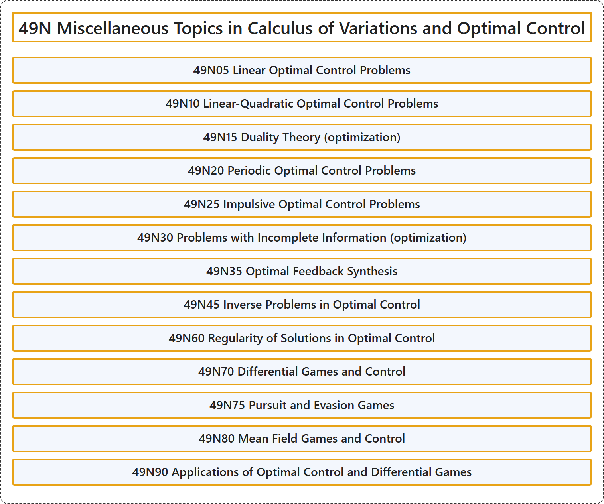

# 49N Miscellaneous Topics in Calculus of Variations and Optimal Control

## Classification

## Glossary

| Term | Definition | 中文翻译 | Source |
|---|---|---|---|
| **49N Miscellaneous Topics in Calculus of Variations and Optimal Control** 变分法与最优控制的杂项专题 | (No definition) | （无定义） | [Associate Editors of Mathematical Reviews and zbMATH, 2020](https://msc2020.org/) |
| **49N05 Linear Optimal Control Problems** 线性最优控制问题 | (No definition) | （无定义） | [Associate Editors of Mathematical Reviews and zbMATH, 2020](https://msc2020.org/) |
| **49N10 Linear-Quadratic Optimal Control Problems** 线性二次最优控制问题 | (No definition) | （无定义） | [Associate Editors of Mathematical Reviews and zbMATH, 2020](https://msc2020.org/) |
| **49N15 Duality Theory (optimization)** 对偶理论（最优化） | (No definition) | （无定义） | [Associate Editors of Mathematical Reviews and zbMATH, 2020](https://msc2020.org/) |
| **49N20 Periodic Optimal Control Problems** 周期最优控制问题 | (No definition) | （无定义） | [Associate Editors of Mathematical Reviews and zbMATH, 2020](https://msc2020.org/) |
| **49N25 Impulsive Optimal Control Problems** 脉冲最优控制问题 | (No definition) | （无定义） | [Associate Editors of Mathematical Reviews and zbMATH, 2020](https://msc2020.org/) |
| **49N30 Problems with Incomplete Information (optimization)** 不完全信息问题（最优化） | (No definition) | （无定义） | [Associate Editors of Mathematical Reviews and zbMATH, 2020](https://msc2020.org/) |
| **49N35 Optimal Feedback Synthesis** 最优反馈综合 | (No definition) | （无定义） | [Associate Editors of Mathematical Reviews and zbMATH, 2020](https://msc2020.org/) |
| **49N45 Inverse Problems in Optimal Control** 最优控制中的反问题 | (No definition) | （无定义） | [Associate Editors of Mathematical Reviews and zbMATH, 2020](https://msc2020.org/) |
| **49N60 Regularity of Solutions in Optimal Control** 最优控制中解的正则性 | (No definition) | （无定义） | [Associate Editors of Mathematical Reviews and zbMATH, 2020](https://msc2020.org/) |
| **49N70 Differential Games and Control** 微分对策与控制 | (No definition) | （无定义） | [Associate Editors of Mathematical Reviews and zbMATH, 2020](https://msc2020.org/) |
| **49N75 Pursuit and Evasion Games** 追逐与逃避对策 | (No definition) | （无定义） | [Associate Editors of Mathematical Reviews and zbMATH, 2020](https://msc2020.org/) |
| **49N80 Mean Field Games and Control** 平均场对策与控制 | (No definition) | （无定义） | [Associate Editors of Mathematical Reviews and zbMATH, 2020](https://msc2020.org/) |
| **49N90 Applications of Optimal Control and Differential Games** 最优控制与微分对策的应用 | (No definition) | （无定义） | [Associate Editors of Mathematical Reviews and zbMATH, 2020](https://msc2020.org/) |

## References

Associate Editors of Mathematical Reviews and zbMATH. (2020). *MSC2020: Mathematics Subject Classification system*. Retrieved October 27, 2026, from <https://msc2020.org/>
