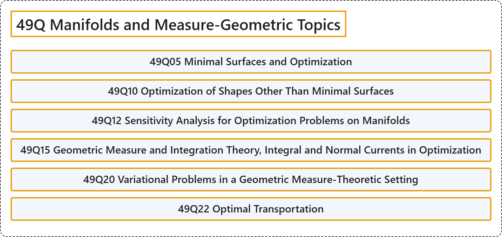

# 49Q Manifolds and Measure-Geometric Topics

## Classification

## Glossary

| Term | Definition | 中文翻译 | Source |
|---|---|---|---|
| **49Q Manifolds and Measure-Geometric Topics** 流形与几何测度论专题 | (No definition) | （无定义） | [Associate Editors of Mathematical Reviews and zbMATH, 2020](https://msc2020.org/) |
| **49Q05 Minimal Surfaces and Optimization** 极小曲面与最优化 | (No definition) | （无定义） | [Associate Editors of Mathematical Reviews and zbMATH, 2020](https://msc2020.org/) |
| **49Q10 Optimization of Shapes Other Than Minimal Surfaces** 极小曲面以外的形状优化 | (No definition) | （无定义） | [Associate Editors of Mathematical Reviews and zbMATH, 2020](https://msc2020.org/) |
| **49Q12 Sensitivity Analysis for Optimization Problems on Manifolds** 流形上最优化问题的灵敏度分析 | (No definition) | （无定义） | [Associate Editors of Mathematical Reviews and zbMATH, 2020](https://msc2020.org/) |
| **49Q15 Geometric Measure and Integration Theory, Integral and Normal Currents in Optimization** 最优化中的几何测度与积分理论、积分流与正规流 | (No definition) | （无定义） | [Associate Editors of Mathematical Reviews and zbMATH, 2020](https://msc2020.org/) |
| **49Q20 Variational Problems in a Geometric Measure-Theoretic Setting** 几何测度论背景下的变分问题 | (No definition) | （无定义） | [Associate Editors of Mathematical Reviews and zbMATH, 2020](https://msc2020.org/) |
| **49Q22 Optimal Transportation** 最优运输 | (No definition) | （无定义） | [Associate Editors of Mathematical Reviews and zbMATH, 2020](https://msc2020.org/) |

## References

Associate Editors of Mathematical Reviews and zbMATH. (2020). *MSC2020: Mathematics Subject Classification system*. Retrieved October 27, 2026, from <https://msc2020.org/>
