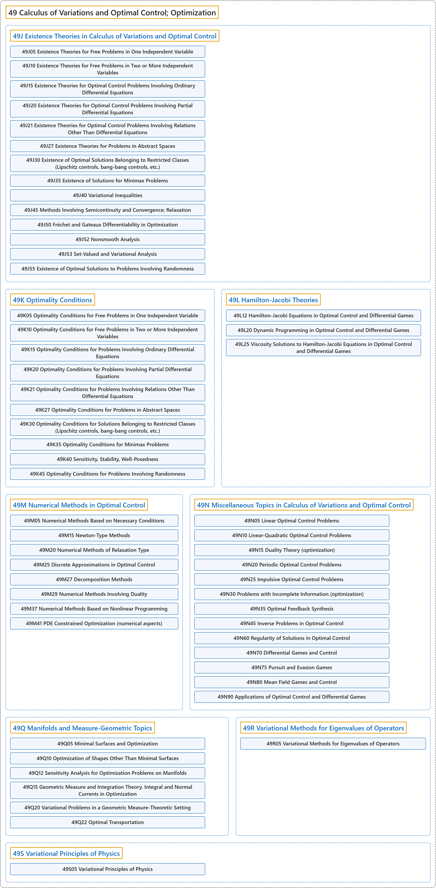

# 49 Calculus of Variations and Optimal Control; Optimization

## Classification

## Glossary

| Term | Definition | 中文翻译 | Source |
|---|---|---|---|
| **49 Calculus of Variations and Optimal Control; Optimization** 变分法与最优控制；最优化 | "Calculus of variations seeks to find **the path, curve, surface, etc., for which a given functional has a stationary value** (which, in physical problems, is usually a minimum or maximum)." | 变分法寻找**使给定泛函取驻值的路径、曲线、曲面等**（在物理问题中通常是极小值或极大值）。 | [Weisstein, n.d., "Calculus of variations" entry, para. 1](https://mathworld.wolfram.com/CalculusofVariations.html#:~:text=Calculus%20of%20variations%20seeks%20to%20find%20the%20path) |
| **[49J Existence Theories in Calculus of Variations and Optimal Control](49j-existence-theories-in-calculus-of-variations-and-optimal-con.md)** 变分法与最优控制中的存在性理论 | (No definition) | （无定义） | [Associate Editors of Mathematical Reviews and zbMATH, 2020](https://msc2020.org/) |
| **[49K Optimality Conditions](49k-optimality-conditions.md)** 最优性条件 | (No definition) | （无定义） | [Associate Editors of Mathematical Reviews and zbMATH, 2020](https://msc2020.org/) |
| **[49L Hamilton-Jacobi Theories](49l-hamilton-jacobi-theories.md)** 哈密顿-雅可比理论 | (No definition) | （无定义） | [Associate Editors of Mathematical Reviews and zbMATH, 2020](https://msc2020.org/) |
| **[49M Numerical Methods in Optimal Control](49m-numerical-methods-in-optimal-control.md)** 最优控制中的数值方法 | (No definition) | （无定义） | [Associate Editors of Mathematical Reviews and zbMATH, 2020](https://msc2020.org/) |
| **[49N Miscellaneous Topics in Calculus of Variations and Optimal Control](49n-miscellaneous-topics-in-calculus-of-variations-and-optimal-c.md)** 变分法与最优控制的杂项专题 | (No definition) | （无定义） | [Associate Editors of Mathematical Reviews and zbMATH, 2020](https://msc2020.org/) |
| **[49Q Manifolds and Measure-Geometric Topics](49q-manifolds-and-measure-geometric-topics.md)** 流形与几何测度论专题 | (No definition) | （无定义） | [Associate Editors of Mathematical Reviews and zbMATH, 2020](https://msc2020.org/) |
| **[49R Variational Methods for Eigenvalues of Operators](49r-variational-methods-for-eigenvalues-of-operators.md)** 算子特征值的变分方法 | (No definition) | （无定义） | [Associate Editors of Mathematical Reviews and zbMATH, 2020](https://msc2020.org/) |
| **[49S Variational Principles of Physics](49s-variational-principles-of-physics.md)** 物理学的变分原理 | (No definition) | （无定义） | [Associate Editors of Mathematical Reviews and zbMATH, 2020](https://msc2020.org/) |

## References

Associate Editors of Mathematical Reviews and zbMATH. (2020). *MSC2020: Mathematics Subject Classification system*. Retrieved October 27, 2026, from <https://msc2020.org/>

Weisstein, E. W. (n.d.). *Calculus of variations*. MathWorld: A Wolfram Resource. Retrieved October 27, 2026, from <https://mathworld.wolfram.com/CalculusofVariations.html>
