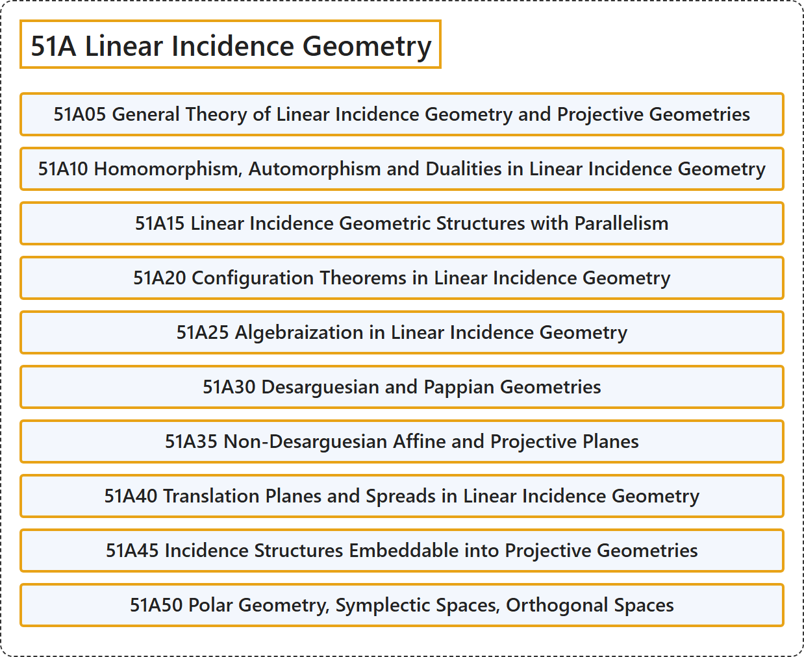

# 51A Linear Incidence Geometry

## Classification

## Glossary

| Term | Definition | 中文翻译 | Source |
|---|---|---|---|
| **51A Linear Incidence Geometry** 线性关联几何 | (No definition) | （无定义） | [Associate Editors of Mathematical Reviews and zbMATH, 2020](https://msc2020.org/) |
| **51A05 General Theory of Linear Incidence Geometry and Projective Geometries** 线性关联几何与射影几何的一般理论 | (No definition) | （无定义） | [Associate Editors of Mathematical Reviews and zbMATH, 2020](https://msc2020.org/) |
| **51A10 Homomorphism, Automorphism and Dualities in Linear Incidence Geometry** 线性关联几何中的同态、自同构与对偶 | (No definition) | （无定义） | [Associate Editors of Mathematical Reviews and zbMATH, 2020](https://msc2020.org/) |
| **51A15 Linear Incidence Geometric Structures with Parallelism** 具有平行性的线性关联几何结构 | (No definition) | （无定义） | [Associate Editors of Mathematical Reviews and zbMATH, 2020](https://msc2020.org/) |
| **51A20 Configuration Theorems in Linear Incidence Geometry** 线性关联几何中的构形定理 | (No definition) | （无定义） | [Associate Editors of Mathematical Reviews and zbMATH, 2020](https://msc2020.org/) |
| **51A25 Algebraization in Linear Incidence Geometry** 线性关联几何中的代数化 | (No definition) | （无定义） | [Associate Editors of Mathematical Reviews and zbMATH, 2020](https://msc2020.org/) |
| **51A30 Desarguesian and Pappian Geometries** 德沙格几何与帕普斯几何 | (No definition) | （无定义） | [Associate Editors of Mathematical Reviews and zbMATH, 2020](https://msc2020.org/) |
| **51A35 Non-Desarguesian Affine and Projective Planes** 非德沙格仿射平面与射影平面 | (No definition) | （无定义） | [Associate Editors of Mathematical Reviews and zbMATH, 2020](https://msc2020.org/) |
| **51A40 Translation Planes and Spreads in Linear Incidence Geometry** 线性关联几何中的平移平面与拟扇 | (No definition) | （无定义） | [Associate Editors of Mathematical Reviews and zbMATH, 2020](https://msc2020.org/) |
| **51A45 Incidence Structures Embeddable into Projective Geometries** 可嵌入射影几何的关联结构 | (No definition) | （无定义） | [Associate Editors of Mathematical Reviews and zbMATH, 2020](https://msc2020.org/) |
| **51A50 Polar Geometry, Symplectic Spaces, Orthogonal Spaces** 极几何、辛空间、正交空间 | (No definition) | （无定义） | [Associate Editors of Mathematical Reviews and zbMATH, 2020](https://msc2020.org/) |

## References

Associate Editors of Mathematical Reviews and zbMATH. (2020). *MSC2020: Mathematics Subject Classification system*. Retrieved October 27, 2026, from <https://msc2020.org/>
