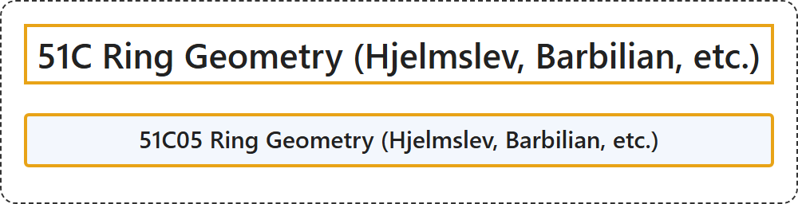

# 51C Ring Geometry (Hjelmslev, Barbilian, etc.)

## Classification

## Glossary

| Term | Definition | 中文翻译 | Source |
|---|---|---|---|
| **51C Ring Geometry (Hjelmslev, Barbilian, etc.)** 环几何（Hjelmslev、Barbilian 等） | (No definition) | （无定义） | [Associate Editors of Mathematical Reviews and zbMATH, 2020](https://msc2020.org/) |
| **51C05 Ring Geometry (Hjelmslev, Barbilian, etc.)** 环几何（Hjelmslev、Barbilian 等） | (No definition) | （无定义） | [Associate Editors of Mathematical Reviews and zbMATH, 2020](https://msc2020.org/) |

## References

Associate Editors of Mathematical Reviews and zbMATH. (2020). *MSC2020: Mathematics Subject Classification system*. Retrieved October 27, 2026, from <https://msc2020.org/>
