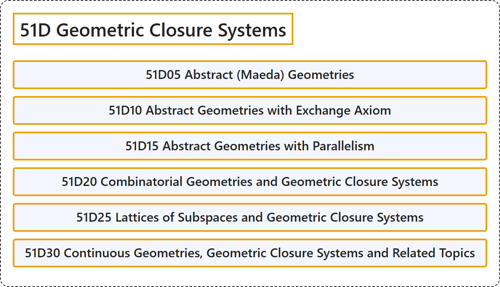

# 51D Geometric Closure Systems

## Classification

## Glossary

| Term | Definition | 中文翻译 | Source |
|---|---|---|---|
| **51D Geometric Closure Systems** 几何闭包系统 | (No definition) | （无定义） | [Associate Editors of Mathematical Reviews and zbMATH, 2020](https://msc2020.org/) |
| **51D05 Abstract (Maeda) Geometries** 抽象（前田）几何 | (No definition) | （无定义） | [Associate Editors of Mathematical Reviews and zbMATH, 2020](https://msc2020.org/) |
| **51D10 Abstract Geometries with Exchange Axiom** 具有交换公理的抽象几何 | (No definition) | （无定义） | [Associate Editors of Mathematical Reviews and zbMATH, 2020](https://msc2020.org/) |
| **51D15 Abstract Geometries with Parallelism** 具有平行性的抽象几何 | (No definition) | （无定义） | [Associate Editors of Mathematical Reviews and zbMATH, 2020](https://msc2020.org/) |
| **51D20 Combinatorial Geometries and Geometric Closure Systems** 组合几何与几何闭包系统 | (No definition) | （无定义） | [Associate Editors of Mathematical Reviews and zbMATH, 2020](https://msc2020.org/) |
| **51D25 Lattices of Subspaces and Geometric Closure Systems** 子空间格与几何闭包系统 | (No definition) | （无定义） | [Associate Editors of Mathematical Reviews and zbMATH, 2020](https://msc2020.org/) |
| **51D30 Continuous Geometries, Geometric Closure Systems and Related Topics** 连续几何、几何闭包系统及相关主题 | (No definition) | （无定义） | [Associate Editors of Mathematical Reviews and zbMATH, 2020](https://msc2020.org/) |

## References

Associate Editors of Mathematical Reviews and zbMATH. (2020). *MSC2020: Mathematics Subject Classification system*. Retrieved October 27, 2026, from <https://msc2020.org/>
