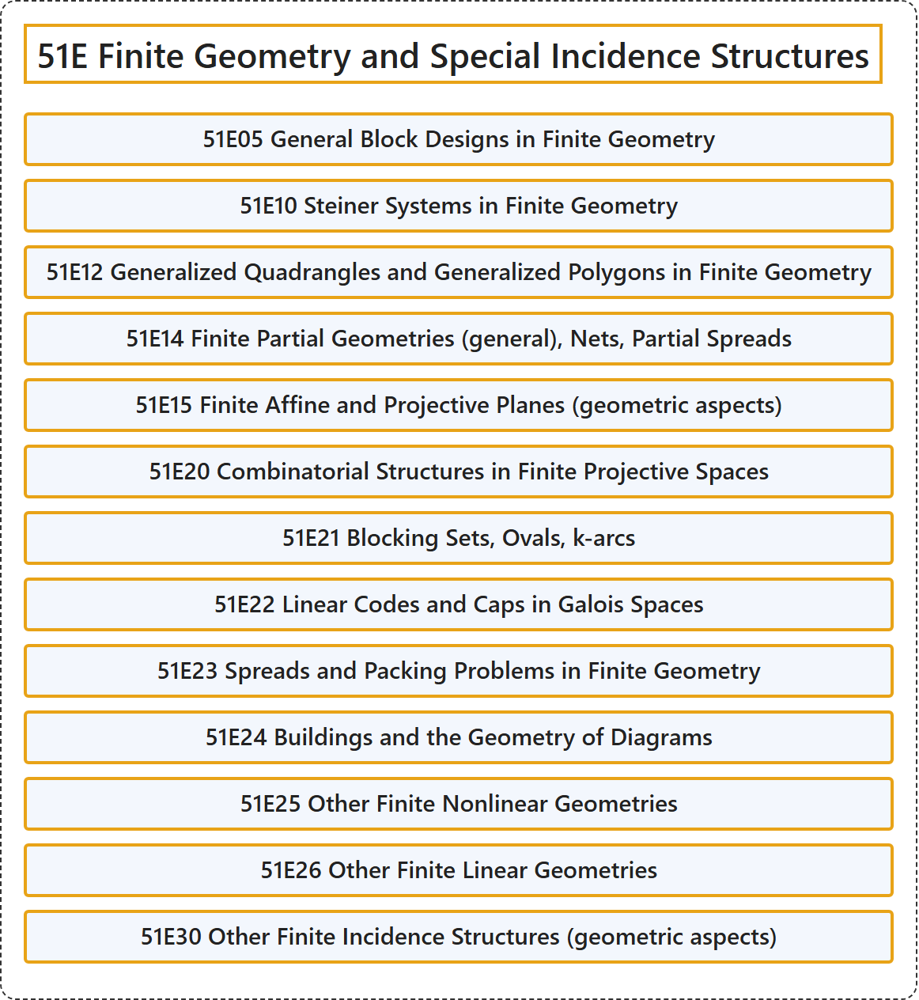

# 51E Finite Geometry and Special Incidence Structures

## Classification

## Glossary

| Term | Definition | 中文翻译 | Source |
|---|---|---|---|
| **51E Finite Geometry and Special Incidence Structures** 有限几何与特殊关联结构 | (No definition) | （无定义） | [Associate Editors of Mathematical Reviews and zbMATH, 2020](https://msc2020.org/) |
| **51E05 General Block Designs in Finite Geometry** 有限几何中的一般区组设计 | (No definition) | （无定义） | [Associate Editors of Mathematical Reviews and zbMATH, 2020](https://msc2020.org/) |
| **51E10 Steiner Systems in Finite Geometry** 有限几何中的施泰纳系 | (No definition) | （无定义） | [Associate Editors of Mathematical Reviews and zbMATH, 2020](https://msc2020.org/) |
| **51E12 Generalized Quadrangles and Generalized Polygons in Finite Geometry** 有限几何中的广义四边形与广义多边形 | (No definition) | （无定义） | [Associate Editors of Mathematical Reviews and zbMATH, 2020](https://msc2020.org/) |
| **51E14 Finite Partial Geometries (general), Nets, Partial Spreads** 有限偏几何（一般）、网、偏拟扇 | (No definition) | （无定义） | [Associate Editors of Mathematical Reviews and zbMATH, 2020](https://msc2020.org/) |
| **51E15 Finite Affine and Projective Planes (geometric aspects)** 有限仿射平面与射影平面（几何方面） | (No definition) | （无定义） | [Associate Editors of Mathematical Reviews and zbMATH, 2020](https://msc2020.org/) |
| **51E20 Combinatorial Structures in Finite Projective Spaces** 有限射影空间中的组合结构 | (No definition) | （无定义） | [Associate Editors of Mathematical Reviews and zbMATH, 2020](https://msc2020.org/) |
| **51E21 Blocking Sets, Ovals, k-arcs** 阻塞集、卵形线、k-弧 | (No definition) | （无定义） | [Associate Editors of Mathematical Reviews and zbMATH, 2020](https://msc2020.org/) |
| **51E22 Linear Codes and Caps in Galois Spaces** 伽罗瓦空间中的线性码与帽 | (No definition) | （无定义） | [Associate Editors of Mathematical Reviews and zbMATH, 2020](https://msc2020.org/) |
| **51E23 Spreads and Packing Problems in Finite Geometry** 有限几何中的拟扇与堆积问题 | (No definition) | （无定义） | [Associate Editors of Mathematical Reviews and zbMATH, 2020](https://msc2020.org/) |
| **51E24 Buildings and the Geometry of Diagrams** 建筑与图的几何 | (No definition) | （无定义） | [Associate Editors of Mathematical Reviews and zbMATH, 2020](https://msc2020.org/) |
| **51E25 Other Finite Nonlinear Geometries** 其他有限非线性几何 | (No definition) | （无定义） | [Associate Editors of Mathematical Reviews and zbMATH, 2020](https://msc2020.org/) |
| **51E26 Other Finite Linear Geometries** 其他有限线性几何 | (No definition) | （无定义） | [Associate Editors of Mathematical Reviews and zbMATH, 2020](https://msc2020.org/) |
| **51E30 Other Finite Incidence Structures (geometric aspects)** 其他有限关联结构（几何方面） | (No definition) | （无定义） | [Associate Editors of Mathematical Reviews and zbMATH, 2020](https://msc2020.org/) |

## References

Associate Editors of Mathematical Reviews and zbMATH. (2020). *MSC2020: Mathematics Subject Classification system*. Retrieved October 27, 2026, from <https://msc2020.org/>
