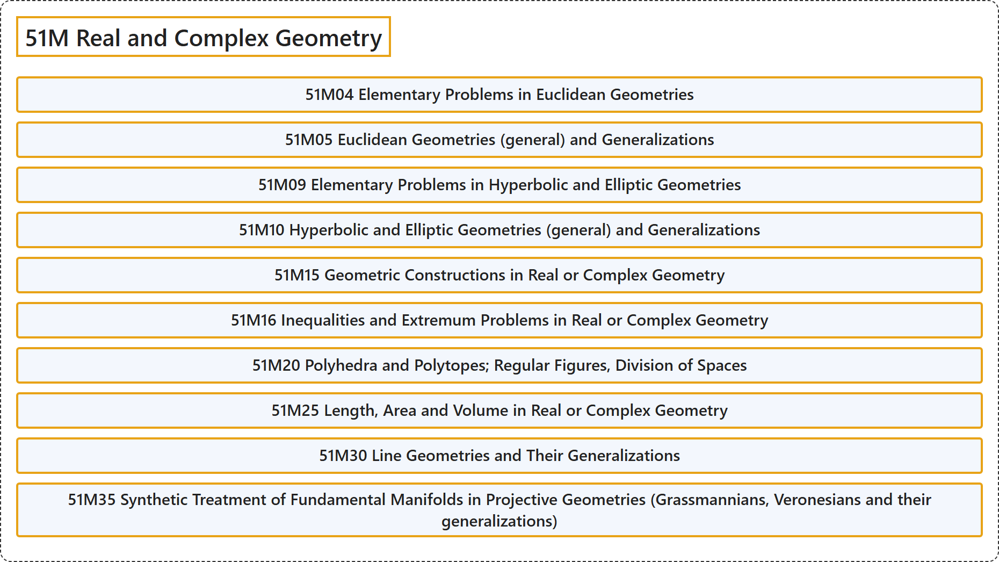

# 51M Real and Complex Geometry

## Classification

## Glossary

| Term | Definition | 中文翻译 | Source |
|---|---|---|---|
| **51M Real and Complex Geometry** 实几何与复几何 | (No definition) | （无定义） | [Associate Editors of Mathematical Reviews and zbMATH, 2020](https://msc2020.org/) |
| **51M04 Elementary Problems in Euclidean Geometries** 欧几里得几何中的初等问题 | (No definition) | （无定义） | [Associate Editors of Mathematical Reviews and zbMATH, 2020](https://msc2020.org/) |
| **51M05 Euclidean Geometries (general) and Generalizations** 欧几里得几何（一般）及其推广 | (No definition) | （无定义） | [Associate Editors of Mathematical Reviews and zbMATH, 2020](https://msc2020.org/) |
| **51M09 Elementary Problems in Hyperbolic and Elliptic Geometries** 双曲几何与椭圆几何中的初等问题 | (No definition) | （无定义） | [Associate Editors of Mathematical Reviews and zbMATH, 2020](https://msc2020.org/) |
| **51M10 Hyperbolic and Elliptic Geometries (general) and Generalizations** 双曲几何与椭圆几何（一般）及其推广 | (No definition) | （无定义） | [Associate Editors of Mathematical Reviews and zbMATH, 2020](https://msc2020.org/) |
| **51M15 Geometric Constructions in Real or Complex Geometry** 实几何或复几何中的几何作图 | (No definition) | （无定义） | [Associate Editors of Mathematical Reviews and zbMATH, 2020](https://msc2020.org/) |
| **51M16 Inequalities and Extremum Problems in Real or Complex Geometry** 实几何或复几何中的不等式与极值问题 | (No definition) | （无定义） | [Associate Editors of Mathematical Reviews and zbMATH, 2020](https://msc2020.org/) |
| **51M20 Polyhedra and Polytopes; Regular Figures, Division of Spaces** 多面体与多胞形；正则图形、空间的划分 | (No definition) | （无定义） | [Associate Editors of Mathematical Reviews and zbMATH, 2020](https://msc2020.org/) |
| **51M25 Length, Area and Volume in Real or Complex Geometry** 实几何或复几何中的长度、面积与体积 | (No definition) | （无定义） | [Associate Editors of Mathematical Reviews and zbMATH, 2020](https://msc2020.org/) |
| **51M30 Line Geometries and Their Generalizations** 线几何及其推广 | (No definition) | （无定义） | [Associate Editors of Mathematical Reviews and zbMATH, 2020](https://msc2020.org/) |
| **51M35 Synthetic Treatment of Fundamental Manifolds in Projective Geometries (Grassmannians, Veronesians and their generalizations)** 射影几何中基本流形的综合处理（格拉斯曼流形、韦罗内塞流形及其推广） | (No definition) | （无定义） | [Associate Editors of Mathematical Reviews and zbMATH, 2020](https://msc2020.org/) |

## References

Associate Editors of Mathematical Reviews and zbMATH. (2020). *MSC2020: Mathematics Subject Classification system*. Retrieved October 27, 2026, from <https://msc2020.org/>
