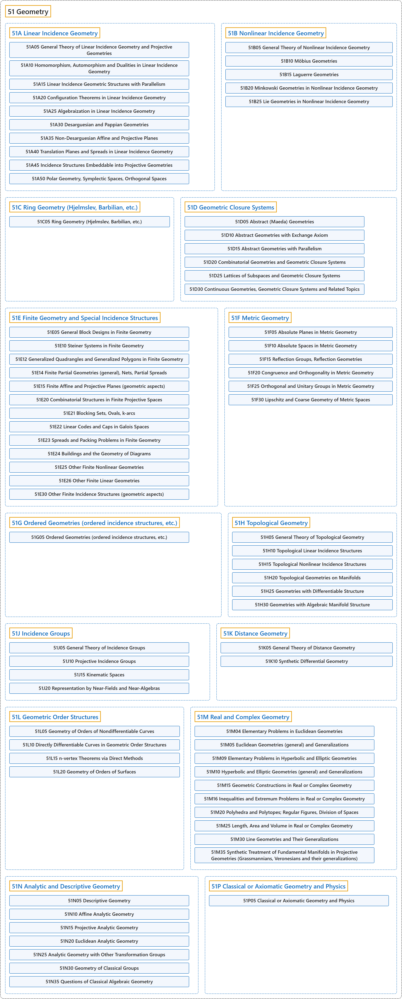

# 51 Geometry

## Classification

## Glossary

| Term | Definition | 中文翻译 | Source |
|---|---|---|---|
| **51 Geometry** 几何 | "Geometry is the study of **figures in a space of a given number of dimensions and of a given type**." | 几何研究**给定维数、给定类型的空间中的图形**。 | [Weisstein, n.d., "Geometry" entry, para. 1](https://mathworld.wolfram.com/Geometry.html#:~:text=Geometry%20is%20the%20study%20of%20figures%20in%20a%20space) |
| **[51A Linear Incidence Geometry](51a-linear-incidence-geometry.md)** 线性关联几何 | (No definition) | （无定义） | [Associate Editors of Mathematical Reviews and zbMATH, 2020](https://msc2020.org/) |
| **[51B Nonlinear Incidence Geometry](51b-nonlinear-incidence-geometry.md)** 非线性关联几何 | (No definition) | （无定义） | [Associate Editors of Mathematical Reviews and zbMATH, 2020](https://msc2020.org/) |
| **[51C Ring Geometry (Hjelmslev, Barbilian, etc.)](51c-ring-geometry-hjelmslev-barbilian-etc.md)** 环几何（Hjelmslev、Barbilian 等） | (No definition) | （无定义） | [Associate Editors of Mathematical Reviews and zbMATH, 2020](https://msc2020.org/) |
| **[51D Geometric Closure Systems](51d-geometric-closure-systems.md)** 几何闭包系统 | (No definition) | （无定义） | [Associate Editors of Mathematical Reviews and zbMATH, 2020](https://msc2020.org/) |
| **[51E Finite Geometry and Special Incidence Structures](51e-finite-geometry-and-special-incidence-structures.md)** 有限几何与特殊关联结构 | (No definition) | （无定义） | [Associate Editors of Mathematical Reviews and zbMATH, 2020](https://msc2020.org/) |
| **[51F Metric Geometry](51f-metric-geometry.md)** 度量几何 | (No definition) | （无定义） | [Associate Editors of Mathematical Reviews and zbMATH, 2020](https://msc2020.org/) |
| **[51G Ordered Geometries (ordered incidence structures, etc.)](51g-ordered-geometries-ordered-incidence-structures-etc.md)** 序几何（序关联结构等） | (No definition) | （无定义） | [Associate Editors of Mathematical Reviews and zbMATH, 2020](https://msc2020.org/) |
| **[51H Topological Geometry](51h-topological-geometry.md)** 拓扑几何 | (No definition) | （无定义） | [Associate Editors of Mathematical Reviews and zbMATH, 2020](https://msc2020.org/) |
| **[51J Incidence Groups](51j-incidence-groups.md)** 关联群 | (No definition) | （无定义） | [Associate Editors of Mathematical Reviews and zbMATH, 2020](https://msc2020.org/) |
| **[51K Distance Geometry](51k-distance-geometry.md)** 距离几何 | (No definition) | （无定义） | [Associate Editors of Mathematical Reviews and zbMATH, 2020](https://msc2020.org/) |
| **[51L Geometric Order Structures](51l-geometric-order-structures.md)** 几何序结构 | (No definition) | （无定义） | [Associate Editors of Mathematical Reviews and zbMATH, 2020](https://msc2020.org/) |
| **[51M Real and Complex Geometry](51m-real-and-complex-geometry.md)** 实几何与复几何 | (No definition) | （无定义） | [Associate Editors of Mathematical Reviews and zbMATH, 2020](https://msc2020.org/) |
| **[51N Analytic and Descriptive Geometry](51n-analytic-and-descriptive-geometry.md)** 解析几何与画法几何 | (No definition) | （无定义） | [Associate Editors of Mathematical Reviews and zbMATH, 2020](https://msc2020.org/) |
| **[51P Classical or Axiomatic Geometry and Physics](51p-classical-or-axiomatic-geometry-and-physics.md)** 经典几何或公理几何与物理 | (No definition) | （无定义） | [Associate Editors of Mathematical Reviews and zbMATH, 2020](https://msc2020.org/) |

## References

Associate Editors of Mathematical Reviews and zbMATH. (2020). *MSC2020: Mathematics Subject Classification system*. Retrieved October 27, 2026, from <https://msc2020.org/>

Weisstein, E. W. (n.d.). *Geometry*. MathWorld: A Wolfram Resource. Retrieved October 27, 2026, from <https://mathworld.wolfram.com/Geometry.html>
