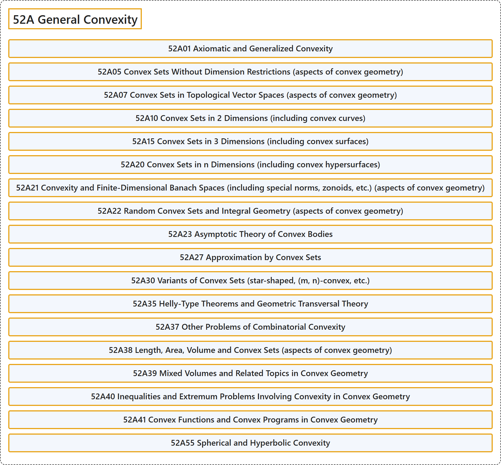

# 52A General Convexity

## Classification

## Glossary

| Term | Definition | 中文翻译 | Source |
|---|---|---|---|
| **52A General Convexity** 一般凸性 | (No definition) | （无定义） | [Associate Editors of Mathematical Reviews and zbMATH, 2020](https://msc2020.org/) |
| **52A01 Axiomatic and Generalized Convexity** 公理凸性与广义凸性 | (No definition) | （无定义） | [Associate Editors of Mathematical Reviews and zbMATH, 2020](https://msc2020.org/) |
| **52A05 Convex Sets Without Dimension Restrictions (aspects of convex geometry)** 无维数限制的凸集（凸几何方面） | (No definition) | （无定义） | [Associate Editors of Mathematical Reviews and zbMATH, 2020](https://msc2020.org/) |
| **52A07 Convex Sets in Topological Vector Spaces (aspects of convex geometry)** 拓扑向量空间中的凸集（凸几何方面） | (No definition) | （无定义） | [Associate Editors of Mathematical Reviews and zbMATH, 2020](https://msc2020.org/) |
| **52A10 Convex Sets in 2 Dimensions (including convex curves)** 二维凸集（包括凸曲线） | (No definition) | （无定义） | [Associate Editors of Mathematical Reviews and zbMATH, 2020](https://msc2020.org/) |
| **52A15 Convex Sets in 3 Dimensions (including convex surfaces)** 三维凸集（包括凸曲面） | (No definition) | （无定义） | [Associate Editors of Mathematical Reviews and zbMATH, 2020](https://msc2020.org/) |
| **52A20 Convex Sets in n Dimensions (including convex hypersurfaces)** n 维凸集（包括凸超曲面） | (No definition) | （无定义） | [Associate Editors of Mathematical Reviews and zbMATH, 2020](https://msc2020.org/) |
| **52A21 Convexity and Finite-Dimensional Banach Spaces (including special norms, zonoids, etc.) (aspects of convex geometry)** 凸性与有限维巴拿赫空间（包括特殊范数、带体等）（凸几何方面） | (No definition) | （无定义） | [Associate Editors of Mathematical Reviews and zbMATH, 2020](https://msc2020.org/) |
| **52A22 Random Convex Sets and Integral Geometry (aspects of convex geometry)** 随机凸集与积分几何（凸几何方面） | (No definition) | （无定义） | [Associate Editors of Mathematical Reviews and zbMATH, 2020](https://msc2020.org/) |
| **52A23 Asymptotic Theory of Convex Bodies** 凸体的渐近理论 | (No definition) | （无定义） | [Associate Editors of Mathematical Reviews and zbMATH, 2020](https://msc2020.org/) |
| **52A27 Approximation by Convex Sets** 凸集逼近 | (No definition) | （无定义） | [Associate Editors of Mathematical Reviews and zbMATH, 2020](https://msc2020.org/) |
| **52A30 Variants of Convex Sets (star-shaped, (m, n)-convex, etc.)** 凸集的变体（星形、(m, n)-凸等） | (No definition) | （无定义） | [Associate Editors of Mathematical Reviews and zbMATH, 2020](https://msc2020.org/) |
| **52A35 Helly-Type Theorems and Geometric Transversal Theory** 黑利型定理与几何横截理论 | (No definition) | （无定义） | [Associate Editors of Mathematical Reviews and zbMATH, 2020](https://msc2020.org/) |
| **52A37 Other Problems of Combinatorial Convexity** 组合凸性的其他问题 | (No definition) | （无定义） | [Associate Editors of Mathematical Reviews and zbMATH, 2020](https://msc2020.org/) |
| **52A38 Length, Area, Volume and Convex Sets (aspects of convex geometry)** 长度、面积、体积与凸集（凸几何方面） | (No definition) | （无定义） | [Associate Editors of Mathematical Reviews and zbMATH, 2020](https://msc2020.org/) |
| **52A39 Mixed Volumes and Related Topics in Convex Geometry** 混合体积及凸几何中的相关主题 | (No definition) | （无定义） | [Associate Editors of Mathematical Reviews and zbMATH, 2020](https://msc2020.org/) |
| **52A40 Inequalities and Extremum Problems Involving Convexity in Convex Geometry** 凸几何中涉及凸性的不等式与极值问题 | (No definition) | （无定义） | [Associate Editors of Mathematical Reviews and zbMATH, 2020](https://msc2020.org/) |
| **52A41 Convex Functions and Convex Programs in Convex Geometry** 凸几何中的凸函数与凸规划 | (No definition) | （无定义） | [Associate Editors of Mathematical Reviews and zbMATH, 2020](https://msc2020.org/) |
| **52A55 Spherical and Hyperbolic Convexity** 球面凸性与双曲凸性 | (No definition) | （无定义） | [Associate Editors of Mathematical Reviews and zbMATH, 2020](https://msc2020.org/) |

## References

Associate Editors of Mathematical Reviews and zbMATH. (2020). *MSC2020: Mathematics Subject Classification system*. Retrieved October 27, 2026, from <https://msc2020.org/>
