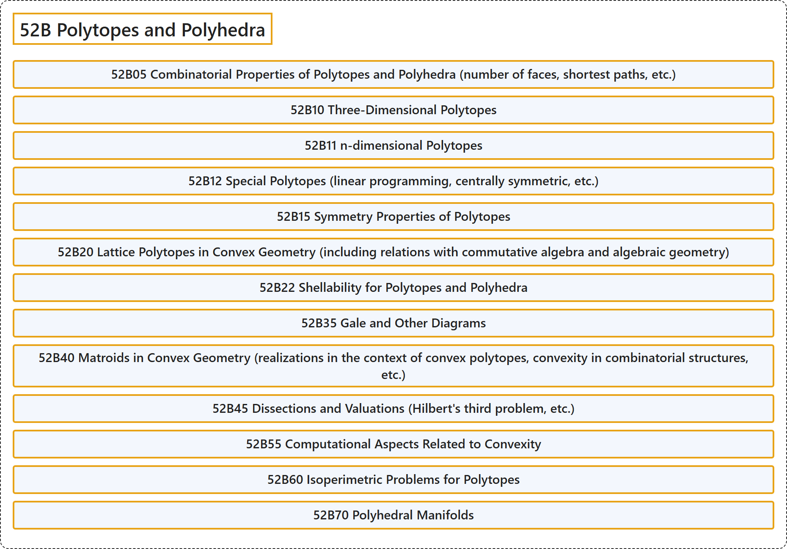

# 52B Polytopes and Polyhedra

## Classification

## Glossary

| Term | Definition | 中文翻译 | Source |
|---|---|---|---|
| **52B Polytopes and Polyhedra** 多胞形与多面体 | (No definition) | （无定义） | [Associate Editors of Mathematical Reviews and zbMATH, 2020](https://msc2020.org/) |
| **52B05 Combinatorial Properties of Polytopes and Polyhedra (number of faces, shortest paths, etc.)** 多胞形与多面体的组合性质（面数、最短路径等） | (No definition) | （无定义） | [Associate Editors of Mathematical Reviews and zbMATH, 2020](https://msc2020.org/) |
| **52B10 Three-Dimensional Polytopes** 三维多胞形 | (No definition) | （无定义） | [Associate Editors of Mathematical Reviews and zbMATH, 2020](https://msc2020.org/) |
| **52B11 n-dimensional Polytopes** n 维多胞形 | (No definition) | （无定义） | [Associate Editors of Mathematical Reviews and zbMATH, 2020](https://msc2020.org/) |
| **52B12 Special Polytopes (linear programming, centrally symmetric, etc.)** 特殊多胞形（线性规划、中心对称等） | (No definition) | （无定义） | [Associate Editors of Mathematical Reviews and zbMATH, 2020](https://msc2020.org/) |
| **52B15 Symmetry Properties of Polytopes** 多胞形的对称性质 | (No definition) | （无定义） | [Associate Editors of Mathematical Reviews and zbMATH, 2020](https://msc2020.org/) |
| **52B20 Lattice Polytopes in Convex Geometry (including relations with commutative algebra and algebraic geometry)** 凸几何中的格多胞形（包括与交换代数和代数几何的联系） | (No definition) | （无定义） | [Associate Editors of Mathematical Reviews and zbMATH, 2020](https://msc2020.org/) |
| **52B22 Shellability for Polytopes and Polyhedra** 多胞形与多面体的可剖分性 | (No definition) | （无定义） | [Associate Editors of Mathematical Reviews and zbMATH, 2020](https://msc2020.org/) |
| **52B35 Gale and Other Diagrams** 盖尔图及其他图 | (No definition) | （无定义） | [Associate Editors of Mathematical Reviews and zbMATH, 2020](https://msc2020.org/) |
| **52B40 Matroids in Convex Geometry (realizations in the context of convex polytopes, convexity in combinatorial structures, etc.)** 凸几何中的拟阵（凸多胞形背景下的实现、组合结构中的凸性等） | (No definition) | （无定义） | [Associate Editors of Mathematical Reviews and zbMATH, 2020](https://msc2020.org/) |
| **52B45 Dissections and Valuations (Hilbert's third problem, etc.)** 剖分与赋值（希尔伯特第三问题等） | (No definition) | （无定义） | [Associate Editors of Mathematical Reviews and zbMATH, 2020](https://msc2020.org/) |
| **52B55 Computational Aspects Related to Convexity** 与凸性有关的计算方面 | (No definition) | （无定义） | [Associate Editors of Mathematical Reviews and zbMATH, 2020](https://msc2020.org/) |
| **52B60 Isoperimetric Problems for Polytopes** 多胞形的等周问题 | (No definition) | （无定义） | [Associate Editors of Mathematical Reviews and zbMATH, 2020](https://msc2020.org/) |
| **52B70 Polyhedral Manifolds** 多面体流形 | (No definition) | （无定义） | [Associate Editors of Mathematical Reviews and zbMATH, 2020](https://msc2020.org/) |

## References

Associate Editors of Mathematical Reviews and zbMATH. (2020). *MSC2020: Mathematics Subject Classification system*. Retrieved October 27, 2026, from <https://msc2020.org/>
