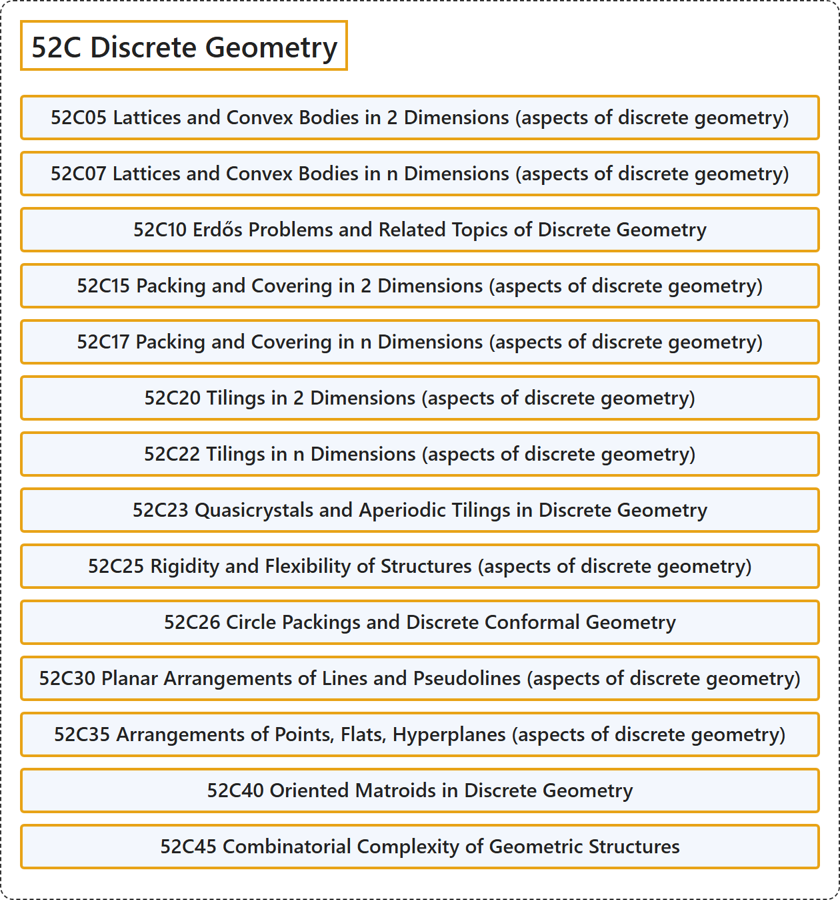

# 52C Discrete Geometry

## Classification

## Glossary

| Term | Definition | 中文翻译 | Source |
|---|---|---|---|
| **52C Discrete Geometry** 离散几何 | (No definition) | （无定义） | [Associate Editors of Mathematical Reviews and zbMATH, 2020](https://msc2020.org/) |
| **52C05 Lattices and Convex Bodies in 2 Dimensions (aspects of discrete geometry)** 二维格与凸体（离散几何方面） | (No definition) | （无定义） | [Associate Editors of Mathematical Reviews and zbMATH, 2020](https://msc2020.org/) |
| **52C07 Lattices and Convex Bodies in n Dimensions (aspects of discrete geometry)** n 维格与凸体（离散几何方面） | (No definition) | （无定义） | [Associate Editors of Mathematical Reviews and zbMATH, 2020](https://msc2020.org/) |
| **52C10 Erdős Problems and Related Topics of Discrete Geometry** 爱尔特希问题及离散几何的相关主题 | (No definition) | （无定义） | [Associate Editors of Mathematical Reviews and zbMATH, 2020](https://msc2020.org/) |
| **52C15 Packing and Covering in 2 Dimensions (aspects of discrete geometry)** 二维堆积与覆盖（离散几何方面） | (No definition) | （无定义） | [Associate Editors of Mathematical Reviews and zbMATH, 2020](https://msc2020.org/) |
| **52C17 Packing and Covering in n Dimensions (aspects of discrete geometry)** n 维堆积与覆盖（离散几何方面） | (No definition) | （无定义） | [Associate Editors of Mathematical Reviews and zbMATH, 2020](https://msc2020.org/) |
| **52C20 Tilings in 2 Dimensions (aspects of discrete geometry)** 二维镶嵌（离散几何方面） | (No definition) | （无定义） | [Associate Editors of Mathematical Reviews and zbMATH, 2020](https://msc2020.org/) |
| **52C22 Tilings in n Dimensions (aspects of discrete geometry)** n 维镶嵌（离散几何方面） | (No definition) | （无定义） | [Associate Editors of Mathematical Reviews and zbMATH, 2020](https://msc2020.org/) |
| **52C23 Quasicrystals and Aperiodic Tilings in Discrete Geometry** 离散几何中的准晶体与非周期镶嵌 | (No definition) | （无定义） | [Associate Editors of Mathematical Reviews and zbMATH, 2020](https://msc2020.org/) |
| **52C25 Rigidity and Flexibility of Structures (aspects of discrete geometry)** 结构的刚性与柔性（离散几何方面） | (No definition) | （无定义） | [Associate Editors of Mathematical Reviews and zbMATH, 2020](https://msc2020.org/) |
| **52C26 Circle Packings and Discrete Conformal Geometry** 圆堆积与离散共形几何 | (No definition) | （无定义） | [Associate Editors of Mathematical Reviews and zbMATH, 2020](https://msc2020.org/) |
| **52C30 Planar Arrangements of Lines and Pseudolines (aspects of discrete geometry)** 直线与伪直线的平面排列（离散几何方面） | (No definition) | （无定义） | [Associate Editors of Mathematical Reviews and zbMATH, 2020](https://msc2020.org/) |
| **52C35 Arrangements of Points, Flats, Hyperplanes (aspects of discrete geometry)** 点、平坦子空间、超平面的排列（离散几何方面） | (No definition) | （无定义） | [Associate Editors of Mathematical Reviews and zbMATH, 2020](https://msc2020.org/) |
| **52C40 Oriented Matroids in Discrete Geometry** 离散几何中的有向拟阵 | (No definition) | （无定义） | [Associate Editors of Mathematical Reviews and zbMATH, 2020](https://msc2020.org/) |
| **52C45 Combinatorial Complexity of Geometric Structures** 几何结构的组合复杂度 | (No definition) | （无定义） | [Associate Editors of Mathematical Reviews and zbMATH, 2020](https://msc2020.org/) |

## References

Associate Editors of Mathematical Reviews and zbMATH. (2020). *MSC2020: Mathematics Subject Classification system*. Retrieved October 27, 2026, from <https://msc2020.org/>
