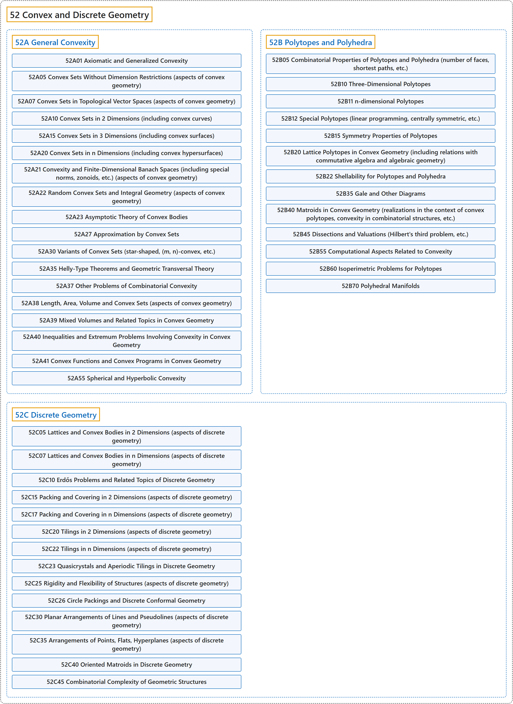

# 52 Convex and Discrete Geometry

## Classification

## Glossary

| Term | Definition | 中文翻译 | Source |
|---|---|---|---|
| **52 Convex and Discrete Geometry** 凸几何与离散几何 | (context) "Combinatorial geometry is a blending of principles from the areas of combinatorics and geometry. It deals with **combinations and arrangements of geometric objects** and with **discrete properties of these objects**." | （语境）组合几何融合了组合学和几何学两方面的原理。它研究**几何对象的组合与排列**，以及**这些对象的离散性质**。 | [Weisstein, n.d., "Combinatorial geometry" entry, para. 1](https://mathworld.wolfram.com/CombinatorialGeometry.html#:~:text=It%20deals%20with%20combinations%20and%20arrangements%20of%20geometric%20objects) |
| **[52A General Convexity](52a-general-convexity.md)** 一般凸性 | (No definition) | （无定义） | [Associate Editors of Mathematical Reviews and zbMATH, 2020](https://msc2020.org/) |
| **[52B Polytopes and Polyhedra](52b-polytopes-and-polyhedra.md)** 多胞形与多面体 | (No definition) | （无定义） | [Associate Editors of Mathematical Reviews and zbMATH, 2020](https://msc2020.org/) |
| **[52C Discrete Geometry](52c-discrete-geometry.md)** 离散几何 | (No definition) | （无定义） | [Associate Editors of Mathematical Reviews and zbMATH, 2020](https://msc2020.org/) |

## References

Associate Editors of Mathematical Reviews and zbMATH. (2020). *MSC2020: Mathematics Subject Classification system*. Retrieved October 27, 2026, from <https://msc2020.org/>

Weisstein, E. W. (n.d.). *Combinatorial geometry*. MathWorld: A Wolfram Resource. Retrieved October 27, 2026, from <https://mathworld.wolfram.com/CombinatorialGeometry.html>
