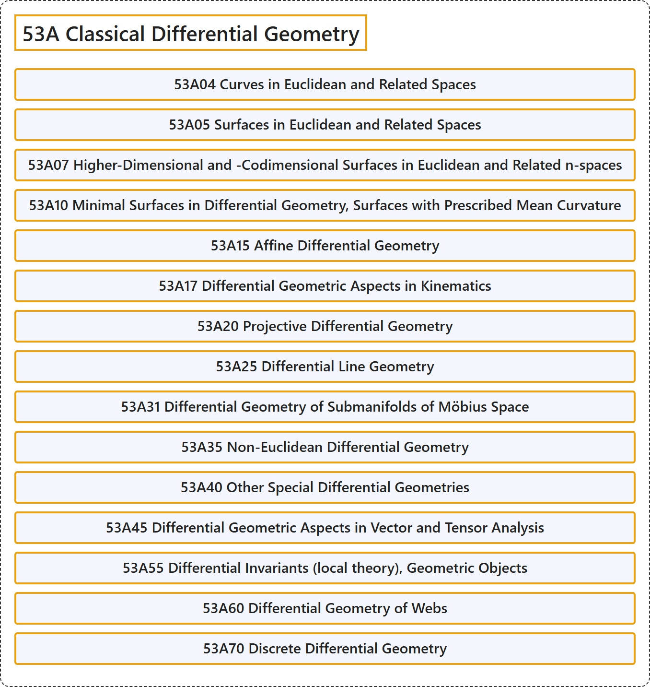

# 53A Classical Differential Geometry

## Classification

## Glossary

| Term | Definition | 中文翻译 | Source |
|---|---|---|---|
| **53A Classical Differential Geometry** 经典微分几何 | (No definition) | （无定义） | [Associate Editors of Mathematical Reviews and zbMATH, 2020](https://msc2020.org/) |
| **53A04 Curves in Euclidean and Related Spaces** 欧几里得及相关空间中的曲线 | (No definition) | （无定义） | [Associate Editors of Mathematical Reviews and zbMATH, 2020](https://msc2020.org/) |
| **53A05 Surfaces in Euclidean and Related Spaces** 欧几里得及相关空间中的曲面 | (No definition) | （无定义） | [Associate Editors of Mathematical Reviews and zbMATH, 2020](https://msc2020.org/) |
| **53A07 Higher-Dimensional and -Codimensional Surfaces in Euclidean and Related n-spaces** 欧几里得及相关 n 维空间中的高维曲面与高余维曲面 | (No definition) | （无定义） | [Associate Editors of Mathematical Reviews and zbMATH, 2020](https://msc2020.org/) |
| **53A10 Minimal Surfaces in Differential Geometry, Surfaces with Prescribed Mean Curvature** 微分几何中的极小曲面、具有给定平均曲率的曲面 | (No definition) | （无定义） | [Associate Editors of Mathematical Reviews and zbMATH, 2020](https://msc2020.org/) |
| **53A15 Affine Differential Geometry** 仿射微分几何 | (No definition) | （无定义） | [Associate Editors of Mathematical Reviews and zbMATH, 2020](https://msc2020.org/) |
| **53A17 Differential Geometric Aspects in Kinematics** 运动学中的微分几何方面 | (No definition) | （无定义） | [Associate Editors of Mathematical Reviews and zbMATH, 2020](https://msc2020.org/) |
| **53A20 Projective Differential Geometry** 射影微分几何 | (No definition) | （无定义） | [Associate Editors of Mathematical Reviews and zbMATH, 2020](https://msc2020.org/) |
| **53A25 Differential Line Geometry** 微分线几何 | (No definition) | （无定义） | [Associate Editors of Mathematical Reviews and zbMATH, 2020](https://msc2020.org/) |
| **53A31 Differential Geometry of Submanifolds of Möbius Space** 默比乌斯空间子流形的微分几何 | (No definition) | （无定义） | [Associate Editors of Mathematical Reviews and zbMATH, 2020](https://msc2020.org/) |
| **53A35 Non-Euclidean Differential Geometry** 非欧微分几何 | (No definition) | （无定义） | [Associate Editors of Mathematical Reviews and zbMATH, 2020](https://msc2020.org/) |
| **53A40 Other Special Differential Geometries** 其他特殊微分几何 | (No definition) | （无定义） | [Associate Editors of Mathematical Reviews and zbMATH, 2020](https://msc2020.org/) |
| **53A45 Differential Geometric Aspects in Vector and Tensor Analysis** 向量分析与张量分析中的微分几何方面 | (No definition) | （无定义） | [Associate Editors of Mathematical Reviews and zbMATH, 2020](https://msc2020.org/) |
| **53A55 Differential Invariants (local theory), Geometric Objects** 微分不变量（局部理论）、几何对象 | (No definition) | （无定义） | [Associate Editors of Mathematical Reviews and zbMATH, 2020](https://msc2020.org/) |
| **53A60 Differential Geometry of Webs** 网的微分几何 | (No definition) | （无定义） | [Associate Editors of Mathematical Reviews and zbMATH, 2020](https://msc2020.org/) |
| **53A70 Discrete Differential Geometry** 离散微分几何 | (No definition) | （无定义） | [Associate Editors of Mathematical Reviews and zbMATH, 2020](https://msc2020.org/) |

## References

Associate Editors of Mathematical Reviews and zbMATH. (2020). *MSC2020: Mathematics Subject Classification system*. Retrieved October 27, 2026, from <https://msc2020.org/>
